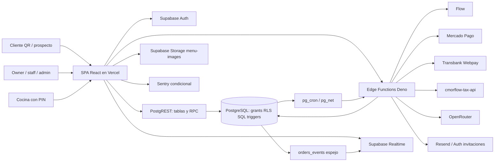
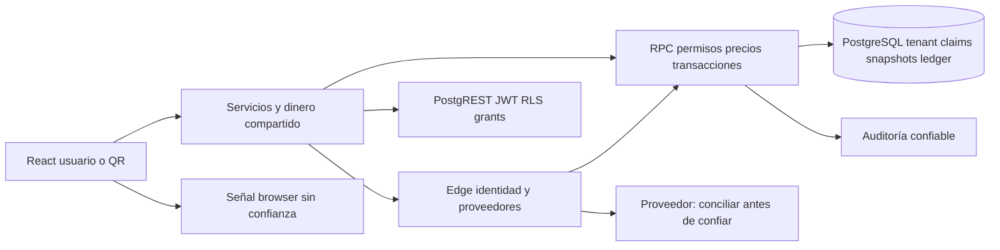
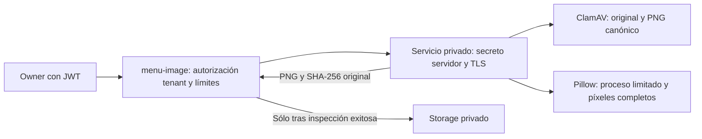

> Referencia de arquitectura heredada y saneada. No constituye evidencia de despliegue ni validación de esta distribución. Las guías públicas del README prevalecen para instalaciones nuevas.

# Arquitectura vigente

> Actualización 2026-10-07: las secciones anteriores a «Cambio autorizado» conservan la reconstrucción del baseline 2026-10-05. Para contratos modificados prevalecen las specs TASK-002–015 y el [estado actual](IMPLEMENTATION_STATUS.md). La validación local final está en LOCAL_VALIDATION; el despliegue permanece UNKNOWN.

AS-IS. CONFIRMADO para código/config local; despliegue efectivo DESCONOCIDO. Fuentes de entrada: [App](../../src/App.tsx), [servicios](../../src/services/restaurantService.ts), [Supabase config](../../supabase/config.toml), [Vercel](../../vercel.json).

## Frontend, estado e interfaces

- BrowserRouter con lazy imports y Suspense. Rutas internas se declaran en shells de restaurante/admin, no sólo en App. `/restaurant/cash` es alias de Pos; CashShift está integrado desde POS. [Rutas](USER_FLOWS.md).
- AuthProvider centraliza perfil, membresías y restaurante. Estado local React para carritos/formularios; almacenamiento de borradores QR 4h en localStorage y POS 12h en sessionStorage. No se observa Redux ni almacén global universal.
- Servicios exportan funciones, pero páginas/hook/components también consultan tablas directamente. No hay repositorio backend único; invariantes están distribuidos entre React, servicios, SQL y Edge. [API](API_SPEC.md) enumera también esos consumidores directos.
- MockSupabaseClient no se importa en config/supabase.ts vigente y se usa directamente en tests; interfaces manuales en config/supabase.ts no sustituyen un schema del catálogo PostgreSQL.

## SQL y procesamiento

89 migraciones ordenadas por nombre construyen el esquema declarado. Los SQL históricos de database/ son evidencia secundaria; no prevalecen sobre reemplazos posteriores. RLS filtra filas, grants autorizan tablas/columnas/funciones; una policy permisiva por sí sola no concede privilegio ni viceversa.

Pedidos usan JSONB de items y numeración por secuencia. El espejo orders_events recibe snapshots mediante trigger; subscribeToOrders escucha ese espejo con refetch 30s y ventana inicial 7 días. Es mecanismo local confirmado; el comentario sobre limitación del proveedor no se toma como una garantía técnica universal.

Completado requiere paid y puede descontar inventario. RPCs de caja calculan cierre; RPCs de mesa usan capabilities; funciones administrativas dependen de is_admin. [SQL_CATALOG](SQL_CATALOG.md) conserva cronología, ALTER, grants/revokes y SQL dinámico sin ejecutarlo.

La cola contable es una tabla accounting_documents con estados e idempotencia, procesada por accounting/sync; no se encontró broker externo de mensajes. El cron contable se declara cada 5 minutos con pg_net y secreto en tabla privada. Existe función sweep_expired_trials; su scheduling efectivo no se acredita sólo por definirla.

## Integraciones y almacenamiento

Edge con service role orquesta pagos, emails, DSAR, IA y DTE. `_shared/authorization.ts` valida Bearer, perfil/membresía y admin en algunas rutas; otras implementan sus propios controles. verify_jwt=false no implica ausencia de control si existe comprobación en handler, ni verify_jwt=true implica ownership.

Storage usa bucket menu-images, compresión cliente, carpeta de restaurante y signed URLs. Caché en memoria de flag de pedidos: 5 minutos; localStorage/sessionStorage mantienen borradores y preferencias. No se encontró Redis ni caché distribuida de aplicación.

## Observabilidad, red y entornos

- Sentry condicional a VITE_SENTRY_DSN, con release y redacción; console y logger coexisten. Las acciones audit_log no cubren automáticamente toda lectura/cobro/exportación.
- Vercel declara SPA rewrite, CSP, HSTS y otros headers; no se verificaron headers servidos. CSP incluye Supabase/Flow pero no todos los hosts que otras integraciones podrían necesitar desde el navegador; impactos reales requieren pruebas locales de navegador aislado.
- Supabase local: API 54321, DB 54322, Studio 54323 y pooler 54329 declarados. Config Auth local usa localhost y redirect adicional; URLs reales se configuran fuera de ese archivo.
- CI ejecuta lint/type-check/build y tests; E2E/security-live dependen de secrets de staging. Otros workflows declaran healthchecks/backup y notificaciones externas. Se inspeccionaron, no se ejecutaron.
- No se encontró Dockerfile/Compose de la aplicación ni IaC general versionada. Supabase CLI config no acredita instalación local del stack.

Entornos diferenciados: configuración Vite cliente, secrets Deno servidor, credenciales de GitHub Actions y configuración PostgreSQL. [INTEGRATIONS](INTEGRATIONS.md) enumera nombres de variables sin valores. No se realizó conexión a producción/staging ni migración.

## Cambio autorizado — fronteras de confianza

MFA admin comprobado SQL/Edge. Service role usa funciones internas, no representa admin humano. Reserva/reconcile separan transacción SQL/efecto remoto; no exactly-once externo. IA externa desactivada. Contratos API_SPEC, datos DATA_MODEL, pruebas TESTING.

## Frontera de archivos — TASK-016

El navegador nunca recibe el secreto del inspector. La disponibilidad/configuración del servicio es responsabilidad del administrador de cada instalación; un fallo bloquea nuevas subidas. Consultar API-251 y [servicio privado](../../services/image-inspector/README.md). La red/TLS desplegadas requieren validación; el recorrido local sí tiene prueba reproducible.
