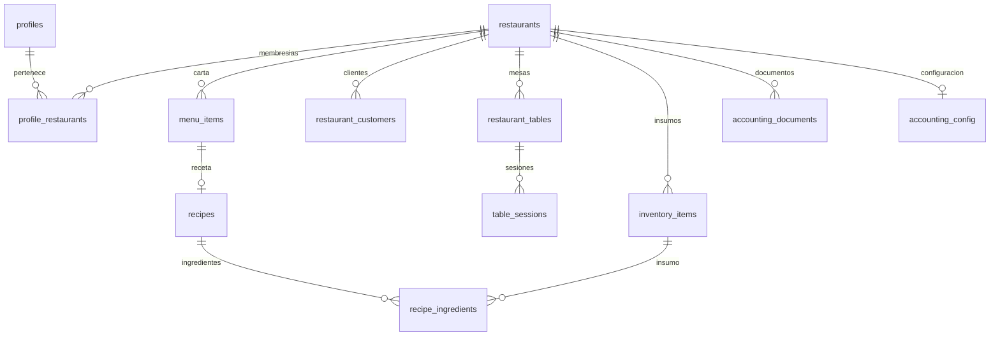

> Referencia de arquitectura heredada y saneada. No constituye evidencia de despliegue ni validación de esta distribución. Las guías públicas del README prevalecen para instalaciones nuevas.

# Modelo de datos

> Actualización 2026-10-07: las secciones anteriores a «Cambio autorizado» conservan la reconstrucción del baseline 2026-10-05. Para contratos modificados prevalecen las specs TASK-002–015 y el [estado actual](IMPLEMENTATION_STATUS.md). La validación local final está en LOCAL_VALIDATION; el despliegue permanece UNKNOWN.

Fecha de análisis: 2026-10-05 (America/Santiago). Commit base: `319a4d2a9bd88d2b1b16b3d61ef8ae7094a8948d`. Evidencia local; despliegue real DESCONOCIDO.

AS-IS — CONFIRMADO para declaraciones versionadas; REQUIERE VALIDACIÓN para esquema efectivo. PostgreSQL 15 se declara en `supabase/config.toml`. Auth y Storage son esquemas gestionados por Supabase. `graphql_public` figura expuesto en la configuración local; su uso por la aplicación no está demostrado.

## Relaciones principales



El diagrama usa REFERENCES encontradas; no añade una FK de `accounting_documents.order_id` a pedidos. Los enlaces lógicos a orders deben verificarse en servicios/SQL y no equivalen a constraints.

## Convenciones y límites

- Ownership principal por `restaurant_id` y `profile_restaurants`; helpers RLS y grants se detallan en SQL_CATALOG y SECURITY.
- Precios y montos NUMERIC en SQL; TypeScript utiliza number. `items`, opciones, payloads y metadata emplean JSONB.
- Fechas `timestamptz`, defaults `now()` y triggers `updated_at` según tabla. No existe una política universal de soft delete: `is_active`, estados y DELETE coexisten.
- Partición de orders, secuencia para numeración, espejo orders_events y límites de retención no deben deducirse sólo de interfaces TypeScript.
- La historia DDL se presenta cronológicamente para no ocultar columnas añadidas, constraints reemplazados ni permisos revocados. Los bloques dinámicos no están materializados.

## DATA-001 — accounting_config

Estado: CONFIRMADO (declaración). Consumidores directos: [supabase/functions/accounting/index.ts](<../../supabase/functions/accounting/index.ts>).

Fuente inicial: [supabase/migrations/20260905000001_accounting_module.sql:27](<../../supabase/migrations/20260905000001_accounting_module.sql#L27>).

```sql
CREATE TABLE IF NOT EXISTS public.accounting_config (
  restaurant_id        uuid PRIMARY KEY REFERENCES public.restaurants(id) ON DELETE CASCADE,
  auto_emit            boolean NOT NULL DEFAULT false,
  tax_key_id           text,
  tax_secret_encrypted text,
  tax_key_version      integer NOT NULL DEFAULT 1,
  last_sync_at         timestamptz,
  created_at           timestamptz NOT NULL DEFAULT now(),
  updated_at           timestamptz NOT NULL DEFAULT now()
);
```

### Evolución y controles

- [supabase/migrations/20260905000001_accounting_module.sql:82](<../../supabase/migrations/20260905000001_accounting_module.sql#L82>): `ALTER TABLE public.accounting_config ENABLE ROW LEVEL SECURITY;`
- [supabase/migrations/20260905000001_accounting_module.sql:88](<../../supabase/migrations/20260905000001_accounting_module.sql#L88>): `DROP POLICY IF EXISTS "Owner reads accounting config" ON public.accounting_config;`
- [supabase/migrations/20260905000001_accounting_module.sql:90](<../../supabase/migrations/20260905000001_accounting_module.sql#L90>): `CREATE POLICY "Owner reads accounting config" ON public.accounting_config FOR SELECT USING (public.is_my_restaurant(restaurant_id));`
- [supabase/migrations/20260906000001_accounting_grant_hardening.sql:17](<../../supabase/migrations/20260906000001_accounting_grant_hardening.sql#L17>): `REVOKE ALL ON public.accounting_config FROM anon, authenticated;`

Funciones, triggers y bloques dinámicos adicionales: [cronología completa](SQL_CATALOG.md).

## DATA-002 — accounting_cron_secret

Estado: CONFIRMADO (declaración). Consumidores directos: [supabase/functions/accounting/index.ts](<../../supabase/functions/accounting/index.ts>).

Fuente inicial: [supabase/migrations/20260905000001_accounting_module.sql:110](<../../supabase/migrations/20260905000001_accounting_module.sql#L110>).

```sql
CREATE TABLE IF NOT EXISTS public.accounting_cron_secret (
  id         integer PRIMARY KEY DEFAULT 1 CHECK (id = 1),
  secret     text NOT NULL,
  created_at timestamptz NOT NULL DEFAULT now(),
  updated_at timestamptz NOT NULL DEFAULT now()
);
```

### Evolución y controles

- [supabase/migrations/20260905000001_accounting_module.sql:123](<../../supabase/migrations/20260905000001_accounting_module.sql#L123>): `ALTER TABLE public.accounting_cron_secret ENABLE ROW LEVEL SECURITY;`
- [supabase/migrations/20260905000001_accounting_module.sql:125](<../../supabase/migrations/20260905000001_accounting_module.sql#L125>): `REVOKE ALL ON public.accounting_cron_secret FROM anon, authenticated;`
- [supabase/migrations/20260906000001_accounting_grant_hardening.sql:31](<../../supabase/migrations/20260906000001_accounting_grant_hardening.sql#L31>): `REVOKE ALL ON public.accounting_cron_secret FROM anon, authenticated;`

Funciones, triggers y bloques dinámicos adicionales: [cronología completa](SQL_CATALOG.md).

## DATA-003 — accounting_documents

Estado: CONFIRMADO (declaración). Consumidores directos: [supabase/functions/accounting/index.ts](<../../supabase/functions/accounting/index.ts>).

Fuente inicial: [supabase/migrations/20260905000001_accounting_module.sql:41](<../../supabase/migrations/20260905000001_accounting_module.sql#L41>).

```sql
CREATE TABLE IF NOT EXISTS public.accounting_documents (
  id                  uuid PRIMARY KEY DEFAULT gen_random_uuid(),
  restaurant_id       uuid NOT NULL REFERENCES public.restaurants(id) ON DELETE CASCADE,
  order_id            uuid, 
  dte_type            integer NOT NULL CHECK (dte_type IN (33, 39, 61)),
  status              text NOT NULL DEFAULT 'queued'
                      CHECK (status IN ('queued','processing','submitted','accepted','observed','rejected','failed','cancelled')),
  attempt             integer NOT NULL DEFAULT 1 CHECK (attempt >= 1),
  request_id          text,
  dte_id              text,
  folio               integer,
  sii_status          text,
  track_id            text,
  amount              numeric(14,2),
  external_reference  text NOT NULL,
  receiver_rut        text,
  receiver_name       text,
  related_document_id uuid REFERENCES public.accounting_documents(id) ON DELETE SET NULL,
  last_error          text,
  trace_id            text,
  payload             jsonb,
  accepted_at         timestamptz,
  created_at          timestamptz NOT NULL DEFAULT now(),
  updated_at          timestamptz NOT NULL DEFAULT now()
);
```

### Evolución y controles

- [supabase/migrations/20260905000001_accounting_module.sql:70](<../../supabase/migrations/20260905000001_accounting_module.sql#L70>): `CREATE UNIQUE INDEX IF NOT EXISTS uq_accounting_docs_ext_ref ON public.accounting_documents (restaurant_id, external_reference);`
- [supabase/migrations/20260905000001_accounting_module.sql:75](<../../supabase/migrations/20260905000001_accounting_module.sql#L75>): `CREATE INDEX IF NOT EXISTS idx_accounting_docs_rest_status ON public.accounting_documents (restaurant_id, status);`
- [supabase/migrations/20260905000001_accounting_module.sql:78](<../../supabase/migrations/20260905000001_accounting_module.sql#L78>): `CREATE INDEX IF NOT EXISTS idx_accounting_docs_rest_created ON public.accounting_documents (restaurant_id, created_at DESC);`
- [supabase/migrations/20260905000001_accounting_module.sql:80](<../../supabase/migrations/20260905000001_accounting_module.sql#L80>): `CREATE INDEX IF NOT EXISTS idx_accounting_docs_request ON public.accounting_documents (request_id);`
- [supabase/migrations/20260905000001_accounting_module.sql:87](<../../supabase/migrations/20260905000001_accounting_module.sql#L87>): `ALTER TABLE public.accounting_documents ENABLE ROW LEVEL SECURITY;`
- [supabase/migrations/20260905000001_accounting_module.sql:93](<../../supabase/migrations/20260905000001_accounting_module.sql#L93>): `DROP POLICY IF EXISTS "Owner reads accounting documents" ON public.accounting_documents;`
- [supabase/migrations/20260905000001_accounting_module.sql:95](<../../supabase/migrations/20260905000001_accounting_module.sql#L95>): `CREATE POLICY "Owner reads accounting documents" ON public.accounting_documents FOR SELECT USING (public.is_my_restaurant(restaurant_id));`
- [supabase/migrations/20260906000001_accounting_grant_hardening.sql:19](<../../supabase/migrations/20260906000001_accounting_grant_hardening.sql#L19>): `REVOKE ALL ON public.accounting_documents FROM anon, authenticated;`

Funciones, triggers y bloques dinámicos adicionales: [cronología completa](SQL_CATALOG.md).

## DATA-004 — admin_users

Estado: CONFIRMADO (declaración). Consumidores directos: MISSING — revisar consumidores SQL/dinámicos antes de declarar huérfana.

Fuente inicial: [supabase/migrations/20260101000000_initial_schema.sql:142](<../../supabase/migrations/20260101000000_initial_schema.sql#L142>).

```sql
CREATE TABLE IF NOT EXISTS admin_users (
  id UUID PRIMARY KEY DEFAULT uuid_generate_v4(),
  email TEXT NOT NULL UNIQUE,
  password_hash TEXT NOT NULL,
  name TEXT,
  is_super_admin BOOLEAN NOT NULL DEFAULT FALSE,
  is_active BOOLEAN NOT NULL DEFAULT TRUE,
  last_login_at TIMESTAMPTZ,
  created_at TIMESTAMPTZ NOT NULL DEFAULT NOW(),
  updated_at TIMESTAMPTZ NOT NULL DEFAULT NOW()
);
```

### Evolución y controles

- [supabase/migrations/20260101000000_initial_schema.sql:184](<../../supabase/migrations/20260101000000_initial_schema.sql#L184>): `CREATE INDEX IF NOT EXISTS idx_admin_users_email ON admin_users(email);`
- [supabase/migrations/20260101000000_initial_schema.sql:413](<../../supabase/migrations/20260101000000_initial_schema.sql#L413>): `ALTER TABLE admin_users ENABLE ROW LEVEL SECURITY;`
- [supabase/migrations/20260101000002_privacy_foundation.sql:224](<../../supabase/migrations/20260101000002_privacy_foundation.sql#L224>): `REVOKE ALL ON public.admin_users FROM anon, authenticated;`
- [supabase/migrations/20260622000005_p0_4_revoke_legacy_login.sql:17](<../../supabase/migrations/20260622000005_p0_4_revoke_legacy_login.sql#L17>): `ALTER TABLE public.admin_users ADD COLUMN IF NOT EXISTS migrated_at timestamptz, ADD COLUMN IF NOT EXISTS deprecated_at timestamptz;`

Funciones, triggers y bloques dinámicos adicionales: [cronología completa](SQL_CATALOG.md).

## DATA-005 — ai_usage_log

Estado: CONFIRMADO (declaración). Consumidores directos: [supabase/functions/ai-recommendations/index.ts](<../../supabase/functions/ai-recommendations/index.ts>).

Fuente inicial: [supabase/migrations/20260828000003_audit_ai_usage_log.sql:7](<../../supabase/migrations/20260828000003_audit_ai_usage_log.sql#L7>).

```sql
CREATE TABLE IF NOT EXISTS public.ai_usage_log (
  id uuid PRIMARY KEY DEFAULT gen_random_uuid(),
  user_id uuid NOT NULL,
  restaurant_id uuid NOT NULL,
  created_at timestamptz NOT NULL DEFAULT now()
);
```

### Evolución y controles

- [supabase/migrations/20260828000003_audit_ai_usage_log.sql:14](<../../supabase/migrations/20260828000003_audit_ai_usage_log.sql#L14>): `ALTER TABLE public.ai_usage_log ENABLE ROW LEVEL SECURITY;`
- [supabase/migrations/20260828000003_audit_ai_usage_log.sql:19](<../../supabase/migrations/20260828000003_audit_ai_usage_log.sql#L19>): `CREATE INDEX IF NOT EXISTS idx_ai_usage_log_user_window ON public.ai_usage_log (user_id, created_at DESC);`

Funciones, triggers y bloques dinámicos adicionales: [cronología completa](SQL_CATALOG.md).

## DATA-006 — audit_log

Estado: CONFIRMADO (declaración). Consumidores directos: [src/services/securityService.ts](<../../src/services/securityService.ts>); [supabase/functions/privacy-access/index.ts](<../../supabase/functions/privacy-access/index.ts>); [supabase/functions/privacy-erase/index.ts](<../../supabase/functions/privacy-erase/index.ts>); [supabase/functions/privacy-export/index.ts](<../../supabase/functions/privacy-export/index.ts>); [supabase/functions/privacy-object/index.ts](<../../supabase/functions/privacy-object/index.ts>); [supabase/functions/privacy-rectify/index.ts](<../../supabase/functions/privacy-rectify/index.ts>); [supabase/functions/privacy-revoke-consent/index.ts](<../../supabase/functions/privacy-revoke-consent/index.ts>); [supabase/functions/verify-dsar/index.ts](<../../supabase/functions/verify-dsar/index.ts>).

Fuente inicial: [supabase/migrations/20260101000002_privacy_foundation.sql:103](<../../supabase/migrations/20260101000002_privacy_foundation.sql#L103>).

```sql
CREATE TABLE IF NOT EXISTS public.audit_log (
  id            bigserial PRIMARY KEY,
  actor_id      uuid,
  actor_email   text,
  action        text NOT NULL,
  table_name    text,
  row_id        text,
  metadata      jsonb,
  before_state  jsonb,
  after_state   jsonb,
  ip            inet,
  user_agent    text,
  created_at    timestamptz NOT NULL DEFAULT now()
) WITH (fillfactor = 95);
```

### Evolución y controles

- [supabase/migrations/20260101000002_privacy_foundation.sql:124](<../../supabase/migrations/20260101000002_privacy_foundation.sql#L124>): `ALTER TABLE public.audit_log ADD COLUMN IF NOT EXISTS before_state jsonb, ADD COLUMN IF NOT EXISTS after_state jsonb;`
- [supabase/migrations/20260101000002_privacy_foundation.sql:131](<../../supabase/migrations/20260101000002_privacy_foundation.sql#L131>): `CREATE INDEX IF NOT EXISTS audit_log_actor_id_idx ON public.audit_log(actor_id);`
- [supabase/migrations/20260101000002_privacy_foundation.sql:134](<../../supabase/migrations/20260101000002_privacy_foundation.sql#L134>): `CREATE INDEX IF NOT EXISTS audit_log_created_at_idx ON public.audit_log(created_at DESC);`
- [supabase/migrations/20260101000002_privacy_foundation.sql:136](<../../supabase/migrations/20260101000002_privacy_foundation.sql#L136>): `CREATE INDEX IF NOT EXISTS audit_log_action_idx ON public.audit_log(action);`
- [supabase/migrations/20260101000002_privacy_foundation.sql:138](<../../supabase/migrations/20260101000002_privacy_foundation.sql#L138>): `ALTER TABLE public.audit_log ENABLE ROW LEVEL SECURITY;`
- [supabase/migrations/20260101000002_privacy_foundation.sql:140](<../../supabase/migrations/20260101000002_privacy_foundation.sql#L140>): `DROP POLICY IF EXISTS audit_log_admin_select ON public.audit_log;`
- [supabase/migrations/20260101000002_privacy_foundation.sql:142](<../../supabase/migrations/20260101000002_privacy_foundation.sql#L142>): `CREATE POLICY audit_log_admin_select ON public.audit_log FOR SELECT USING (public.is_admin());`
- [supabase/migrations/20260101000002_privacy_foundation.sql:144](<../../supabase/migrations/20260101000002_privacy_foundation.sql#L144>): `DROP POLICY IF EXISTS audit_log_insert_any ON public.audit_log;`
- [supabase/migrations/20260101000002_privacy_foundation.sql:146](<../../supabase/migrations/20260101000002_privacy_foundation.sql#L146>): `CREATE POLICY audit_log_insert_any ON public.audit_log FOR INSERT WITH CHECK (true);`
- [supabase/migrations/20260101000002_privacy_foundation.sql:148](<../../supabase/migrations/20260101000002_privacy_foundation.sql#L148>): `GRANT SELECT, INSERT ON public.audit_log TO authenticated, anon;`
- [supabase/migrations/20260101000002_privacy_foundation.sql:150](<../../supabase/migrations/20260101000002_privacy_foundation.sql#L150>): `REVOKE UPDATE, DELETE ON public.audit_log FROM PUBLIC, authenticated, anon, service_role;`

Funciones, triggers y bloques dinámicos adicionales: [cronología completa](SQL_CATALOG.md).

## DATA-007 — breach_register

Estado: CONFIRMADO (declaración). Consumidores directos: [src/services/securityService.ts](<../../src/services/securityService.ts>).

Fuente inicial: [supabase/migrations/20260101000002_privacy_foundation.sql:395](<../../supabase/migrations/20260101000002_privacy_foundation.sql#L395>).

```sql
CREATE TABLE IF NOT EXISTS public.breach_register (
  id              uuid PRIMARY KEY DEFAULT gen_random_uuid(),
  detected_at     timestamptz NOT NULL DEFAULT now(),
  reported_at     timestamptz,
  severity        text NOT NULL CHECK (severity IN ('low','medium','high','critical')),
  status          text NOT NULL DEFAULT 'detected' CHECK (status IN
                    ('detected','investigating','contained','notified','closed')),
  description     text NOT NULL,
  affected_data_categories text[],
  affected_subjects_count integer,
  containment_measures text,
  root_cause      text,
  authority_notified_at timestamptz,
  subjects_notified_at timestamptz,
  created_by      uuid REFERENCES auth.users(id),
  created_at      timestamptz NOT NULL DEFAULT now(),
  updated_at      timestamptz NOT NULL DEFAULT now()
);
```

### Evolución y controles

- [supabase/migrations/20260101000002_privacy_foundation.sql:424](<../../supabase/migrations/20260101000002_privacy_foundation.sql#L424>): `CREATE INDEX IF NOT EXISTS breach_status_idx ON public.breach_register(status);`
- [supabase/migrations/20260101000002_privacy_foundation.sql:426](<../../supabase/migrations/20260101000002_privacy_foundation.sql#L426>): `CREATE INDEX IF NOT EXISTS breach_detected_at_idx ON public.breach_register(detected_at DESC);`
- [supabase/migrations/20260101000002_privacy_foundation.sql:435](<../../supabase/migrations/20260101000002_privacy_foundation.sql#L435>): `ALTER TABLE public.breach_register ENABLE ROW LEVEL SECURITY;`
- [supabase/migrations/20260101000002_privacy_foundation.sql:437](<../../supabase/migrations/20260101000002_privacy_foundation.sql#L437>): `DROP POLICY IF EXISTS breach_admin_all ON public.breach_register;`
- [supabase/migrations/20260101000002_privacy_foundation.sql:439](<../../supabase/migrations/20260101000002_privacy_foundation.sql#L439>): `CREATE POLICY breach_admin_all ON public.breach_register FOR ALL USING (public.is_admin()) WITH CHECK (public.is_admin());`
- [supabase/migrations/20260101000002_privacy_foundation.sql:441](<../../supabase/migrations/20260101000002_privacy_foundation.sql#L441>): `GRANT SELECT, INSERT, UPDATE ON public.breach_register TO authenticated;`
- [supabase/migrations/20260807010340_add_active_foreign_key_indexes.sql:1](<../../supabase/migrations/20260807010340_add_active_foreign_key_indexes.sql#L1>): `CREATE INDEX IF NOT EXISTS idx_breach_register_created_by ON public.breach_register (created_by);`

Funciones, triggers y bloques dinámicos adicionales: [cronología completa](SQL_CATALOG.md).

## DATA-008 — cash_shifts

Estado: CONFIRMADO (declaración). Consumidores directos: [src/pages/restaurant/Reports.tsx](<../../src/pages/restaurant/Reports.tsx>); [src/services/cashShiftService.ts](<../../src/services/cashShiftService.ts>); [src/services/dashboardService.ts](<../../src/services/dashboardService.ts>).

Fuente inicial: [supabase/migrations/20260710000007_cash_shifts.sql:17](<../../supabase/migrations/20260710000007_cash_shifts.sql#L17>).

```sql
CREATE TABLE IF NOT EXISTS public.cash_shifts (
  id              uuid PRIMARY KEY DEFAULT gen_random_uuid(),
  restaurant_id   uuid NOT NULL REFERENCES public.restaurants(id) ON DELETE CASCADE,
  opened_by       uuid REFERENCES auth.users(id) ON DELETE SET NULL,
  closed_by       uuid REFERENCES auth.users(id) ON DELETE SET NULL,
  opened_at       timestamptz NOT NULL DEFAULT now(),
  closed_at       timestamptz,
  total_sales     decimal(10,2) NOT NULL DEFAULT 0,
  cash_sales      decimal(10,2) NOT NULL DEFAULT 0,
  card_sales      decimal(10,2) NOT NULL DEFAULT 0,
  transfer_sales  decimal(10,2) NOT NULL DEFAULT 0,
  qr_sales        decimal(10,2) NOT NULL DEFAULT 0,
  total_tips      decimal(10,2) NOT NULL DEFAULT 0,
  cash_tips       decimal(10,2) NOT NULL DEFAULT 0,
  card_tips       decimal(10,2) NOT NULL DEFAULT 0,
  opening_cash    decimal(10,2) NOT NULL DEFAULT 0,
  expected_cash   decimal(10,2) NOT NULL DEFAULT 0,
  actual_cash     decimal(10,2),
  cash_difference decimal(10,2),
  
  waiter_summary  jsonb NOT NULL DEFAULT '[]'::jsonb,
  orders_count    integer NOT NULL DEFAULT 0,
  status          text NOT NULL DEFAULT 'open' CHECK (status IN ('open','closed')),
  notes           text,
  created_at      timestamptz NOT NULL DEFAULT now(),
  updated_at      timestamptz NOT NULL DEFAULT now()
);
```

### Evolución y controles

- [supabase/migrations/20260710000007_cash_shifts.sql:48](<../../supabase/migrations/20260710000007_cash_shifts.sql#L48>): `CREATE INDEX IF NOT EXISTS idx_cash_shifts_restaurant ON public.cash_shifts(restaurant_id, opened_at DESC);`
- [supabase/migrations/20260710000007_cash_shifts.sql:51](<../../supabase/migrations/20260710000007_cash_shifts.sql#L51>): `CREATE INDEX IF NOT EXISTS idx_cash_shifts_open ON public.cash_shifts(restaurant_id) WHERE status = 'open';`
- [supabase/migrations/20260710000007_cash_shifts.sql:58](<../../supabase/migrations/20260710000007_cash_shifts.sql#L58>): `ALTER TABLE public.cash_shifts ENABLE ROW LEVEL SECURITY;`
- [supabase/migrations/20260710000007_cash_shifts.sql:61](<../../supabase/migrations/20260710000007_cash_shifts.sql#L61>): `DROP POLICY IF EXISTS "Owner manages cash_shifts" ON public.cash_shifts;`
- [supabase/migrations/20260710000007_cash_shifts.sql:62](<../../supabase/migrations/20260710000007_cash_shifts.sql#L62>): `CREATE POLICY "Owner manages cash_shifts" ON public.cash_shifts FOR ALL USING (public.is_my_restaurant(restaurant_id)) WITH CHECK (public.is_my_restaurant(restaurant_id));`
- [supabase/migrations/20260714000002_cash_shift_responsible.sql:9](<../../supabase/migrations/20260714000002_cash_shift_responsible.sql#L9>): `ALTER TABLE public.cash_shifts ADD COLUMN IF NOT EXISTS responsible_waiter_id uuid REFERENCES public.waiters(id) ON DELETE SET NULL;`
- [supabase/migrations/20260807010340_add_active_foreign_key_indexes.sql:3](<../../supabase/migrations/20260807010340_add_active_foreign_key_indexes.sql#L3>): `CREATE INDEX IF NOT EXISTS idx_cash_shifts_closed_by ON public.cash_shifts (closed_by);`
- [supabase/migrations/20260807010340_add_active_foreign_key_indexes.sql:5](<../../supabase/migrations/20260807010340_add_active_foreign_key_indexes.sql#L5>): `CREATE INDEX IF NOT EXISTS idx_cash_shifts_opened_by ON public.cash_shifts (opened_by);`
- [supabase/migrations/20260807010340_add_active_foreign_key_indexes.sql:6](<../../supabase/migrations/20260807010340_add_active_foreign_key_indexes.sql#L6>): `CREATE INDEX IF NOT EXISTS idx_cash_shifts_responsible_waiter ON public.cash_shifts (responsible_waiter_id);`
- [supabase/migrations/20260807010340_add_active_foreign_key_indexes.sql:7](<../../supabase/migrations/20260807010340_add_active_foreign_key_indexes.sql#L7>): `CREATE INDEX IF NOT EXISTS idx_cash_shifts_restaurant ON public.cash_shifts (restaurant_id);`

Funciones, triggers y bloques dinámicos adicionales: [cronología completa](SQL_CATALOG.md).

## DATA-009 — consents

Estado: CONFIRMADO (declaración). Consumidores directos: [src/services/privacyService.ts](<../../src/services/privacyService.ts>); [supabase/functions/privacy-access/index.ts](<../../supabase/functions/privacy-access/index.ts>); [supabase/functions/privacy-erase/index.ts](<../../supabase/functions/privacy-erase/index.ts>); [supabase/functions/privacy-export/index.ts](<../../supabase/functions/privacy-export/index.ts>); [supabase/functions/privacy-object/index.ts](<../../supabase/functions/privacy-object/index.ts>); [supabase/functions/privacy-revoke-consent/index.ts](<../../supabase/functions/privacy-revoke-consent/index.ts>); [supabase/functions/verify-dsar/index.ts](<../../supabase/functions/verify-dsar/index.ts>).

Fuente inicial: [supabase/migrations/20260101000002_privacy_foundation.sql:50](<../../supabase/migrations/20260101000002_privacy_foundation.sql#L50>).

```sql
CREATE TABLE IF NOT EXISTS public.consents (
  id            uuid PRIMARY KEY DEFAULT gen_random_uuid(),
  subject_id    uuid REFERENCES auth.users(id) ON DELETE CASCADE,
  subject_email text NOT NULL,
  scope         text NOT NULL CHECK (scope IN
                  ('cookies','marketing','ai_profiling','analytics','third_party_share')),
  purpose       text NOT NULL,
  legal_basis   text NOT NULL CHECK (legal_basis IN
                  ('consent','contract','legal_obligation','legitimate_interest')),
  granted       boolean NOT NULL,
  granted_at    timestamptz,
  revoked_at    timestamptz,
  proof         jsonb,
  privacy_policy_version text NOT NULL,
  created_at    timestamptz NOT NULL DEFAULT now()
);
```

### Evolución y controles

- [supabase/migrations/20260101000002_privacy_foundation.sql:76](<../../supabase/migrations/20260101000002_privacy_foundation.sql#L76>): `CREATE INDEX IF NOT EXISTS consents_subject_id_idx ON public.consents(subject_id);`
- [supabase/migrations/20260101000002_privacy_foundation.sql:79](<../../supabase/migrations/20260101000002_privacy_foundation.sql#L79>): `CREATE INDEX IF NOT EXISTS consents_subject_email_idx ON public.consents(subject_email);`
- [supabase/migrations/20260101000002_privacy_foundation.sql:81](<../../supabase/migrations/20260101000002_privacy_foundation.sql#L81>): `CREATE INDEX IF NOT EXISTS consents_scope_granted_idx ON public.consents(scope, granted);`
- [supabase/migrations/20260101000002_privacy_foundation.sql:83](<../../supabase/migrations/20260101000002_privacy_foundation.sql#L83>): `ALTER TABLE public.consents ENABLE ROW LEVEL SECURITY;`
- [supabase/migrations/20260101000002_privacy_foundation.sql:85](<../../supabase/migrations/20260101000002_privacy_foundation.sql#L85>): `DROP POLICY IF EXISTS consents_select_self ON public.consents;`
- [supabase/migrations/20260101000002_privacy_foundation.sql:87](<../../supabase/migrations/20260101000002_privacy_foundation.sql#L87>): `CREATE POLICY consents_select_self ON public.consents FOR SELECT USING (subject_id = auth.uid());`
- [supabase/migrations/20260101000002_privacy_foundation.sql:89](<../../supabase/migrations/20260101000002_privacy_foundation.sql#L89>): `DROP POLICY IF EXISTS consents_select_admin ON public.consents;`
- [supabase/migrations/20260101000002_privacy_foundation.sql:91](<../../supabase/migrations/20260101000002_privacy_foundation.sql#L91>): `CREATE POLICY consents_select_admin ON public.consents FOR SELECT USING (public.is_admin());`
- [supabase/migrations/20260101000002_privacy_foundation.sql:93](<../../supabase/migrations/20260101000002_privacy_foundation.sql#L93>): `DROP POLICY IF EXISTS consents_insert_any ON public.consents;`
- [supabase/migrations/20260101000002_privacy_foundation.sql:95](<../../supabase/migrations/20260101000002_privacy_foundation.sql#L95>): `CREATE POLICY consents_insert_any ON public.consents FOR INSERT WITH CHECK (true);`
- [supabase/migrations/20260101000002_privacy_foundation.sql:97](<../../supabase/migrations/20260101000002_privacy_foundation.sql#L97>): `DROP POLICY IF EXISTS consents_update_self ON public.consents;`
- [supabase/migrations/20260101000002_privacy_foundation.sql:99](<../../supabase/migrations/20260101000002_privacy_foundation.sql#L99>): `CREATE POLICY consents_update_self ON public.consents FOR UPDATE USING (subject_id = auth.uid() OR public.is_admin());`
- [supabase/migrations/20260101000002_privacy_foundation.sql:101](<../../supabase/migrations/20260101000002_privacy_foundation.sql#L101>): `GRANT SELECT, INSERT, UPDATE ON public.consents TO authenticated, anon;`
- [supabase/migrations/20260807010636_optimize_auth_rls_policy_initplans.sql:16](<../../supabase/migrations/20260807010636_optimize_auth_rls_policy_initplans.sql#L16>): `ALTER POLICY consents_select_self ON public.consents USING (subject_id = (SELECT auth.uid()));`
- [supabase/migrations/20260807010636_optimize_auth_rls_policy_initplans.sql:19](<../../supabase/migrations/20260807010636_optimize_auth_rls_policy_initplans.sql#L19>): `ALTER POLICY consents_update_self ON public.consents USING ( subject_id = (SELECT auth.uid()) OR (SELECT public.is_admin()) );`

Funciones, triggers y bloques dinámicos adicionales: [cronología completa](SQL_CATALOG.md).

## DATA-010 — data_subject_requests

Estado: CONFIRMADO (declaración). Consumidores directos: [src/services/privacyService.ts](<../../src/services/privacyService.ts>); [supabase/functions/_shared/cors.ts](<../../supabase/functions/_shared/cors.ts>); [supabase/functions/privacy-access/index.ts](<../../supabase/functions/privacy-access/index.ts>); [supabase/functions/privacy-erase/index.ts](<../../supabase/functions/privacy-erase/index.ts>); [supabase/functions/privacy-export/index.ts](<../../supabase/functions/privacy-export/index.ts>); [supabase/functions/privacy-object/index.ts](<../../supabase/functions/privacy-object/index.ts>); [supabase/functions/privacy-rectify/index.ts](<../../supabase/functions/privacy-rectify/index.ts>); [supabase/functions/privacy-revoke-consent/index.ts](<../../supabase/functions/privacy-revoke-consent/index.ts>); [supabase/functions/verify-dsar/index.ts](<../../supabase/functions/verify-dsar/index.ts>).

Fuente inicial: [supabase/migrations/20260101000002_privacy_foundation.sql:230](<../../supabase/migrations/20260101000002_privacy_foundation.sql#L230>).

```sql
CREATE TABLE IF NOT EXISTS public.data_subject_requests (
  id              uuid PRIMARY KEY DEFAULT gen_random_uuid(),
  request_type    text NOT NULL CHECK (request_type IN
                    ('access','rectify','erase','object','export','revoke-consent','contact')),
  subject_id      uuid REFERENCES auth.users(id) ON DELETE SET NULL,
  subject_email   text NOT NULL,
  verification_token text UNIQUE DEFAULT encode(gen_random_bytes(32),'hex'),
  token_expires_at timestamptz NOT NULL DEFAULT (now() + interval '24 hours'),
  status          text NOT NULL DEFAULT 'pending' CHECK (status IN
                    ('pending','verified','in_progress','fulfilled','rejected','cancelled')),
  payload         jsonb,
  fulfilled_at    timestamptz,
  fulfilled_by    uuid REFERENCES auth.users(id),
  result_metadata jsonb,
  rejection_reason text,
  sla_due_at      timestamptz NOT NULL,
  created_at      timestamptz NOT NULL DEFAULT now(),
  updated_at      timestamptz NOT NULL DEFAULT now()
);
```

### Evolución y controles

- [supabase/migrations/20260101000002_privacy_foundation.sql:260](<../../supabase/migrations/20260101000002_privacy_foundation.sql#L260>): `CREATE INDEX IF NOT EXISTS dsr_subject_email_idx ON public.data_subject_requests(subject_email);`
- [supabase/migrations/20260101000002_privacy_foundation.sql:263](<../../supabase/migrations/20260101000002_privacy_foundation.sql#L263>): `CREATE INDEX IF NOT EXISTS dsr_status_idx ON public.data_subject_requests(status);`
- [supabase/migrations/20260101000002_privacy_foundation.sql:265](<../../supabase/migrations/20260101000002_privacy_foundation.sql#L265>): `CREATE INDEX IF NOT EXISTS dsr_sla_due_at_idx ON public.data_subject_requests(sla_due_at) WHERE status IN ('pending','verified','in_progress');`
- [supabase/migrations/20260101000002_privacy_foundation.sql:277](<../../supabase/migrations/20260101000002_privacy_foundation.sql#L277>): `ALTER TABLE public.data_subject_requests ENABLE ROW LEVEL SECURITY;`
- [supabase/migrations/20260101000002_privacy_foundation.sql:279](<../../supabase/migrations/20260101000002_privacy_foundation.sql#L279>): `DROP POLICY IF EXISTS dsr_select_self ON public.data_subject_requests;`
- [supabase/migrations/20260101000002_privacy_foundation.sql:281](<../../supabase/migrations/20260101000002_privacy_foundation.sql#L281>): `CREATE POLICY dsr_select_self ON public.data_subject_requests FOR SELECT USING ( subject_id = auth.uid() OR subject_email = ( SELECT email FROM auth.users WHERE id = auth.uid() ) );`
- [supabase/migrations/20260101000002_privacy_foundation.sql:288](<../../supabase/migrations/20260101000002_privacy_foundation.sql#L288>): `DROP POLICY IF EXISTS dsr_admin_all ON public.data_subject_requests;`
- [supabase/migrations/20260101000002_privacy_foundation.sql:290](<../../supabase/migrations/20260101000002_privacy_foundation.sql#L290>): `CREATE POLICY dsr_admin_all ON public.data_subject_requests FOR ALL USING (public.is_admin()) WITH CHECK (public.is_admin());`
- [supabase/migrations/20260101000002_privacy_foundation.sql:292](<../../supabase/migrations/20260101000002_privacy_foundation.sql#L292>): `DROP POLICY IF EXISTS dsr_insert_any ON public.data_subject_requests;`
- [supabase/migrations/20260101000002_privacy_foundation.sql:294](<../../supabase/migrations/20260101000002_privacy_foundation.sql#L294>): `CREATE POLICY dsr_insert_any ON public.data_subject_requests FOR INSERT WITH CHECK (true);`
- [supabase/migrations/20260101000002_privacy_foundation.sql:296](<../../supabase/migrations/20260101000002_privacy_foundation.sql#L296>): `GRANT SELECT, INSERT, UPDATE ON public.data_subject_requests TO authenticated, anon;`
- [supabase/migrations/20260622000001_p0_1_p0_3_p0_7_rls_orders_rpcs_admin.sql:11](<../../supabase/migrations/20260622000001_p0_1_p0_3_p0_7_rls_orders_rpcs_admin.sql#L11>): `DROP POLICY IF EXISTS dsr_insert_any ON public.data_subject_requests;`
- [supabase/migrations/20260622000001_p0_1_p0_3_p0_7_rls_orders_rpcs_admin.sql:17](<../../supabase/migrations/20260622000001_p0_1_p0_3_p0_7_rls_orders_rpcs_admin.sql#L17>): `CREATE POLICY dsr_insert_any ON public.data_subject_requests FOR INSERT TO anon, authenticated WITH CHECK (true);`
- [supabase/migrations/20260622000014_p2_14_fix_dsr_select_policy.sql:7](<../../supabase/migrations/20260622000014_p2_14_fix_dsr_select_policy.sql#L7>): `DROP POLICY IF EXISTS dsr_select_self ON public.data_subject_requests;`
- [supabase/migrations/20260622000014_p2_14_fix_dsr_select_policy.sql:9](<../../supabase/migrations/20260622000014_p2_14_fix_dsr_select_policy.sql#L9>): `CREATE POLICY dsr_select_self ON public.data_subject_requests FOR SELECT USING ( subject_id = auth.uid() OR subject_email = coalesce(auth.jwt() ->> 'email', '') );`
- [supabase/migrations/20260807010340_add_active_foreign_key_indexes.sql:8](<../../supabase/migrations/20260807010340_add_active_foreign_key_indexes.sql#L8>): `CREATE INDEX IF NOT EXISTS idx_dsr_fulfilled_by ON public.data_subject_requests (fulfilled_by);`
- [supabase/migrations/20260807010340_add_active_foreign_key_indexes.sql:10](<../../supabase/migrations/20260807010340_add_active_foreign_key_indexes.sql#L10>): `CREATE INDEX IF NOT EXISTS idx_dsr_subject ON public.data_subject_requests (subject_id);`
- [supabase/migrations/20260807010636_optimize_auth_rls_policy_initplans.sql:31](<../../supabase/migrations/20260807010636_optimize_auth_rls_policy_initplans.sql#L31>): `ALTER POLICY dsr_select_self ON public.data_subject_requests USING ( subject_id = (SELECT auth.uid()) OR subject_email = COALESCE((SELECT auth.jwt() ->> 'email'), '') );`
- [supabase/migrations/20260807010730_fix_dsr_auth_jwt_initplan.sql:1](<../../supabase/migrations/20260807010730_fix_dsr_auth_jwt_initplan.sql#L1>): `ALTER POLICY dsr_select_self ON public.data_subject_requests USING ( subject_id = (SELECT auth.uid()) OR subject_email = COALESCE(((SELECT auth.jwt()) ->> 'email'), '') );`

Funciones, triggers y bloques dinámicos adicionales: [cronología completa](SQL_CATALOG.md).

## DATA-011 — feature_flags

Estado: CONFIRMADO (declaración). Consumidores directos: MISSING — revisar consumidores SQL/dinámicos antes de declarar huérfana.

Fuente inicial: [supabase/migrations/20260622000003_p0_3_feature_flags.sql:7](<../../supabase/migrations/20260622000003_p0_3_feature_flags.sql#L7>).

```sql
CREATE TABLE IF NOT EXISTS public.feature_flags (
  key text PRIMARY KEY,
  description text NOT NULL,
  enabled_globally boolean NOT NULL DEFAULT false,
  enabled_for_restaurants uuid[] NOT NULL DEFAULT '{}',
  disabled_for_restaurants uuid[] NOT NULL DEFAULT '{}',
  rollout_percentage int NOT NULL DEFAULT 0 CHECK (rollout_percentage BETWEEN 0 AND 100),
  created_at timestamptz NOT NULL DEFAULT now(),
  updated_at timestamptz NOT NULL DEFAULT now()
);
```

### Evolución y controles

- [supabase/migrations/20260622000003_p0_3_feature_flags.sql:18](<../../supabase/migrations/20260622000003_p0_3_feature_flags.sql#L18>): `ALTER TABLE public.feature_flags ENABLE ROW LEVEL SECURITY;`
- [supabase/migrations/20260622000003_p0_3_feature_flags.sql:20](<../../supabase/migrations/20260622000003_p0_3_feature_flags.sql#L20>): `DROP POLICY IF EXISTS "Anyone can read flags" ON public.feature_flags;`
- [supabase/migrations/20260622000003_p0_3_feature_flags.sql:23](<../../supabase/migrations/20260622000003_p0_3_feature_flags.sql#L23>): `CREATE POLICY "Anyone can read flags" ON public.feature_flags FOR SELECT TO anon, authenticated USING (true);`
- [supabase/migrations/20260622000003_p0_3_feature_flags.sql:25](<../../supabase/migrations/20260622000003_p0_3_feature_flags.sql#L25>): `DROP POLICY IF EXISTS "Only admin can write flags" ON public.feature_flags;`
- [supabase/migrations/20260622000003_p0_3_feature_flags.sql:28](<../../supabase/migrations/20260622000003_p0_3_feature_flags.sql#L28>): `CREATE POLICY "Only admin can write flags" ON public.feature_flags FOR ALL TO authenticated USING (public.is_admin()) WITH CHECK (public.is_admin());`

Funciones, triggers y bloques dinámicos adicionales: [cronología completa](SQL_CATALOG.md).

## DATA-012 — flow_coupons

Estado: CONFIRMADO (declaración). Consumidores directos: MISSING — revisar consumidores SQL/dinámicos antes de declarar huérfana.

Fuente inicial: [supabase/migrations/20260627000001_flow_integration_tables.sql:171](<../../supabase/migrations/20260627000001_flow_integration_tables.sql#L171>).

```sql
CREATE TABLE IF NOT EXISTS public.flow_coupons (
  id text PRIMARY KEY, 
  name text NOT NULL,
  percent_off numeric,
  amount_off numeric,
  currency text,
  duration text NOT NULL CHECK (duration IN ('once', 'repeating', 'forever')),
  duration_in_months integer,
  created_at timestamptz NOT NULL DEFAULT now()
);
```

### Evolución y controles

- [supabase/migrations/20260627000001_flow_integration_tables.sql:186](<../../supabase/migrations/20260627000001_flow_integration_tables.sql#L186>): `ALTER TABLE public.flow_coupons ENABLE ROW LEVEL SECURITY;`
- [supabase/migrations/20260627000001_flow_integration_tables.sql:189](<../../supabase/migrations/20260627000001_flow_integration_tables.sql#L189>): `DROP POLICY IF EXISTS "Cualquier usuario autenticado puede ver cupones" ON public.flow_coupons;`
- [supabase/migrations/20260627000001_flow_integration_tables.sql:192](<../../supabase/migrations/20260627000001_flow_integration_tables.sql#L192>): `CREATE POLICY "Cualquier usuario autenticado puede ver cupones" ON public.flow_coupons FOR SELECT TO authenticated USING (true);`
- [supabase/migrations/20260627000001_flow_integration_tables.sql:194](<../../supabase/migrations/20260627000001_flow_integration_tables.sql#L194>): `DROP POLICY IF EXISTS "Solo admins pueden modificar cupones" ON public.flow_coupons;`
- [supabase/migrations/20260627000001_flow_integration_tables.sql:196](<../../supabase/migrations/20260627000001_flow_integration_tables.sql#L196>): `CREATE POLICY "Solo admins pueden modificar cupones" ON public.flow_coupons FOR ALL TO authenticated USING (public.is_admin()) WITH CHECK (public.is_admin());`

Funciones, triggers y bloques dinámicos adicionales: [cronología completa](SQL_CATALOG.md).

## DATA-013 — flow_customers

Estado: CONFIRMADO (declaración). Consumidores directos: [src/hooks/useFlowSubscription.ts](<../../src/hooks/useFlowSubscription.ts>); [supabase/functions/flow-customer/index.ts](<../../supabase/functions/flow-customer/index.ts>); [supabase/functions/flow-subscription/index.ts](<../../supabase/functions/flow-subscription/index.ts>); [supabase/functions/webhooks/flow/index.ts](<../../supabase/functions/webhooks/flow/index.ts>).

Fuente inicial: [supabase/migrations/20260627000001_flow_integration_tables.sql:34](<../../supabase/migrations/20260627000001_flow_integration_tables.sql#L34>).

```sql
CREATE TABLE IF NOT EXISTS public.flow_customers (
  id text PRIMARY KEY, 
  restaurant_id uuid REFERENCES public.restaurants(id) ON DELETE CASCADE NOT NULL,
  email text NOT NULL,
  name text NOT NULL,
  credit_card_type text,
  last4_card_digits text,
  created_at timestamptz NOT NULL DEFAULT now(),
  updated_at timestamptz NOT NULL DEFAULT now()
);
```

### Evolución y controles

- [supabase/migrations/20260627000001_flow_integration_tables.sql:49](<../../supabase/migrations/20260627000001_flow_integration_tables.sql#L49>): `ALTER TABLE public.flow_customers ENABLE ROW LEVEL SECURITY;`
- [supabase/migrations/20260627000001_flow_integration_tables.sql:52](<../../supabase/migrations/20260627000001_flow_integration_tables.sql#L52>): `DROP POLICY IF EXISTS "Restaurant owners y admins pueden gestionar sus clientes Flow" ON public.flow_customers;`
- [supabase/migrations/20260627000001_flow_integration_tables.sql:55](<../../supabase/migrations/20260627000001_flow_integration_tables.sql#L55>): `CREATE POLICY "Restaurant owners y admins pueden gestionar sus clientes Flow" ON public.flow_customers FOR ALL TO authenticated USING (public.is_my_restaurant(restaurant_id) OR public.is_admin()) WITH CHECK (public.is_my_restaurant(restaurant_id) OR public.is_admin());`
- [supabase/migrations/20260627000001_flow_integration_tables.sql:98](<../../supabase/migrations/20260627000001_flow_integration_tables.sql#L98>): `ALTER TABLE public.restaurants ADD COLUMN IF NOT EXISTS flow_customer_id text REFERENCES public.flow_customers(id) ON DELETE SET NULL;`
- [supabase/migrations/20260627000001_flow_integration_tables.sql:253](<../../supabase/migrations/20260627000001_flow_integration_tables.sql#L253>): `CREATE INDEX IF NOT EXISTS idx_flow_customers_restaurant ON public.flow_customers(restaurant_id);`

Funciones, triggers y bloques dinámicos adicionales: [cronología completa](SQL_CATALOG.md).

## DATA-014 — flow_invoices

Estado: CONFIRMADO (declaración). Consumidores directos: [src/pages/restaurant/Subscription.tsx](<../../src/pages/restaurant/Subscription.tsx>).

Fuente inicial: [supabase/migrations/20260627000001_flow_integration_tables.sql:132](<../../supabase/migrations/20260627000001_flow_integration_tables.sql#L132>).

```sql
CREATE TABLE IF NOT EXISTS public.flow_invoices (
  id text PRIMARY KEY, 
  subscription_id text REFERENCES public.flow_subscriptions(id) ON DELETE CASCADE NOT NULL,
  amount numeric(10, 2) NOT NULL,
  currency text NOT NULL DEFAULT 'CLP',
  status text NOT NULL CHECK (status IN ('pending', 'paid', 'cancelled', 'overdue')),
  due_date timestamptz,
  paid_at timestamptz,
  created_at timestamptz NOT NULL DEFAULT now()
);
```

### Evolución y controles

- [supabase/migrations/20260627000001_flow_integration_tables.sql:147](<../../supabase/migrations/20260627000001_flow_integration_tables.sql#L147>): `ALTER TABLE public.flow_invoices ENABLE ROW LEVEL SECURITY;`
- [supabase/migrations/20260627000001_flow_integration_tables.sql:150](<../../supabase/migrations/20260627000001_flow_integration_tables.sql#L150>): `DROP POLICY IF EXISTS "Restaurant owners y admins pueden ver sus facturas Flow" ON public.flow_invoices;`
- [supabase/migrations/20260627000001_flow_integration_tables.sql:153](<../../supabase/migrations/20260627000001_flow_integration_tables.sql#L153>): `CREATE POLICY "Restaurant owners y admins pueden ver sus facturas Flow" ON public.flow_invoices FOR ALL TO authenticated USING ( public.is_admin() OR EXISTS ( SELECT 1 FROM public.flow_subscriptions s JOIN public.flow_customers c ON c.id = s.customer_id WHERE s.id = subscription_id AND public.is_my_restaurant(c.restaurant_id) ) ) WITH CHECK ( public.is_admin() OR EXISTS ( SELECT 1 FROM public.flow_subscriptions s JOIN public.flow_customers c ON c.id = s.customer_id WHERE s.id = subscription_id AND public.is_my_restaurant(c.restaurant_id) ) );`

Funciones, triggers y bloques dinámicos adicionales: [cronología completa](SQL_CATALOG.md).

## DATA-015 — flow_payments

Estado: CONFIRMADO (declaración). Consumidores directos: [src/pages/restaurant/Subscription.tsx](<../../src/pages/restaurant/Subscription.tsx>); [supabase/functions/webhooks/flow/index.ts](<../../supabase/functions/webhooks/flow/index.ts>).

Fuente inicial: [supabase/migrations/20260627000001_flow_integration_tables.sql:105](<../../supabase/migrations/20260627000001_flow_integration_tables.sql#L105>).

```sql
CREATE TABLE IF NOT EXISTS public.flow_payments (
  id uuid PRIMARY KEY DEFAULT gen_random_uuid(),
  restaurant_id uuid REFERENCES public.restaurants(id) ON DELETE CASCADE NOT NULL,
  subscription_id text REFERENCES public.flow_subscriptions(id) ON DELETE SET NULL,
  flow_order numeric UNIQUE NOT NULL,
  commerce_order text NOT NULL,
  amount numeric(10, 2) NOT NULL,
  status integer NOT NULL CHECK (status IN (1, 2, 3, 4)), 
  payment_method text,
  transaction_date timestamptz,
  created_at timestamptz NOT NULL DEFAULT now()
);
```

### Evolución y controles

- [supabase/migrations/20260627000001_flow_integration_tables.sql:122](<../../supabase/migrations/20260627000001_flow_integration_tables.sql#L122>): `ALTER TABLE public.flow_payments ENABLE ROW LEVEL SECURITY;`
- [supabase/migrations/20260627000001_flow_integration_tables.sql:125](<../../supabase/migrations/20260627000001_flow_integration_tables.sql#L125>): `DROP POLICY IF EXISTS "Restaurant owners y admins pueden ver sus pagos Flow" ON public.flow_payments;`
- [supabase/migrations/20260627000001_flow_integration_tables.sql:128](<../../supabase/migrations/20260627000001_flow_integration_tables.sql#L128>): `CREATE POLICY "Restaurant owners y admins pueden ver sus pagos Flow" ON public.flow_payments FOR ALL TO authenticated USING (public.is_my_restaurant(restaurant_id) OR public.is_admin()) WITH CHECK (public.is_my_restaurant(restaurant_id) OR public.is_admin());`
- [supabase/migrations/20260627000001_flow_integration_tables.sql:260](<../../supabase/migrations/20260627000001_flow_integration_tables.sql#L260>): `CREATE INDEX IF NOT EXISTS idx_flow_payments_restaurant ON public.flow_payments(restaurant_id);`
- [supabase/migrations/20260627000001_flow_integration_tables.sql:261](<../../supabase/migrations/20260627000001_flow_integration_tables.sql#L261>): `CREATE INDEX IF NOT EXISTS idx_flow_payments_flow_order ON public.flow_payments(flow_order);`
- [supabase/migrations/20260807010340_add_active_foreign_key_indexes.sql:11](<../../supabase/migrations/20260807010340_add_active_foreign_key_indexes.sql#L11>): `CREATE INDEX IF NOT EXISTS idx_flow_payments_restaurant ON public.flow_payments (restaurant_id);`

Funciones, triggers y bloques dinámicos adicionales: [cronología completa](SQL_CATALOG.md).

## DATA-016 — flow_plans

Estado: CONFIRMADO (declaración). Consumidores directos: [supabase/functions/flow-subscription/index.ts](<../../supabase/functions/flow-subscription/index.ts>).

Fuente inicial: [supabase/migrations/20260627000001_flow_integration_tables.sql:6](<../../supabase/migrations/20260627000001_flow_integration_tables.sql#L6>).

```sql
CREATE TABLE IF NOT EXISTS public.flow_plans (
  id text PRIMARY KEY, 
  name text NOT NULL,
  amount numeric(10, 2) NOT NULL,
  currency text NOT NULL DEFAULT 'CLP',
  interval integer NOT NULL CHECK (interval IN (1, 2, 3, 4)), 
  interval_count integer NOT NULL DEFAULT 1,
  trial_period_days integer NOT NULL DEFAULT 0,
  days_until_due integer NOT NULL DEFAULT 0,
  created_at timestamptz NOT NULL DEFAULT now(),
  updated_at timestamptz NOT NULL DEFAULT now()
);
```

### Evolución y controles

- [supabase/migrations/20260627000001_flow_integration_tables.sql:22](<../../supabase/migrations/20260627000001_flow_integration_tables.sql#L22>): `ALTER TABLE public.flow_plans ENABLE ROW LEVEL SECURITY;`
- [supabase/migrations/20260627000001_flow_integration_tables.sql:25](<../../supabase/migrations/20260627000001_flow_integration_tables.sql#L25>): `DROP POLICY IF EXISTS "Cualquiera puede ver los planes" ON public.flow_plans;`
- [supabase/migrations/20260627000001_flow_integration_tables.sql:28](<../../supabase/migrations/20260627000001_flow_integration_tables.sql#L28>): `CREATE POLICY "Cualquiera puede ver los planes" ON public.flow_plans FOR SELECT USING (true);`
- [supabase/migrations/20260627000001_flow_integration_tables.sql:30](<../../supabase/migrations/20260627000001_flow_integration_tables.sql#L30>): `DROP POLICY IF EXISTS "Solo admins pueden modificar planes" ON public.flow_plans;`
- [supabase/migrations/20260627000001_flow_integration_tables.sql:32](<../../supabase/migrations/20260627000001_flow_integration_tables.sql#L32>): `CREATE POLICY "Solo admins pueden modificar planes" ON public.flow_plans FOR ALL TO authenticated USING (public.is_admin()) WITH CHECK (public.is_admin());`

Funciones, triggers y bloques dinámicos adicionales: [cronología completa](SQL_CATALOG.md).

## DATA-017 — flow_subscriptions

Estado: CONFIRMADO (declaración). Consumidores directos: [supabase/functions/flow-subscription/index.ts](<../../supabase/functions/flow-subscription/index.ts>); [supabase/functions/webhooks/flow/index.ts](<../../supabase/functions/webhooks/flow/index.ts>).

Fuente inicial: [supabase/migrations/20260627000001_flow_integration_tables.sql:59](<../../supabase/migrations/20260627000001_flow_integration_tables.sql#L59>).

```sql
CREATE TABLE IF NOT EXISTS public.flow_subscriptions (
  id text PRIMARY KEY, 
  plan_id text REFERENCES public.flow_plans(id) ON DELETE RESTRICT NOT NULL,
  customer_id text REFERENCES public.flow_customers(id) ON DELETE CASCADE NOT NULL,
  status integer NOT NULL CHECK (status IN (0, 1, 2, 3, 4, 5)), 
  subscription_start timestamptz,
  trial_ends_at timestamptz,
  current_period_start timestamptz,
  current_period_end timestamptz,
  created_at timestamptz NOT NULL DEFAULT now(),
  updated_at timestamptz NOT NULL DEFAULT now()
);
```

### Evolución y controles

- [supabase/migrations/20260627000001_flow_integration_tables.sql:76](<../../supabase/migrations/20260627000001_flow_integration_tables.sql#L76>): `ALTER TABLE public.flow_subscriptions ENABLE ROW LEVEL SECURITY;`
- [supabase/migrations/20260627000001_flow_integration_tables.sql:79](<../../supabase/migrations/20260627000001_flow_integration_tables.sql#L79>): `DROP POLICY IF EXISTS "Restaurant owners y admins pueden ver/gestionar sus suscripciones" ON public.flow_subscriptions;`
- [supabase/migrations/20260627000001_flow_integration_tables.sql:82](<../../supabase/migrations/20260627000001_flow_integration_tables.sql#L82>): `CREATE POLICY "Restaurant owners y admins pueden ver/gestionar sus suscripciones" ON public.flow_subscriptions FOR ALL TO authenticated USING ( public.is_admin() OR EXISTS ( SELECT 1 FROM public.flow_customers c WHERE c.id = customer_id AND public.is_my_restaurant(c.restaurant_id) ) ) WITH CHECK ( public.is_admin() OR EXISTS ( SELECT 1 FROM public.flow_customers c WHERE c.id = customer_id AND public.is_my_restaurant(c.restaurant_id) ) );`
- [supabase/migrations/20260627000001_flow_integration_tables.sql:104](<../../supabase/migrations/20260627000001_flow_integration_tables.sql#L104>): `ALTER TABLE public.restaurants ADD COLUMN IF NOT EXISTS flow_subscription_id text REFERENCES public.flow_subscriptions(id) ON DELETE SET NULL;`
- [supabase/migrations/20260627000001_flow_integration_tables.sql:259](<../../supabase/migrations/20260627000001_flow_integration_tables.sql#L259>): `CREATE INDEX IF NOT EXISTS idx_flow_subscriptions_customer ON public.flow_subscriptions(customer_id);`
- [supabase/migrations/20260807010340_add_active_foreign_key_indexes.sql:14](<../../supabase/migrations/20260807010340_add_active_foreign_key_indexes.sql#L14>): `CREATE INDEX IF NOT EXISTS idx_flow_subscriptions_customer ON public.flow_subscriptions (customer_id);`
- [supabase/migrations/20260807010340_add_active_foreign_key_indexes.sql:15](<../../supabase/migrations/20260807010340_add_active_foreign_key_indexes.sql#L15>): `CREATE INDEX IF NOT EXISTS idx_flow_subscriptions_plan ON public.flow_subscriptions (plan_id);`

Funciones, triggers y bloques dinámicos adicionales: [cronología completa](SQL_CATALOG.md).

## DATA-018 — flow_webhook_events

Estado: CONFIRMADO (declaración). Consumidores directos: [supabase/functions/webhooks/flow/index.ts](<../../supabase/functions/webhooks/flow/index.ts>).

Fuente inicial: [supabase/migrations/20260627000001_flow_integration_tables.sql:198](<../../supabase/migrations/20260627000001_flow_integration_tables.sql#L198>).

```sql
CREATE TABLE IF NOT EXISTS public.flow_webhook_events (
  id uuid PRIMARY KEY DEFAULT gen_random_uuid(),
  flow_token text UNIQUE,
  event_type text NOT NULL,
  payload jsonb NOT NULL,
  processed_at timestamptz,
  created_at timestamptz NOT NULL DEFAULT now()
);
```

### Evolución y controles

- [supabase/migrations/20260627000001_flow_integration_tables.sql:211](<../../supabase/migrations/20260627000001_flow_integration_tables.sql#L211>): `ALTER TABLE public.flow_webhook_events ENABLE ROW LEVEL SECURITY;`
- [supabase/migrations/20260627000001_flow_integration_tables.sql:214](<../../supabase/migrations/20260627000001_flow_integration_tables.sql#L214>): `DROP POLICY IF EXISTS "Solo admins pueden ver los eventos de webhook" ON public.flow_webhook_events;`
- [supabase/migrations/20260627000001_flow_integration_tables.sql:217](<../../supabase/migrations/20260627000001_flow_integration_tables.sql#L217>): `CREATE POLICY "Solo admins pueden ver los eventos de webhook" ON public.flow_webhook_events FOR ALL TO authenticated USING (public.is_admin()) WITH CHECK (public.is_admin());`
- [supabase/migrations/20260806000004_harden_flow_webhook_idempotency.sql:1](<../../supabase/migrations/20260806000004_harden_flow_webhook_idempotency.sql#L1>): `ALTER TABLE public.flow_webhook_events ADD COLUMN IF NOT EXISTS processing_started_at timestamptz;`

Funciones, triggers y bloques dinámicos adicionales: [cronología completa](SQL_CATALOG.md).

## DATA-019 — inventory_items

Estado: CONFIRMADO (declaración). Consumidores directos: [src/pages/restaurant/Reports.tsx](<../../src/pages/restaurant/Reports.tsx>); [src/services/dashboardService.ts](<../../src/services/dashboardService.ts>); [src/services/inventoryService.ts](<../../src/services/inventoryService.ts>); [supabase/functions/ai-recommendations/index.ts](<../../supabase/functions/ai-recommendations/index.ts>).

Fuente inicial: [supabase/migrations/20260710000001_inventory.sql:9](<../../supabase/migrations/20260710000001_inventory.sql#L9>).

```sql
CREATE TABLE IF NOT EXISTS public.inventory_items (
  id            uuid PRIMARY KEY DEFAULT gen_random_uuid(),
  restaurant_id uuid NOT NULL REFERENCES public.restaurants(id) ON DELETE CASCADE,
  name          text NOT NULL,
  unit          text NOT NULL CHECK (unit IN ('kg','g','l','ml','unidad','porcion')),
  current_stock decimal(12,3) NOT NULL DEFAULT 0,
  min_stock     decimal(12,3) NOT NULL DEFAULT 0,
  cost_per_unit decimal(10,2) NOT NULL DEFAULT 0,
  category      text,
  is_active     boolean NOT NULL DEFAULT true,
  created_at    timestamptz NOT NULL DEFAULT now(),
  updated_at    timestamptz NOT NULL DEFAULT now(),
  UNIQUE(restaurant_id, name)
);
```

### Evolución y controles

- [supabase/migrations/20260710000001_inventory.sql:59](<../../supabase/migrations/20260710000001_inventory.sql#L59>): `CREATE INDEX IF NOT EXISTS idx_inventory_restaurant ON public.inventory_items(restaurant_id);`
- [supabase/migrations/20260710000001_inventory.sql:62](<../../supabase/migrations/20260710000001_inventory.sql#L62>): `CREATE INDEX IF NOT EXISTS idx_inventory_low_stock ON public.inventory_items(restaurant_id) WHERE current_stock <= min_stock;`
- [supabase/migrations/20260710000001_inventory.sql:76](<../../supabase/migrations/20260710000001_inventory.sql#L76>): `ALTER TABLE public.inventory_items ENABLE ROW LEVEL SECURITY;`
- [supabase/migrations/20260710000001_inventory.sql:79](<../../supabase/migrations/20260710000001_inventory.sql#L79>): `DROP POLICY IF EXISTS "Owner manages inventory_items" ON public.inventory_items;`
- [supabase/migrations/20260710000001_inventory.sql:80](<../../supabase/migrations/20260710000001_inventory.sql#L80>): `CREATE POLICY "Owner manages inventory_items" ON public.inventory_items FOR ALL USING (public.is_my_restaurant(restaurant_id)) WITH CHECK (public.is_my_restaurant(restaurant_id));`
- [supabase/migrations/20260828000006_audit_atomic_inventory_adjust.sql:151](<../../supabase/migrations/20260828000006_audit_atomic_inventory_adjust.sql#L151>): `ALTER TABLE public.inventory_items DROP CONSTRAINT IF EXISTS inventory_items_current_stock_nonnegative;`
- [supabase/migrations/20260828000006_audit_atomic_inventory_adjust.sql:154](<../../supabase/migrations/20260828000006_audit_atomic_inventory_adjust.sql#L154>): `ALTER TABLE public.inventory_items ADD CONSTRAINT inventory_items_current_stock_nonnegative CHECK (current_stock >= 0);`

Funciones, triggers y bloques dinámicos adicionales: [cronología completa](SQL_CATALOG.md).

## DATA-020 — inventory_movements

Estado: CONFIRMADO (declaración). Consumidores directos: [src/services/inventoryService.ts](<../../src/services/inventoryService.ts>).

Fuente inicial: [supabase/migrations/20260710000001_inventory.sql:45](<../../supabase/migrations/20260710000001_inventory.sql#L45>).

```sql
CREATE TABLE IF NOT EXISTS public.inventory_movements (
  id                uuid PRIMARY KEY DEFAULT gen_random_uuid(),
  restaurant_id     uuid NOT NULL REFERENCES public.restaurants(id) ON DELETE CASCADE,
  inventory_item_id uuid NOT NULL REFERENCES public.inventory_items(id) ON DELETE CASCADE,
  movement_type     text NOT NULL CHECK (movement_type IN
                      ('purchase','sale_deduction','manual_adjustment','waste','return')),
  quantity          decimal(12,3) NOT NULL,
  reference_id      text,
  notes             text,
  created_by        uuid REFERENCES auth.users(id) ON DELETE SET NULL,
  created_at        timestamptz NOT NULL DEFAULT now()
);
```

### Evolución y controles

- [supabase/migrations/20260710000001_inventory.sql:66](<../../supabase/migrations/20260710000001_inventory.sql#L66>): `CREATE INDEX IF NOT EXISTS idx_movements_restaurant ON public.inventory_movements(restaurant_id, created_at DESC);`
- [supabase/migrations/20260710000001_inventory.sql:107](<../../supabase/migrations/20260710000001_inventory.sql#L107>): `ALTER TABLE public.inventory_movements ENABLE ROW LEVEL SECURITY;`
- [supabase/migrations/20260710000001_inventory.sql:109](<../../supabase/migrations/20260710000001_inventory.sql#L109>): `DROP POLICY IF EXISTS "Owner manages inventory_movements" ON public.inventory_movements;`
- [supabase/migrations/20260710000001_inventory.sql:110](<../../supabase/migrations/20260710000001_inventory.sql#L110>): `CREATE POLICY "Owner manages inventory_movements" ON public.inventory_movements FOR ALL USING (public.is_my_restaurant(restaurant_id)) WITH CHECK (public.is_my_restaurant(restaurant_id));`
- [supabase/migrations/20260807010340_add_active_foreign_key_indexes.sql:16](<../../supabase/migrations/20260807010340_add_active_foreign_key_indexes.sql#L16>): `CREATE INDEX IF NOT EXISTS idx_inventory_movements_created_by ON public.inventory_movements (created_by);`
- [supabase/migrations/20260807010340_add_active_foreign_key_indexes.sql:18](<../../supabase/migrations/20260807010340_add_active_foreign_key_indexes.sql#L18>): `CREATE INDEX IF NOT EXISTS idx_inventory_movements_item ON public.inventory_movements (inventory_item_id);`
- [supabase/migrations/20260807010340_add_active_foreign_key_indexes.sql:19](<../../supabase/migrations/20260807010340_add_active_foreign_key_indexes.sql#L19>): `CREATE INDEX IF NOT EXISTS idx_inventory_movements_restaurant ON public.inventory_movements (restaurant_id);`

Funciones, triggers y bloques dinámicos adicionales: [cronología completa](SQL_CATALOG.md).

## DATA-021 — invitations

Estado: CONFIRMADO (declaración). Consumidores directos: [supabase/functions/activate-trial-registration/index.ts](<../../supabase/functions/activate-trial-registration/index.ts>); [supabase/functions/invite-owner/index.ts](<../../supabase/functions/invite-owner/index.ts>); [supabase/functions/privacy-access/index.ts](<../../supabase/functions/privacy-access/index.ts>); [supabase/functions/privacy-erase/index.ts](<../../supabase/functions/privacy-erase/index.ts>); [supabase/functions/privacy-export/index.ts](<../../supabase/functions/privacy-export/index.ts>); [supabase/functions/webhooks/flow/index.ts](<../../supabase/functions/webhooks/flow/index.ts>).

Fuente inicial: [supabase/migrations/20260101000001_auth_profiles.sql:122](<../../supabase/migrations/20260101000001_auth_profiles.sql#L122>).

```sql
CREATE TABLE IF NOT EXISTS public.invitations (
  id            uuid PRIMARY KEY DEFAULT gen_random_uuid(),
  restaurant_id uuid NOT NULL REFERENCES public.restaurants(id) ON DELETE CASCADE,
  email         text NOT NULL,
  token         text NOT NULL UNIQUE DEFAULT encode(gen_random_bytes(32), 'hex'),
  role          text NOT NULL DEFAULT 'owner',
  status        text NOT NULL DEFAULT 'pending'
                CHECK (status IN ('pending','sent','consumed','cancelled')),
  created_by    uuid,  
  created_at    timestamptz NOT NULL DEFAULT now(),
  sent_at       timestamptz,
  consumed_at   timestamptz
);
```

### Evolución y controles

- [supabase/migrations/20260101000001_auth_profiles.sql:143](<../../supabase/migrations/20260101000001_auth_profiles.sql#L143>): `CREATE INDEX IF NOT EXISTS invitations_email_idx ON public.invitations(email);`
- [supabase/migrations/20260101000001_auth_profiles.sql:145](<../../supabase/migrations/20260101000001_auth_profiles.sql#L145>): `CREATE INDEX IF NOT EXISTS invitations_status_idx ON public.invitations(status);`
- [supabase/migrations/20260101000001_auth_profiles.sql:146](<../../supabase/migrations/20260101000001_auth_profiles.sql#L146>): `CREATE INDEX IF NOT EXISTS invitations_token_idx ON public.invitations(token);`
- [supabase/migrations/20260101000001_auth_profiles.sql:278](<../../supabase/migrations/20260101000001_auth_profiles.sql#L278>): `ALTER TABLE public.invitations ENABLE ROW LEVEL SECURITY;`
- [supabase/migrations/20260101000001_auth_profiles.sql:291](<../../supabase/migrations/20260101000001_auth_profiles.sql#L291>): `DROP POLICY IF EXISTS invitations_admin_all ON public.invitations;`
- [supabase/migrations/20260101000001_auth_profiles.sql:294](<../../supabase/migrations/20260101000001_auth_profiles.sql#L294>): `CREATE POLICY invitations_admin_all ON public.invitations FOR ALL USING (public.is_admin()) WITH CHECK (public.is_admin());`
- [supabase/migrations/20260806000001_lifetime_plan.sql:31](<../../supabase/migrations/20260806000001_lifetime_plan.sql#L31>): `ALTER TABLE public.invitations ADD COLUMN IF NOT EXISTS expires_at timestamptz;`
- [supabase/migrations/20260806000001_lifetime_plan.sql:38](<../../supabase/migrations/20260806000001_lifetime_plan.sql#L38>): `CREATE INDEX IF NOT EXISTS invitations_pending_idx ON public.invitations (status, created_at);`
- [supabase/migrations/20260807010340_add_active_foreign_key_indexes.sql:20](<../../supabase/migrations/20260807010340_add_active_foreign_key_indexes.sql#L20>): `CREATE INDEX IF NOT EXISTS idx_invitations_restaurant ON public.invitations (restaurant_id);`

Funciones, triggers y bloques dinámicos adicionales: [cronología completa](SQL_CATALOG.md).

## DATA-022 — menu_categories

Estado: CONFIRMADO (declaración). Consumidores directos: MISSING — revisar consumidores SQL/dinámicos antes de declarar huérfana.

Fuente inicial: [supabase/migrations/20260101000000_initial_schema.sql:78](<../../supabase/migrations/20260101000000_initial_schema.sql#L78>).

```sql
CREATE TABLE IF NOT EXISTS menu_categories (
  id UUID PRIMARY KEY DEFAULT uuid_generate_v4(),
  restaurant_id UUID NOT NULL REFERENCES restaurants(id) ON DELETE CASCADE,
  name TEXT NOT NULL,
  description TEXT,
  display_order INTEGER NOT NULL DEFAULT 0,
  is_active BOOLEAN NOT NULL DEFAULT TRUE,
  created_at TIMESTAMPTZ NOT NULL DEFAULT NOW(),
  updated_at TIMESTAMPTZ NOT NULL DEFAULT NOW(),
  UNIQUE(restaurant_id, name)
);
```

### Evolución y controles

- [supabase/migrations/20260101000000_initial_schema.sql:178](<../../supabase/migrations/20260101000000_initial_schema.sql#L178>): `CREATE INDEX IF NOT EXISTS idx_menu_categories_restaurant_id ON menu_categories(restaurant_id);`
- [supabase/migrations/20260101000000_initial_schema.sql:410](<../../supabase/migrations/20260101000000_initial_schema.sql#L410>): `ALTER TABLE menu_categories ENABLE ROW LEVEL SECURITY;`
- [supabase/migrations/20260101000001_auth_profiles.sql:329](<../../supabase/migrations/20260101000001_auth_profiles.sql#L329>): `DROP POLICY IF EXISTS "Restaurant owners can manage categories" ON public.menu_categories;`
- [supabase/migrations/20260101000001_auth_profiles.sql:332](<../../supabase/migrations/20260101000001_auth_profiles.sql#L332>): `DROP POLICY IF EXISTS "Public can view categories" ON public.menu_categories;`
- [supabase/migrations/20260101000001_auth_profiles.sql:333](<../../supabase/migrations/20260101000001_auth_profiles.sql#L333>): `DROP POLICY IF EXISTS "Restaurant owners and admins can manage menu categories" ON public.menu_categories;`
- [supabase/migrations/20260101000001_auth_profiles.sql:334](<../../supabase/migrations/20260101000001_auth_profiles.sql#L334>): `CREATE POLICY "Public can view categories" ON public.menu_categories FOR SELECT USING (is_active = true);`
- [supabase/migrations/20260101000001_auth_profiles.sql:337](<../../supabase/migrations/20260101000001_auth_profiles.sql#L337>): `CREATE POLICY "Restaurant owners and admins can manage menu categories" ON public.menu_categories FOR ALL USING (public.is_my_restaurant(restaurant_id)) WITH CHECK (public.is_my_restaurant(restaurant_id));`
- [supabase/migrations/20260807020300_scope_public_menu_policies.sql:14](<../../supabase/migrations/20260807020300_scope_public_menu_policies.sql#L14>): `ALTER POLICY "Restaurant owners and admins can manage menu categories" ON public.menu_categories TO authenticated;`

Funciones, triggers y bloques dinámicos adicionales: [cronología completa](SQL_CATALOG.md).

## DATA-023 — menu_items

Estado: CONFIRMADO (declaración). Consumidores directos: [src/services/restaurantService.ts](<../../src/services/restaurantService.ts>); [src/tests/integration/I01-rls-cross-tenant-denied.test.ts](<../../src/tests/integration/I01-rls-cross-tenant-denied.test.ts>); [src/tests/integration/I02-rls-same-tenant-allowed.test.ts](<../../src/tests/integration/I02-rls-same-tenant-allowed.test.ts>); [src/tests/integration/I03-I10-rpcs-auth-storage.test.ts](<../../src/tests/integration/I03-I10-rpcs-auth-storage.test.ts>); [supabase/functions/ai-recommendations/index.ts](<../../supabase/functions/ai-recommendations/index.ts>).

Fuente inicial: [supabase/migrations/20260101000000_initial_schema.sql:91](<../../supabase/migrations/20260101000000_initial_schema.sql#L91>).

```sql
CREATE TABLE IF NOT EXISTS menu_items (
  id UUID PRIMARY KEY DEFAULT uuid_generate_v4(),
  restaurant_id UUID NOT NULL REFERENCES restaurants(id) ON DELETE CASCADE,
  category_id UUID REFERENCES menu_categories(id) ON DELETE SET NULL,
  category TEXT,
  name TEXT NOT NULL,
  description TEXT,
  base_price DECIMAL(10, 2) NOT NULL CHECK (base_price >= 0),
  image_url TEXT,
  is_available BOOLEAN NOT NULL DEFAULT TRUE,
  is_featured BOOLEAN NOT NULL DEFAULT FALSE,
  sizes JSONB DEFAULT '[]'::jsonb,
  addons JSONB DEFAULT '[]'::jsonb,
  tags TEXT[] DEFAULT '{}',
  prep_time_minutes INTEGER,
  display_order INTEGER NOT NULL DEFAULT 0,
  created_at TIMESTAMPTZ NOT NULL DEFAULT NOW(),
  updated_at TIMESTAMPTZ NOT NULL DEFAULT NOW()
);
```

### Evolución y controles

- [supabase/migrations/20260101000000_initial_schema.sql:179](<../../supabase/migrations/20260101000000_initial_schema.sql#L179>): `CREATE INDEX IF NOT EXISTS idx_menu_items_restaurant_id ON menu_items(restaurant_id);`
- [supabase/migrations/20260101000000_initial_schema.sql:180](<../../supabase/migrations/20260101000000_initial_schema.sql#L180>): `CREATE INDEX IF NOT EXISTS idx_menu_items_is_available ON menu_items(restaurant_id, is_available);`
- [supabase/migrations/20260101000000_initial_schema.sql:411](<../../supabase/migrations/20260101000000_initial_schema.sql#L411>): `ALTER TABLE menu_items ENABLE ROW LEVEL SECURITY;`
- [supabase/migrations/20260101000000_initial_schema.sql:415](<../../supabase/migrations/20260101000000_initial_schema.sql#L415>): `CREATE POLICY "Public can view available menu items" ON menu_items FOR SELECT USING (is_available = TRUE);`
- [supabase/migrations/20260101000000_initial_schema.sql:424](<../../supabase/migrations/20260101000000_initial_schema.sql#L424>): `CREATE POLICY "Restaurant owners can manage menu" ON menu_items FOR ALL USING (auth.uid()::text IN (SELECT id::text FROM users WHERE restaurant_id = menu_items.restaurant_id));`
- [supabase/migrations/20260101000000_initial_schema.sql:435](<../../supabase/migrations/20260101000000_initial_schema.sql#L435>): `ALTER TABLE menu_items REPLICA IDENTITY FULL;`
- [supabase/migrations/20260101000001_auth_profiles.sql:319](<../../supabase/migrations/20260101000001_auth_profiles.sql#L319>): `DROP POLICY IF EXISTS "Restaurant owners can manage menu" ON public.menu_items;`
- [supabase/migrations/20260101000001_auth_profiles.sql:322](<../../supabase/migrations/20260101000001_auth_profiles.sql#L322>): `DROP POLICY IF EXISTS "Public can view available menu items" ON public.menu_items;`
- [supabase/migrations/20260101000001_auth_profiles.sql:323](<../../supabase/migrations/20260101000001_auth_profiles.sql#L323>): `DROP POLICY IF EXISTS "Restaurant owners and admins can manage menu items" ON public.menu_items;`
- [supabase/migrations/20260101000001_auth_profiles.sql:324](<../../supabase/migrations/20260101000001_auth_profiles.sql#L324>): `CREATE POLICY "Public can view available menu items" ON public.menu_items FOR SELECT USING (is_available = true);`
- [supabase/migrations/20260101000001_auth_profiles.sql:327](<../../supabase/migrations/20260101000001_auth_profiles.sql#L327>): `CREATE POLICY "Restaurant owners and admins can manage menu items" ON public.menu_items FOR ALL USING (public.is_my_restaurant(restaurant_id)) WITH CHECK (public.is_my_restaurant(restaurant_id));`
- [supabase/migrations/20260101000003_registration_flow.sql:13](<../../supabase/migrations/20260101000003_registration_flow.sql#L13>): `ALTER TABLE public.menu_items ADD COLUMN IF NOT EXISTS image_urls JSONB DEFAULT '[]'::jsonb;`
- [supabase/migrations/20260101000006_trial_15_days.sql:1](<../../supabase/migrations/20260101000006_trial_15_days.sql#L1>): `ALTER TABLE public.menu_items ADD COLUMN IF NOT EXISTS image_urls JSONB DEFAULT '[]'::jsonb;`
- [supabase/migrations/20260622000004_p0_8_validate_image_urls.sql:7](<../../supabase/migrations/20260622000004_p0_8_validate_image_urls.sql#L7>): `ALTER TABLE public.menu_items DROP CONSTRAINT IF EXISTS menu_items_image_urls_size;`
- [supabase/migrations/20260622000004_p0_8_validate_image_urls.sql:11](<../../supabase/migrations/20260622000004_p0_8_validate_image_urls.sql#L11>): `ALTER TABLE public.menu_items ADD CONSTRAINT menu_items_image_urls_size CHECK (octet_length(image_urls::text) < 5000);`
- [supabase/migrations/20260807010340_add_active_foreign_key_indexes.sql:22](<../../supabase/migrations/20260807010340_add_active_foreign_key_indexes.sql#L22>): `CREATE INDEX IF NOT EXISTS idx_menu_items_category ON public.menu_items (category_id);`
- [supabase/migrations/20260807010340_add_active_foreign_key_indexes.sql:23](<../../supabase/migrations/20260807010340_add_active_foreign_key_indexes.sql#L23>): `CREATE INDEX IF NOT EXISTS idx_menu_items_restaurant ON public.menu_items (restaurant_id);`
- [supabase/migrations/20260807020300_scope_public_menu_policies.sql:17](<../../supabase/migrations/20260807020300_scope_public_menu_policies.sql#L17>): `ALTER POLICY "Restaurant owners and admins can manage menu items" ON public.menu_items TO authenticated;`
- [supabase/migrations/20260901000001_phase2_multi_country.sql:11](<../../supabase/migrations/20260901000001_phase2_multi_country.sql#L11>): `ALTER TABLE public.menu_items ADD COLUMN IF NOT EXISTS name_pt TEXT;`
- [supabase/migrations/20260901000001_phase2_multi_country.sql:17](<../../supabase/migrations/20260901000001_phase2_multi_country.sql#L17>): `ALTER TABLE public.menu_items ADD COLUMN IF NOT EXISTS description_pt TEXT;`

Funciones, triggers y bloques dinámicos adicionales: [cronología completa](SQL_CATALOG.md).

## DATA-024 — notifications

Estado: CONFIRMADO (declaración). Consumidores directos: [src/services/dashboardService.ts](<../../src/services/dashboardService.ts>).

Fuente inicial: [supabase/migrations/20260101000000_initial_schema.sql:155](<../../supabase/migrations/20260101000000_initial_schema.sql#L155>).

```sql
CREATE TABLE IF NOT EXISTS notifications (
  id UUID PRIMARY KEY DEFAULT uuid_generate_v4(),
  restaurant_id UUID REFERENCES restaurants(id) ON DELETE CASCADE,
  user_id UUID REFERENCES users(id) ON DELETE CASCADE,
  type TEXT NOT NULL,
  title TEXT NOT NULL,
  message TEXT NOT NULL,
  data JSONB,
  is_read BOOLEAN NOT NULL DEFAULT FALSE,
  created_at TIMESTAMPTZ NOT NULL DEFAULT NOW()
);
```

### Evolución y controles

- [supabase/migrations/20260101000000_initial_schema.sql:414](<../../supabase/migrations/20260101000000_initial_schema.sql#L414>): `ALTER TABLE notifications ENABLE ROW LEVEL SECURITY;`
- [supabase/migrations/20260101000002_privacy_foundation.sql:172](<../../supabase/migrations/20260101000002_privacy_foundation.sql#L172>): `ALTER TABLE public.notifications ENABLE ROW LEVEL SECURITY;`
- [supabase/migrations/20260101000002_privacy_foundation.sql:175](<../../supabase/migrations/20260101000002_privacy_foundation.sql#L175>): `DROP POLICY IF EXISTS "Users can view own notifications" ON public.notifications;`
- [supabase/migrations/20260101000002_privacy_foundation.sql:177](<../../supabase/migrations/20260101000002_privacy_foundation.sql#L177>): `CREATE POLICY "Users can view own notifications" ON public.notifications FOR SELECT USING (user_id = auth.uid());`
- [supabase/migrations/20260101000002_privacy_foundation.sql:179](<../../supabase/migrations/20260101000002_privacy_foundation.sql#L179>): `DROP POLICY IF EXISTS "Users can update own notifications" ON public.notifications;`
- [supabase/migrations/20260101000002_privacy_foundation.sql:181](<../../supabase/migrations/20260101000002_privacy_foundation.sql#L181>): `CREATE POLICY "Users can update own notifications" ON public.notifications FOR UPDATE USING (user_id = auth.uid());`
- [supabase/migrations/20260101000002_privacy_foundation.sql:183](<../../supabase/migrations/20260101000002_privacy_foundation.sql#L183>): `DROP POLICY IF EXISTS "System can insert notifications" ON public.notifications;`
- [supabase/migrations/20260101000002_privacy_foundation.sql:185](<../../supabase/migrations/20260101000002_privacy_foundation.sql#L185>): `CREATE POLICY "System can insert notifications" ON public.notifications FOR INSERT WITH CHECK (true);`
- [supabase/migrations/20260710000008_notifications_usage.sql:32](<../../supabase/migrations/20260710000008_notifications_usage.sql#L32>): `CREATE INDEX IF NOT EXISTS idx_notifications_restaurant ON public.notifications(restaurant_id, created_at DESC);`
- [supabase/migrations/20260710000008_notifications_usage.sql:35](<../../supabase/migrations/20260710000008_notifications_usage.sql#L35>): `CREATE INDEX IF NOT EXISTS idx_notifications_unread ON public.notifications(restaurant_id) WHERE is_read = false;`
- [supabase/migrations/20260710000008_notifications_usage.sql:38](<../../supabase/migrations/20260710000008_notifications_usage.sql#L38>): `ALTER TABLE public.notifications ENABLE ROW LEVEL SECURITY;`
- [supabase/migrations/20260710000008_notifications_usage.sql:43](<../../supabase/migrations/20260710000008_notifications_usage.sql#L43>): `DROP POLICY IF EXISTS "Owner manages notifications" ON public.notifications;`
- [supabase/migrations/20260710000008_notifications_usage.sql:44](<../../supabase/migrations/20260710000008_notifications_usage.sql#L44>): `CREATE POLICY "Owner manages notifications" ON public.notifications FOR ALL USING (public.is_my_restaurant(restaurant_id)) WITH CHECK (public.is_my_restaurant(restaurant_id));`
- [supabase/migrations/20260807010340_add_active_foreign_key_indexes.sql:24](<../../supabase/migrations/20260807010340_add_active_foreign_key_indexes.sql#L24>): `CREATE INDEX IF NOT EXISTS idx_notifications_restaurant ON public.notifications (restaurant_id);`
- [supabase/migrations/20260807010340_add_active_foreign_key_indexes.sql:25](<../../supabase/migrations/20260807010340_add_active_foreign_key_indexes.sql#L25>): `CREATE INDEX IF NOT EXISTS idx_notifications_user ON public.notifications (user_id);`
- [supabase/migrations/20260807010636_optimize_auth_rls_policy_initplans.sql:25](<../../supabase/migrations/20260807010636_optimize_auth_rls_policy_initplans.sql#L25>): `ALTER POLICY "Users can view own notifications" ON public.notifications USING (user_id = (SELECT auth.uid()));`
- [supabase/migrations/20260807010636_optimize_auth_rls_policy_initplans.sql:28](<../../supabase/migrations/20260807010636_optimize_auth_rls_policy_initplans.sql#L28>): `ALTER POLICY "Users can update own notifications" ON public.notifications USING (user_id = (SELECT auth.uid()));`

Funciones, triggers y bloques dinámicos adicionales: [cronología completa](SQL_CATALOG.md).

## DATA-025 — order_payments

Estado: CONFIRMADO (declaración). Consumidores directos: [src/services/splitBillService.ts](<../../src/services/splitBillService.ts>).

Fuente inicial: [supabase/migrations/20260710000004_split_bills.sql:7](<../../supabase/migrations/20260710000004_split_bills.sql#L7>).

```sql
CREATE TABLE IF NOT EXISTS public.order_payments (
  id            uuid PRIMARY KEY DEFAULT gen_random_uuid(),
  order_id      uuid NOT NULL,
  restaurant_id uuid NOT NULL REFERENCES public.restaurants(id) ON DELETE CASCADE,
  payment_number integer NOT NULL DEFAULT 1,
  amount        decimal(10,2) NOT NULL CHECK (amount > 0),
  tip_amount    decimal(10,2) NOT NULL DEFAULT 0,
  payment_method text NOT NULL CHECK (payment_method IN ('cash','card','transfer','qr')),
  payment_status text NOT NULL DEFAULT 'pending' CHECK (payment_status IN ('pending','paid','failed','refunded')),
  transaction_id text,
  payer_label   text,
  created_at    timestamptz NOT NULL DEFAULT now()
);
```

### Evolución y controles

- [supabase/migrations/20260710000004_split_bills.sql:21](<../../supabase/migrations/20260710000004_split_bills.sql#L21>): `CREATE INDEX IF NOT EXISTS idx_order_payments_order ON public.order_payments(order_id);`
- [supabase/migrations/20260710000004_split_bills.sql:23](<../../supabase/migrations/20260710000004_split_bills.sql#L23>): `CREATE INDEX IF NOT EXISTS idx_order_payments_restaurant ON public.order_payments(restaurant_id);`
- [supabase/migrations/20260710000004_split_bills.sql:28](<../../supabase/migrations/20260710000004_split_bills.sql#L28>): `ALTER TABLE public.order_payments ENABLE ROW LEVEL SECURITY;`
- [supabase/migrations/20260710000004_split_bills.sql:30](<../../supabase/migrations/20260710000004_split_bills.sql#L30>): `DROP POLICY IF EXISTS "Owner manages order_payments" ON public.order_payments;`
- [supabase/migrations/20260710000004_split_bills.sql:31](<../../supabase/migrations/20260710000004_split_bills.sql#L31>): `CREATE POLICY "Owner manages order_payments" ON public.order_payments FOR ALL USING (public.is_my_restaurant(restaurant_id)) WITH CHECK (public.is_my_restaurant(restaurant_id));`

Funciones, triggers y bloques dinámicos adicionales: [cronología completa](SQL_CATALOG.md).

## DATA-026 — orders

Estado: CONFIRMADO (declaración). Consumidores directos: [src/pages/restaurant/CashShift.tsx](<../../src/pages/restaurant/CashShift.tsx>); [src/pages/restaurant/Dashboard.tsx](<../../src/pages/restaurant/Dashboard.tsx>); [src/pages/restaurant/Pos.tsx](<../../src/pages/restaurant/Pos.tsx>); [src/pages/restaurant/Reports.tsx](<../../src/pages/restaurant/Reports.tsx>); [src/services/accountingService.ts](<../../src/services/accountingService.ts>); [src/services/adminService.ts](<../../src/services/adminService.ts>); [src/services/dashboardService.ts](<../../src/services/dashboardService.ts>); [src/services/restaurantService.ts](<../../src/services/restaurantService.ts>); [src/services/splitBillService.ts](<../../src/services/splitBillService.ts>); [src/tests/integration/I01-rls-cross-tenant-denied.test.ts](<../../src/tests/integration/I01-rls-cross-tenant-denied.test.ts>); [src/tests/integration/I03-I10-rpcs-auth-storage.test.ts](<../../src/tests/integration/I03-I10-rpcs-auth-storage.test.ts>); [src/tests/security/S01-rls-orders.test.ts](<../../src/tests/security/S01-rls-orders.test.ts>); [supabase/functions/accounting/index.ts](<../../supabase/functions/accounting/index.ts>); [supabase/functions/ai-recommendations/index.ts](<../../supabase/functions/ai-recommendations/index.ts>); [supabase/functions/order-pay/index.ts](<../../supabase/functions/order-pay/index.ts>); [supabase/functions/privacy-access/index.ts](<../../supabase/functions/privacy-access/index.ts>); [supabase/functions/privacy-erase/index.ts](<../../supabase/functions/privacy-erase/index.ts>); [supabase/functions/privacy-export/index.ts](<../../supabase/functions/privacy-export/index.ts>); [supabase/functions/verify-dsar/index.ts](<../../supabase/functions/verify-dsar/index.ts>).

Fuente inicial: [supabase/migrations/20260101000000_initial_schema.sql:112](<../../supabase/migrations/20260101000000_initial_schema.sql#L112>).

```sql
CREATE TABLE IF NOT EXISTS orders (
  id UUID PRIMARY KEY DEFAULT uuid_generate_v4(),
  restaurant_id UUID NOT NULL REFERENCES restaurants(id) ON DELETE CASCADE,
  order_number TEXT NOT NULL,
  order_type TEXT NOT NULL CHECK (order_type IN ('qr', 'counter', 'phone', 'table')),
  table_number TEXT,
  customer_name TEXT,
  customer_phone TEXT,
  items JSONB NOT NULL,
  subtotal DECIMAL(10, 2) NOT NULL CHECK (subtotal >= 0),
  tax DECIMAL(10, 2) NOT NULL DEFAULT 0 CHECK (tax >= 0),
  discount DECIMAL(10, 2) NOT NULL DEFAULT 0 CHECK (discount >= 0),
  total DECIMAL(10, 2) NOT NULL CHECK (total >= 0),
  status TEXT NOT NULL DEFAULT 'pending' CHECK (status IN ('pending', 'accepted', 'preparing', 'ready', 'completed', 'cancelled', 'rejected')),
  payment_method TEXT,
  payment_status TEXT DEFAULT 'pending' CHECK (payment_status IN ('pending', 'paid', 'failed')),
  payment_transaction_id TEXT,
  customer_notes TEXT,
  internal_notes TEXT,
  accepted_at TIMESTAMPTZ,
  preparing_at TIMESTAMPTZ,
  ready_at TIMESTAMPTZ,
  completed_at TIMESTAMPTZ,
  cancelled_at TIMESTAMPTZ,
  created_at TIMESTAMPTZ NOT NULL DEFAULT NOW(),
  updated_at TIMESTAMPTZ NOT NULL DEFAULT NOW(),
  UNIQUE(restaurant_id, order_number)
);
```

### Evolución y controles

- [supabase/migrations/20260101000000_initial_schema.sql:181](<../../supabase/migrations/20260101000000_initial_schema.sql#L181>): `CREATE INDEX IF NOT EXISTS idx_orders_restaurant_id ON orders(restaurant_id);`
- [supabase/migrations/20260101000000_initial_schema.sql:182](<../../supabase/migrations/20260101000000_initial_schema.sql#L182>): `CREATE INDEX IF NOT EXISTS idx_orders_status ON orders(restaurant_id, status);`
- [supabase/migrations/20260101000000_initial_schema.sql:183](<../../supabase/migrations/20260101000000_initial_schema.sql#L183>): `CREATE INDEX IF NOT EXISTS idx_orders_created_at ON orders(restaurant_id, created_at DESC);`
- [supabase/migrations/20260101000000_initial_schema.sql:412](<../../supabase/migrations/20260101000000_initial_schema.sql#L412>): `ALTER TABLE orders ENABLE ROW LEVEL SECURITY;`
- [supabase/migrations/20260101000000_initial_schema.sql:419](<../../supabase/migrations/20260101000000_initial_schema.sql#L419>): `CREATE POLICY "Public can create orders" ON orders FOR INSERT WITH CHECK (TRUE);`
- [supabase/migrations/20260101000000_initial_schema.sql:425](<../../supabase/migrations/20260101000000_initial_schema.sql#L425>): `CREATE POLICY "Restaurant owners can manage orders" ON orders FOR ALL USING (auth.uid()::text IN (SELECT id::text FROM users WHERE restaurant_id = orders.restaurant_id));`
- [supabase/migrations/20260101000000_initial_schema.sql:438](<../../supabase/migrations/20260101000000_initial_schema.sql#L438>): `ALTER TABLE orders REPLICA IDENTITY FULL;`
- [supabase/migrations/20260101000001_auth_profiles.sql:339](<../../supabase/migrations/20260101000001_auth_profiles.sql#L339>): `DROP POLICY IF EXISTS "Restaurant owners can manage orders" ON public.orders;`
- [supabase/migrations/20260101000001_auth_profiles.sql:342](<../../supabase/migrations/20260101000001_auth_profiles.sql#L342>): `DROP POLICY IF EXISTS "Public can create orders" ON public.orders;`
- [supabase/migrations/20260101000001_auth_profiles.sql:343](<../../supabase/migrations/20260101000001_auth_profiles.sql#L343>): `DROP POLICY IF EXISTS "Restaurant owners and admins can manage orders" ON public.orders;`
- [supabase/migrations/20260101000001_auth_profiles.sql:344](<../../supabase/migrations/20260101000001_auth_profiles.sql#L344>): `CREATE POLICY "Public can create orders" ON public.orders FOR INSERT WITH CHECK (true);`
- [supabase/migrations/20260101000001_auth_profiles.sql:347](<../../supabase/migrations/20260101000001_auth_profiles.sql#L347>): `CREATE POLICY "Restaurant owners and admins can manage orders" ON public.orders FOR ALL USING (public.is_my_restaurant(restaurant_id)) WITH CHECK (public.is_my_restaurant(restaurant_id));`
- [supabase/migrations/20260101000002_privacy_foundation.sql:153](<../../supabase/migrations/20260101000002_privacy_foundation.sql#L153>): `DROP POLICY IF EXISTS "Public can create orders" ON public.orders;`
- [supabase/migrations/20260101000002_privacy_foundation.sql:162](<../../supabase/migrations/20260101000002_privacy_foundation.sql#L162>): `CREATE POLICY "Public can create orders" ON public.orders FOR INSERT TO authenticated, anon WITH CHECK ( EXISTS ( SELECT 1 FROM public.restaurants r WHERE r.id = orders.restaurant_id AND r.is_active = true AND r.status = 'active' ) );`
- [supabase/migrations/20260101000006_trial_15_days.sql:204](<../../supabase/migrations/20260101000006_trial_15_days.sql#L204>): `DROP POLICY IF EXISTS "Public can create orders" ON public.orders;`
- [supabase/migrations/20260101000006_trial_15_days.sql:207](<../../supabase/migrations/20260101000006_trial_15_days.sql#L207>): `CREATE POLICY "Public can create orders" ON public.orders FOR INSERT TO authenticated, anon WITH CHECK ( EXISTS ( SELECT 1 FROM public.restaurants r WHERE r.id = orders.restaurant_id AND r.is_active = true AND r.status IN ('active', 'trial') ) );`
- [supabase/migrations/20260101000006_trial_15_days.sql:217](<../../supabase/migrations/20260101000006_trial_15_days.sql#L217>): `DROP POLICY IF EXISTS "Public can view orders" ON public.orders;`
- [supabase/migrations/20260101000006_trial_15_days.sql:220](<../../supabase/migrations/20260101000006_trial_15_days.sql#L220>): `CREATE POLICY "Public can view orders" ON public.orders FOR SELECT TO anon USING (true);`
- [supabase/migrations/20260101000011_customers.sql:20](<../../supabase/migrations/20260101000011_customers.sql#L20>): `ALTER TABLE orders ADD COLUMN IF NOT EXISTS customer_id UUID REFERENCES restaurant_customers(id) ON DELETE SET NULL;`
- [supabase/migrations/20260622000001_p0_1_p0_3_p0_7_rls_orders_rpcs_admin.sql:19](<../../supabase/migrations/20260622000001_p0_1_p0_3_p0_7_rls_orders_rpcs_admin.sql#L19>): `ALTER TABLE public.orders ADD COLUMN IF NOT EXISTS access_token uuid;`
- [supabase/migrations/20260622000001_p0_1_p0_3_p0_7_rls_orders_rpcs_admin.sql:30](<../../supabase/migrations/20260622000001_p0_1_p0_3_p0_7_rls_orders_rpcs_admin.sql#L30>): `ALTER TABLE public.orders ALTER COLUMN access_token SET DEFAULT gen_random_uuid();`
- [supabase/migrations/20260622000001_p0_1_p0_3_p0_7_rls_orders_rpcs_admin.sql:33](<../../supabase/migrations/20260622000001_p0_1_p0_3_p0_7_rls_orders_rpcs_admin.sql#L33>): `ALTER TABLE public.orders ALTER COLUMN access_token SET NOT NULL;`
- [supabase/migrations/20260622000001_p0_1_p0_3_p0_7_rls_orders_rpcs_admin.sql:34](<../../supabase/migrations/20260622000001_p0_1_p0_3_p0_7_rls_orders_rpcs_admin.sql#L34>): `CREATE INDEX IF NOT EXISTS idx_orders_access_token ON public.orders(access_token) WHERE access_token IS NOT NULL;`
- [supabase/migrations/20260622000001_p0_1_p0_3_p0_7_rls_orders_rpcs_admin.sql:70](<../../supabase/migrations/20260622000001_p0_1_p0_3_p0_7_rls_orders_rpcs_admin.sql#L70>): `DROP POLICY IF EXISTS "Public can view orders" ON public.orders;`
- [supabase/migrations/20260622000011_p1_11_partition_orders.sql:107](<../../supabase/migrations/20260622000011_p1_11_partition_orders.sql#L107>): `ALTER TABLE public.orders RENAME TO orders_old;`
- [supabase/migrations/20260622000011_p1_11_partition_orders.sql:113](<../../supabase/migrations/20260622000011_p1_11_partition_orders.sql#L113>): `CREATE INDEX IF NOT EXISTS idx_orders_restaurant_created ON public.orders (restaurant_id, created_at DESC);`
- [supabase/migrations/20260622000011_p1_11_partition_orders.sql:119](<../../supabase/migrations/20260622000011_p1_11_partition_orders.sql#L119>): `CREATE INDEX IF NOT EXISTS idx_orders_status ON public.orders (status);`
- [supabase/migrations/20260622000011_p1_11_partition_orders.sql:121](<../../supabase/migrations/20260622000011_p1_11_partition_orders.sql#L121>): `CREATE INDEX IF NOT EXISTS idx_orders_access_token ON public.orders (access_token) WHERE access_token IS NOT NULL;`
- [supabase/migrations/20260622000011_p1_11_partition_orders.sql:123](<../../supabase/migrations/20260622000011_p1_11_partition_orders.sql#L123>): `ALTER TABLE public.orders ENABLE ROW LEVEL SECURITY;`
- [supabase/migrations/20260622000019_p2_19_fix_create_order_items_flat_array.sql:192](<../../supabase/migrations/20260622000019_p2_19_fix_create_order_items_flat_array.sql#L192>): `DROP POLICY IF EXISTS "Restaurant owners and admins can manage orders" ON public.orders;`
- [supabase/migrations/20260622000019_p2_19_fix_create_order_items_flat_array.sql:195](<../../supabase/migrations/20260622000019_p2_19_fix_create_order_items_flat_array.sql#L195>): `CREATE POLICY "Restaurant owners and admins can manage orders" ON public.orders FOR ALL TO public USING (public.is_my_restaurant(restaurant_id)) WITH CHECK (public.is_my_restaurant(restaurant_id));`
- [supabase/migrations/20260710000002_waiters.sql:156](<../../supabase/migrations/20260710000002_waiters.sql#L156>): `ALTER TABLE public.orders ADD COLUMN IF NOT EXISTS waiter_id uuid REFERENCES public.waiters(id) ON DELETE SET NULL, ADD COLUMN IF NOT EXISTS waiter_name text;`
- [supabase/migrations/20260710000004_split_bills.sql:24](<../../supabase/migrations/20260710000004_split_bills.sql#L24>): `ALTER TABLE public.orders ADD COLUMN IF NOT EXISTS is_split boolean NOT NULL DEFAULT false, ADD COLUMN IF NOT EXISTS split_count integer NOT NULL DEFAULT 1;`
- [supabase/migrations/20260713000001_qr_tables.sql:82](<../../supabase/migrations/20260713000001_qr_tables.sql#L82>): `ALTER TABLE public.orders ADD COLUMN IF NOT EXISTS table_session_id uuid REFERENCES public.table_sessions(id) ON DELETE SET NULL;`
- [supabase/migrations/20260807010340_add_active_foreign_key_indexes.sql:28](<../../supabase/migrations/20260807010340_add_active_foreign_key_indexes.sql#L28>): `CREATE INDEX IF NOT EXISTS idx_orders_waiter ON public.orders (waiter_id);`
- [supabase/migrations/20260807013000_repair_payment_integrity_and_sql_lint.sql:4](<../../supabase/migrations/20260807013000_repair_payment_integrity_and_sql_lint.sql#L4>): `ALTER TABLE public.orders ADD COLUMN IF NOT EXISTS paid_at timestamptz;`

Funciones, triggers y bloques dinámicos adicionales: [cronología completa](SQL_CATALOG.md).

## DATA-027 — orders_events

Estado: CONFIRMADO (declaración). Consumidores directos: MISSING — revisar consumidores SQL/dinámicos antes de declarar huérfana.

Fuente inicial: [supabase/migrations/20260629000003_realtime_orders_events_workaround.sql:17](<../../supabase/migrations/20260629000003_realtime_orders_events_workaround.sql#L17>).

```sql
CREATE TABLE IF NOT EXISTS public.orders_events (
  id uuid PRIMARY KEY DEFAULT gen_random_uuid(),
  order_id uuid NOT NULL,
  restaurant_id uuid NOT NULL,
  event_type text NOT NULL CHECK (event_type IN ('INSERT', 'UPDATE', 'DELETE')),
  order_data jsonb,
  created_at timestamptz NOT NULL DEFAULT now()
);
```

### Evolución y controles

- [supabase/migrations/20260629000003_realtime_orders_events_workaround.sql:27](<../../supabase/migrations/20260629000003_realtime_orders_events_workaround.sql#L27>): `CREATE INDEX IF NOT EXISTS idx_orders_events_restaurant ON public.orders_events (restaurant_id, created_at DESC);`
- [supabase/migrations/20260629000003_realtime_orders_events_workaround.sql:30](<../../supabase/migrations/20260629000003_realtime_orders_events_workaround.sql#L30>): `CREATE INDEX IF NOT EXISTS idx_orders_events_order ON public.orders_events (order_id);`
- [supabase/migrations/20260629000003_realtime_orders_events_workaround.sql:32](<../../supabase/migrations/20260629000003_realtime_orders_events_workaround.sql#L32>): `CREATE INDEX IF NOT EXISTS idx_orders_events_cleanup ON public.orders_events (created_at);`
- [supabase/migrations/20260629000003_realtime_orders_events_workaround.sql:34](<../../supabase/migrations/20260629000003_realtime_orders_events_workaround.sql#L34>): `ALTER TABLE public.orders_events ENABLE ROW LEVEL SECURITY;`
- [supabase/migrations/20260629000003_realtime_orders_events_workaround.sql:37](<../../supabase/migrations/20260629000003_realtime_orders_events_workaround.sql#L37>): `DROP POLICY IF EXISTS "Restaurant owners can read own order events" ON public.orders_events;`
- [supabase/migrations/20260629000003_realtime_orders_events_workaround.sql:39](<../../supabase/migrations/20260629000003_realtime_orders_events_workaround.sql#L39>): `CREATE POLICY "Restaurant owners can read own order events" ON public.orders_events FOR SELECT TO authenticated USING (public.is_my_restaurant(restaurant_id) OR public.is_admin());`
- [supabase/migrations/20260629000003_realtime_orders_events_workaround.sql:42](<../../supabase/migrations/20260629000003_realtime_orders_events_workaround.sql#L42>): `GRANT SELECT ON public.orders_events TO authenticated, anon;`
- [supabase/migrations/20260629000003_realtime_orders_events_workaround.sql:88](<../../supabase/migrations/20260629000003_realtime_orders_events_workaround.sql#L88>): `ALTER TABLE public.orders_events REPLICA IDENTITY FULL;`

Funciones, triggers y bloques dinámicos adicionales: [cronología completa](SQL_CATALOG.md).

## DATA-028 — orders_new

Estado: CONFIRMADO (declaración). Consumidores directos: MISSING — revisar consumidores SQL/dinámicos antes de declarar huérfana.

Fuente inicial: [supabase/migrations/20260622000011_p1_11_partition_orders.sql:19](<../../supabase/migrations/20260622000011_p1_11_partition_orders.sql#L19>).

```sql
CREATE TABLE IF NOT EXISTS public.orders_new (
  LIKE public.orders INCLUDING DEFAULTS INCLUDING CONSTRAINTS INCLUDING STORAGE INCLUDING COMMENTS
) PARTITION BY RANGE (created_at);
```

### Evolución y controles

- [supabase/migrations/20260622000011_p1_11_partition_orders.sql:112](<../../supabase/migrations/20260622000011_p1_11_partition_orders.sql#L112>): `ALTER TABLE public.orders_new RENAME TO orders;`

Funciones, triggers y bloques dinámicos adicionales: [cronología completa](SQL_CATALOG.md).

## DATA-029 — payment_intents

Estado: CONFIRMADO (declaración). Consumidores directos: [supabase/functions/create-payment-intent/index.ts](<../../supabase/functions/create-payment-intent/index.ts>); [supabase/functions/flow-checkout/index.ts](<../../supabase/functions/flow-checkout/index.ts>); [supabase/functions/mp-checkout/index.ts](<../../supabase/functions/mp-checkout/index.ts>); [supabase/functions/mp-webhook/index.ts](<../../supabase/functions/mp-webhook/index.ts>); [supabase/functions/order-pay/index.ts](<../../supabase/functions/order-pay/index.ts>); [supabase/functions/webhooks/flow/index.ts](<../../supabase/functions/webhooks/flow/index.ts>); [supabase/functions/webhooks/webpay/index.ts](<../../supabase/functions/webhooks/webpay/index.ts>).

Fuente inicial: [supabase/migrations/20260622000012_p1_7_payment_intents.sql:6](<../../supabase/migrations/20260622000012_p1_7_payment_intents.sql#L6>).

```sql
CREATE TABLE IF NOT EXISTS public.payment_intents (
  id uuid PRIMARY KEY DEFAULT gen_random_uuid(),
  registration_request_id uuid REFERENCES public.registration_requests(id),
  buy_order text UNIQUE NOT NULL,
  session_id text NOT NULL,
  amount numeric(10, 2) NOT NULL,
  plan text NOT NULL CHECK (plan IN ('starter', 'pro')),
  webpay_token text,
  status text NOT NULL DEFAULT 'pending'
    CHECK (status IN ('pending', 'authorized', 'rejected', 'cancelled', 'refunded')),
  provider text NOT NULL DEFAULT 'webpay',
  webpay_response jsonb,
  authorized_at timestamptz,
  created_at timestamptz NOT NULL DEFAULT now(),
  updated_at timestamptz NOT NULL DEFAULT now()
);
```

### Evolución y controles

- [supabase/migrations/20260622000012_p1_7_payment_intents.sql:23](<../../supabase/migrations/20260622000012_p1_7_payment_intents.sql#L23>): `ALTER TABLE public.payment_intents ENABLE ROW LEVEL SECURITY;`
- [supabase/migrations/20260622000012_p1_7_payment_intents.sql:25](<../../supabase/migrations/20260622000012_p1_7_payment_intents.sql#L25>): `CREATE POLICY "Admin can read payment_intents" ON public.payment_intents FOR SELECT TO authenticated USING (public.is_admin());`
- [supabase/migrations/20260622000012_p1_7_payment_intents.sql:29](<../../supabase/migrations/20260622000012_p1_7_payment_intents.sql#L29>): `CREATE POLICY "Anon can insert payment_intents" ON public.payment_intents FOR INSERT TO anon WITH CHECK (true);`
- [supabase/migrations/20260622000012_p1_7_payment_intents.sql:33](<../../supabase/migrations/20260622000012_p1_7_payment_intents.sql#L33>): `CREATE INDEX idx_payment_intents_buy_order ON public.payment_intents(buy_order);`
- [supabase/migrations/20260622000012_p1_7_payment_intents.sql:38](<../../supabase/migrations/20260622000012_p1_7_payment_intents.sql#L38>): `CREATE INDEX idx_payment_intents_request ON public.payment_intents(registration_request_id);`
- [supabase/migrations/20260622000012_p1_7_payment_intents.sql:39](<../../supabase/migrations/20260622000012_p1_7_payment_intents.sql#L39>): `CREATE INDEX idx_payment_intents_status ON public.payment_intents(status);`
- [supabase/migrations/20260627000001_flow_integration_tables.sql:219](<../../supabase/migrations/20260627000001_flow_integration_tables.sql#L219>): `ALTER TABLE public.payment_intents DROP CONSTRAINT IF EXISTS payment_intents_provider_check;`
- [supabase/migrations/20260627000001_flow_integration_tables.sql:225](<../../supabase/migrations/20260627000001_flow_integration_tables.sql#L225>): `ALTER TABLE public.payment_intents ADD CONSTRAINT payment_intents_provider_check CHECK (provider IN ('webpay', 'flow'));`
- [supabase/migrations/20260627000001_flow_integration_tables.sql:226](<../../supabase/migrations/20260627000001_flow_integration_tables.sql#L226>): `ALTER TABLE public.payment_intents ADD COLUMN IF NOT EXISTS flow_order text;`
- [supabase/migrations/20260627000001_flow_integration_tables.sql:228](<../../supabase/migrations/20260627000001_flow_integration_tables.sql#L228>): `ALTER TABLE public.payment_intents ADD COLUMN IF NOT EXISTS flow_token text;`
- [supabase/migrations/20260806000001_lifetime_plan.sql:8](<../../supabase/migrations/20260806000001_lifetime_plan.sql#L8>): `ALTER TABLE public.payment_intents DROP CONSTRAINT IF EXISTS payment_intents_plan_check;`
- [supabase/migrations/20260806000001_lifetime_plan.sql:11](<../../supabase/migrations/20260806000001_lifetime_plan.sql#L11>): `ALTER TABLE public.payment_intents ADD CONSTRAINT payment_intents_plan_check CHECK (plan IN ('starter', 'pro', 'lifetime', 'test_plan'));`
- [supabase/migrations/20260901000001_phase2_multi_country.sql:27](<../../supabase/migrations/20260901000001_phase2_multi_country.sql#L27>): `ALTER TABLE public.payment_intents DROP CONSTRAINT IF EXISTS payment_intents_provider_check;`
- [supabase/migrations/20260901000001_phase2_multi_country.sql:35](<../../supabase/migrations/20260901000001_phase2_multi_country.sql#L35>): `ALTER TABLE public.payment_intents ADD CONSTRAINT payment_intents_provider_check CHECK (provider IN ('webpay', 'flow', 'mp'));`
- [supabase/migrations/20260901000001_phase2_multi_country.sql:39](<../../supabase/migrations/20260901000001_phase2_multi_country.sql#L39>): `ALTER TABLE public.payment_intents DROP CONSTRAINT IF EXISTS payment_intents_plan_check;`
- [supabase/migrations/20260901000001_phase2_multi_country.sql:42](<../../supabase/migrations/20260901000001_phase2_multi_country.sql#L42>): `ALTER TABLE public.payment_intents ADD CONSTRAINT payment_intents_plan_check CHECK (plan IN ('starter', 'pro', 'lifetime', 'test_plan', 'table_order'));`

Funciones, triggers y bloques dinámicos adicionales: [cronología completa](SQL_CATALOG.md).

## DATA-030 — profile_restaurants

Estado: CONFIRMADO (declaración). Consumidores directos: [src/hooks/useAuth.ts](<../../src/hooks/useAuth.ts>); [src/tests/unit/U12-branchCreationEmpirical.test.tsx](<../../src/tests/unit/U12-branchCreationEmpirical.test.tsx>); [supabase/functions/_shared/authorization.ts](<../../supabase/functions/_shared/authorization.ts>); [supabase/functions/ai-recommendations/index.ts](<../../supabase/functions/ai-recommendations/index.ts>).

Fuente inicial: [supabase/migrations/20260101000007_multi_restaurant.sql:1](<../../supabase/migrations/20260101000007_multi_restaurant.sql#L1>).

```sql
CREATE TABLE IF NOT EXISTS public.profile_restaurants (
  id uuid PRIMARY KEY DEFAULT gen_random_uuid(),
  profile_id uuid NOT NULL REFERENCES public.profiles(id) ON DELETE CASCADE,
  restaurant_id uuid NOT NULL REFERENCES public.restaurants(id) ON DELETE CASCADE,
  is_primary boolean NOT NULL DEFAULT false,
  added_at timestamptz NOT NULL DEFAULT now(),
  UNIQUE(profile_id, restaurant_id)
);
```

### Evolución y controles

- [supabase/migrations/20260101000007_multi_restaurant.sql:9](<../../supabase/migrations/20260101000007_multi_restaurant.sql#L9>): `CREATE INDEX idx_pr_profile ON public.profile_restaurants(profile_id);`
- [supabase/migrations/20260101000007_multi_restaurant.sql:11](<../../supabase/migrations/20260101000007_multi_restaurant.sql#L11>): `CREATE INDEX idx_pr_restaurant ON public.profile_restaurants(restaurant_id);`
- [supabase/migrations/20260101000007_multi_restaurant.sql:42](<../../supabase/migrations/20260101000007_multi_restaurant.sql#L42>): `ALTER TABLE public.profile_restaurants ENABLE ROW LEVEL SECURITY;`
- [supabase/migrations/20260101000007_multi_restaurant.sql:45](<../../supabase/migrations/20260101000007_multi_restaurant.sql#L45>): `CREATE POLICY "Users see own associations" ON public.profile_restaurants FOR ALL USING (profile_id = auth.uid());`
- [supabase/migrations/20260101000009_multi_restaurant_insert.sql:145](<../../supabase/migrations/20260101000009_multi_restaurant_insert.sql#L145>): `DROP POLICY IF EXISTS "Users see own associations" ON public.profile_restaurants;`
- [supabase/migrations/20260101000009_multi_restaurant_insert.sql:148](<../../supabase/migrations/20260101000009_multi_restaurant_insert.sql#L148>): `CREATE POLICY "Users see own associations" ON public.profile_restaurants FOR SELECT TO authenticated USING (profile_id = auth.uid());`
- [supabase/migrations/20260807010636_optimize_auth_rls_policy_initplans.sql:37](<../../supabase/migrations/20260807010636_optimize_auth_rls_policy_initplans.sql#L37>): `ALTER POLICY "Users see own associations" ON public.profile_restaurants USING (profile_id = (SELECT auth.uid()));`

Funciones, triggers y bloques dinámicos adicionales: [cronología completa](SQL_CATALOG.md).

## DATA-031 — profiles

Estado: CONFIRMADO (declaración). Consumidores directos: [src/hooks/useAuth.ts](<../../src/hooks/useAuth.ts>); [src/pages/admin/LoginPage.tsx](<../../src/pages/admin/LoginPage.tsx>); [src/pages/public/LoginPage.tsx](<../../src/pages/public/LoginPage.tsx>); [src/pages/public/RegisterPage.tsx](<../../src/pages/public/RegisterPage.tsx>); [supabase/functions/_shared/authorization.ts](<../../supabase/functions/_shared/authorization.ts>).

Fuente inicial: [supabase/migrations/20260101000001_auth_profiles.sql:27](<../../supabase/migrations/20260101000001_auth_profiles.sql#L27>).

```sql
CREATE TABLE IF NOT EXISTS public.profiles (
  id            uuid PRIMARY KEY REFERENCES auth.users(id) ON DELETE CASCADE,
  restaurant_id uuid REFERENCES public.restaurants(id) ON DELETE SET NULL,
  role          text NOT NULL DEFAULT 'owner'
                CHECK (role IN ('owner','staff','admin')),
  display_name  text,
  created_at    timestamptz NOT NULL DEFAULT now()
);
```

### Evolución y controles

- [supabase/migrations/20260101000001_auth_profiles.sql:42](<../../supabase/migrations/20260101000001_auth_profiles.sql#L42>): `CREATE INDEX IF NOT EXISTS profiles_restaurant_id_idx ON public.profiles(restaurant_id);`
- [supabase/migrations/20260101000001_auth_profiles.sql:45](<../../supabase/migrations/20260101000001_auth_profiles.sql#L45>): `CREATE INDEX IF NOT EXISTS profiles_role_idx ON public.profiles(role);`
- [supabase/migrations/20260101000001_auth_profiles.sql:272](<../../supabase/migrations/20260101000001_auth_profiles.sql#L272>): `ALTER TABLE public.profiles ENABLE ROW LEVEL SECURITY;`
- [supabase/migrations/20260101000001_auth_profiles.sql:279](<../../supabase/migrations/20260101000001_auth_profiles.sql#L279>): `DROP POLICY IF EXISTS profiles_select_self ON public.profiles;`
- [supabase/migrations/20260101000001_auth_profiles.sql:282](<../../supabase/migrations/20260101000001_auth_profiles.sql#L282>): `DROP POLICY IF EXISTS profiles_select_admin ON public.profiles;`
- [supabase/migrations/20260101000001_auth_profiles.sql:283](<../../supabase/migrations/20260101000001_auth_profiles.sql#L283>): `DROP POLICY IF EXISTS profiles_update_self ON public.profiles;`
- [supabase/migrations/20260101000001_auth_profiles.sql:284](<../../supabase/migrations/20260101000001_auth_profiles.sql#L284>): `DROP POLICY IF EXISTS profiles_insert_trigger ON public.profiles;`
- [supabase/migrations/20260101000001_auth_profiles.sql:285](<../../supabase/migrations/20260101000001_auth_profiles.sql#L285>): `CREATE POLICY profiles_select_self ON public.profiles FOR SELECT USING (id = auth.uid());`
- [supabase/migrations/20260101000001_auth_profiles.sql:287](<../../supabase/migrations/20260101000001_auth_profiles.sql#L287>): `CREATE POLICY profiles_select_admin ON public.profiles FOR SELECT USING (public.is_admin());`
- [supabase/migrations/20260101000001_auth_profiles.sql:288](<../../supabase/migrations/20260101000001_auth_profiles.sql#L288>): `CREATE POLICY profiles_update_self ON public.profiles FOR UPDATE USING (id = auth.uid());`
- [supabase/migrations/20260101000001_auth_profiles.sql:289](<../../supabase/migrations/20260101000001_auth_profiles.sql#L289>): `CREATE POLICY profiles_insert_trigger ON public.profiles FOR INSERT WITH CHECK (true);`
- [supabase/migrations/20260807010636_optimize_auth_rls_policy_initplans.sql:10](<../../supabase/migrations/20260807010636_optimize_auth_rls_policy_initplans.sql#L10>): `ALTER POLICY profiles_select_self ON public.profiles USING (id = (SELECT auth.uid()));`
- [supabase/migrations/20260807010636_optimize_auth_rls_policy_initplans.sql:13](<../../supabase/migrations/20260807010636_optimize_auth_rls_policy_initplans.sql#L13>): `ALTER POLICY profiles_update_self ON public.profiles USING (id = (SELECT auth.uid()));`

Funciones, triggers y bloques dinámicos adicionales: [cronología completa](SQL_CATALOG.md).

## DATA-032 — rate_limits

Estado: CONFIRMADO (declaración). Consumidores directos: MISSING — revisar consumidores SQL/dinámicos antes de declarar huérfana.

Fuente inicial: [supabase/migrations/20260622000013_p1_2_rate_limits.sql:6](<../../supabase/migrations/20260622000013_p1_2_rate_limits.sql#L6>).

```sql
CREATE TABLE IF NOT EXISTS public.rate_limits (
  id uuid PRIMARY KEY DEFAULT gen_random_uuid(),
  identifier text NOT NULL,  
  identifier_type text NOT NULL CHECK (identifier_type IN ('ip', 'email')),
  endpoint text NOT NULL,    
  count int NOT NULL DEFAULT 1,
  window_start timestamptz NOT NULL DEFAULT now(),
  created_at timestamptz NOT NULL DEFAULT now()
);
```

### Evolución y controles

- [supabase/migrations/20260622000013_p1_2_rate_limits.sql:16](<../../supabase/migrations/20260622000013_p1_2_rate_limits.sql#L16>): `CREATE INDEX IF NOT EXISTS idx_rate_limits_lookup ON public.rate_limits (identifier, endpoint, window_start);`
- [supabase/migrations/20260622000013_p1_2_rate_limits.sql:20](<../../supabase/migrations/20260622000013_p1_2_rate_limits.sql#L20>): `ALTER TABLE public.rate_limits ENABLE ROW LEVEL SECURITY;`
- [supabase/migrations/20260622000013_p1_2_rate_limits.sql:23](<../../supabase/migrations/20260622000013_p1_2_rate_limits.sql#L23>): `CREATE POLICY "Anon can insert rate_limits" ON public.rate_limits FOR INSERT TO anon, authenticated WITH CHECK (true);`

Funciones, triggers y bloques dinámicos adicionales: [cronología completa](SQL_CATALOG.md).

## DATA-033 — recipe_ingredients

Estado: CONFIRMADO (declaración). Consumidores directos: [src/services/inventoryService.ts](<../../src/services/inventoryService.ts>).

Fuente inicial: [supabase/migrations/20260710000001_inventory.sql:35](<../../supabase/migrations/20260710000001_inventory.sql#L35>).

```sql
CREATE TABLE IF NOT EXISTS public.recipe_ingredients (
  id                uuid PRIMARY KEY DEFAULT gen_random_uuid(),
  recipe_id         uuid NOT NULL REFERENCES public.recipes(id) ON DELETE CASCADE,
  inventory_item_id uuid NOT NULL REFERENCES public.inventory_items(id) ON DELETE CASCADE,
  quantity_needed   decimal(10,3) NOT NULL CHECK (quantity_needed > 0),
  unit              text NOT NULL,
  UNIQUE(recipe_id, inventory_item_id)
);
```

### Evolución y controles

- [supabase/migrations/20260710000001_inventory.sql:65](<../../supabase/migrations/20260710000001_inventory.sql#L65>): `CREATE INDEX IF NOT EXISTS idx_recipe_ingredients_recipe ON public.recipe_ingredients(recipe_id);`
- [supabase/migrations/20260710000001_inventory.sql:89](<../../supabase/migrations/20260710000001_inventory.sql#L89>): `ALTER TABLE public.recipe_ingredients ENABLE ROW LEVEL SECURITY;`
- [supabase/migrations/20260710000001_inventory.sql:91](<../../supabase/migrations/20260710000001_inventory.sql#L91>): `DROP POLICY IF EXISTS "Owner manages recipe_ingredients" ON public.recipe_ingredients;`
- [supabase/migrations/20260710000001_inventory.sql:92](<../../supabase/migrations/20260710000001_inventory.sql#L92>): `CREATE POLICY "Owner manages recipe_ingredients" ON public.recipe_ingredients FOR ALL USING ( EXISTS ( SELECT 1 FROM public.recipes r WHERE r.id = recipe_ingredients.recipe_id AND public.is_my_restaurant(r.restaurant_id) ) ) WITH CHECK ( EXISTS ( SELECT 1 FROM public.recipes r WHERE r.id = recipe_ingredients.recipe_id AND public.is_my_restaurant(r.restaurant_id) ) );`
- [supabase/migrations/20260807010340_add_active_foreign_key_indexes.sql:29](<../../supabase/migrations/20260807010340_add_active_foreign_key_indexes.sql#L29>): `CREATE INDEX IF NOT EXISTS idx_recipe_ingredients_recipe ON public.recipe_ingredients (recipe_id);`
- [supabase/migrations/20260807010507_resolve_duplicate_menu_index_and_recipe_fk.sql:3](<../../supabase/migrations/20260807010507_resolve_duplicate_menu_index_and_recipe_fk.sql#L3>): `CREATE INDEX IF NOT EXISTS idx_recipe_ingredients_inventory_item ON public.recipe_ingredients (inventory_item_id);`

Funciones, triggers y bloques dinámicos adicionales: [cronología completa](SQL_CATALOG.md).

## DATA-034 — recipes

Estado: CONFIRMADO (declaración). Consumidores directos: [src/pages/restaurant/Inventory.tsx](<../../src/pages/restaurant/Inventory.tsx>); [src/services/inventoryService.ts](<../../src/services/inventoryService.ts>).

Fuente inicial: [supabase/migrations/20260710000001_inventory.sql:25](<../../supabase/migrations/20260710000001_inventory.sql#L25>).

```sql
CREATE TABLE IF NOT EXISTS public.recipes (
  id            uuid PRIMARY KEY DEFAULT gen_random_uuid(),
  menu_item_id  uuid NOT NULL REFERENCES public.menu_items(id) ON DELETE CASCADE,
  restaurant_id uuid NOT NULL REFERENCES public.restaurants(id) ON DELETE CASCADE,
  created_at    timestamptz NOT NULL DEFAULT now(),
  updated_at    timestamptz NOT NULL DEFAULT now(),
  UNIQUE(menu_item_id)
);
```

### Evolución y controles

- [supabase/migrations/20260710000001_inventory.sql:64](<../../supabase/migrations/20260710000001_inventory.sql#L64>): `CREATE INDEX IF NOT EXISTS idx_recipes_menu_item ON public.recipes(menu_item_id);`
- [supabase/migrations/20260710000001_inventory.sql:83](<../../supabase/migrations/20260710000001_inventory.sql#L83>): `ALTER TABLE public.recipes ENABLE ROW LEVEL SECURITY;`
- [supabase/migrations/20260710000001_inventory.sql:85](<../../supabase/migrations/20260710000001_inventory.sql#L85>): `DROP POLICY IF EXISTS "Owner manages recipes" ON public.recipes;`
- [supabase/migrations/20260710000001_inventory.sql:86](<../../supabase/migrations/20260710000001_inventory.sql#L86>): `CREATE POLICY "Owner manages recipes" ON public.recipes FOR ALL USING (public.is_my_restaurant(restaurant_id)) WITH CHECK (public.is_my_restaurant(restaurant_id));`
- [supabase/migrations/20260807010340_add_active_foreign_key_indexes.sql:31](<../../supabase/migrations/20260807010340_add_active_foreign_key_indexes.sql#L31>): `CREATE INDEX IF NOT EXISTS idx_recipes_menu_item ON public.recipes (menu_item_id);`
- [supabase/migrations/20260807010340_add_active_foreign_key_indexes.sql:32](<../../supabase/migrations/20260807010340_add_active_foreign_key_indexes.sql#L32>): `CREATE INDEX IF NOT EXISTS idx_recipes_restaurant ON public.recipes (restaurant_id);`

Funciones, triggers y bloques dinámicos adicionales: [cronología completa](SQL_CATALOG.md).

## DATA-035 — registration_requests

Estado: CONFIRMADO (declaración). Consumidores directos: [src/pages/public/LoginPage.tsx](<../../src/pages/public/LoginPage.tsx>); [src/pages/public/RegisterPage.tsx](<../../src/pages/public/RegisterPage.tsx>); [src/services/adminService.ts](<../../src/services/adminService.ts>); [supabase/functions/activate-trial-registration/index.ts](<../../supabase/functions/activate-trial-registration/index.ts>); [supabase/functions/create-payment-intent/index.ts](<../../supabase/functions/create-payment-intent/index.ts>); [supabase/functions/flow-checkout/index.ts](<../../supabase/functions/flow-checkout/index.ts>); [supabase/functions/mp-checkout/index.ts](<../../supabase/functions/mp-checkout/index.ts>); [supabase/functions/privacy-access/index.ts](<../../supabase/functions/privacy-access/index.ts>); [supabase/functions/privacy-erase/index.ts](<../../supabase/functions/privacy-erase/index.ts>); [supabase/functions/privacy-export/index.ts](<../../supabase/functions/privacy-export/index.ts>); [supabase/functions/webhooks/webpay/index.ts](<../../supabase/functions/webhooks/webpay/index.ts>).

Fuente inicial: [supabase/migrations/20260101000000_initial_schema.sql:16](<../../supabase/migrations/20260101000000_initial_schema.sql#L16>).

```sql
CREATE TABLE IF NOT EXISTS registration_requests (
  id UUID PRIMARY KEY DEFAULT uuid_generate_v4(),
  restaurant_name TEXT NOT NULL,
  owner_name TEXT NOT NULL,
  phone TEXT NOT NULL,
  email TEXT,
  city TEXT NOT NULL,
  address TEXT,
  restaurant_type TEXT NOT NULL,
  heard_from TEXT,
  notes TEXT,
  status TEXT NOT NULL DEFAULT 'pending' CHECK (status IN ('pending', 'contacted', 'verified', 'rejected')),
  contacted_at TIMESTAMPTZ,
  rejection_reason TEXT,
  internal_notes TEXT,
  created_at TIMESTAMPTZ NOT NULL DEFAULT NOW(),
  updated_at TIMESTAMPTZ NOT NULL DEFAULT NOW()
);
```

### Evolución y controles

- [supabase/migrations/20260101000000_initial_schema.sql:168](<../../supabase/migrations/20260101000000_initial_schema.sql#L168>): `CREATE INDEX IF NOT EXISTS idx_registration_requests_status ON registration_requests(status);`
- [supabase/migrations/20260101000000_initial_schema.sql:173](<../../supabase/migrations/20260101000000_initial_schema.sql#L173>): `CREATE INDEX IF NOT EXISTS idx_registration_requests_created_at ON registration_requests(created_at DESC);`
- [supabase/migrations/20260101000000_initial_schema.sql:403](<../../supabase/migrations/20260101000000_initial_schema.sql#L403>): `ALTER TABLE registration_requests ENABLE ROW LEVEL SECURITY;`
- [supabase/migrations/20260101000000_initial_schema.sql:426](<../../supabase/migrations/20260101000000_initial_schema.sql#L426>): `ALTER TABLE registration_requests REPLICA IDENTITY FULL;`
- [supabase/migrations/20260101000001_auth_profiles.sql:307](<../../supabase/migrations/20260101000001_auth_profiles.sql#L307>): `DROP POLICY IF EXISTS "Public can insert registration requests" ON public.registration_requests;`
- [supabase/migrations/20260101000001_auth_profiles.sql:310](<../../supabase/migrations/20260101000001_auth_profiles.sql#L310>): `DROP POLICY IF EXISTS "Admins can select all registration requests" ON public.registration_requests;`
- [supabase/migrations/20260101000001_auth_profiles.sql:311](<../../supabase/migrations/20260101000001_auth_profiles.sql#L311>): `DROP POLICY IF EXISTS "Admins can update all registration requests" ON public.registration_requests;`
- [supabase/migrations/20260101000001_auth_profiles.sql:312](<../../supabase/migrations/20260101000001_auth_profiles.sql#L312>): `CREATE POLICY "Public can insert registration requests" ON public.registration_requests FOR INSERT WITH CHECK (true);`
- [supabase/migrations/20260101000001_auth_profiles.sql:315](<../../supabase/migrations/20260101000001_auth_profiles.sql#L315>): `CREATE POLICY "Admins can select all registration requests" ON public.registration_requests FOR SELECT USING (public.is_admin());`
- [supabase/migrations/20260101000001_auth_profiles.sql:317](<../../supabase/migrations/20260101000001_auth_profiles.sql#L317>): `CREATE POLICY "Admins can update all registration requests" ON public.registration_requests FOR UPDATE USING (public.is_admin()) WITH CHECK (public.is_admin());`
- [supabase/migrations/20260831000001_multi_country.sql:67](<../../supabase/migrations/20260831000001_multi_country.sql#L67>): `ALTER TABLE public.registration_requests ADD COLUMN IF NOT EXISTS country TEXT NOT NULL DEFAULT 'CL';`
- [supabase/migrations/20260902000001_audit_fixes.sql:14](<../../supabase/migrations/20260902000001_audit_fixes.sql#L14>): `ALTER TABLE public.registration_requests DROP CONSTRAINT IF EXISTS registration_requests_country_check;`
- [supabase/migrations/20260902000001_audit_fixes.sql:21](<../../supabase/migrations/20260902000001_audit_fixes.sql#L21>): `ALTER TABLE public.registration_requests ADD CONSTRAINT registration_requests_country_check CHECK (country IN ('CL', 'BR', 'BO', 'PE'));`

Funciones, triggers y bloques dinámicos adicionales: [cronología completa](SQL_CATALOG.md).

## DATA-036 — restaurant_customers

Estado: CONFIRMADO (declaración). Consumidores directos: [src/services/restaurantService.ts](<../../src/services/restaurantService.ts>); [supabase/functions/privacy-access/index.ts](<../../supabase/functions/privacy-access/index.ts>); [supabase/functions/privacy-erase/index.ts](<../../supabase/functions/privacy-erase/index.ts>); [supabase/functions/privacy-export/index.ts](<../../supabase/functions/privacy-export/index.ts>); [supabase/functions/verify-dsar/index.ts](<../../supabase/functions/verify-dsar/index.ts>).

Fuente inicial: [supabase/migrations/20260101000011_customers.sql:1](<../../supabase/migrations/20260101000011_customers.sql#L1>).

```sql
CREATE TABLE IF NOT EXISTS restaurant_customers (
  id UUID PRIMARY KEY DEFAULT uuid_generate_v4(),
  restaurant_id UUID NOT NULL REFERENCES restaurants(id) ON DELETE CASCADE,
  name TEXT NOT NULL,
  phone TEXT NOT NULL,
  email TEXT,
  notes TEXT,
  created_at TIMESTAMPTZ NOT NULL DEFAULT NOW(),
  updated_at TIMESTAMPTZ NOT NULL DEFAULT NOW(),
  UNIQUE(restaurant_id, phone)
);
```

### Evolución y controles

- [supabase/migrations/20260101000011_customers.sql:12](<../../supabase/migrations/20260101000011_customers.sql#L12>): `ALTER TABLE restaurant_customers ENABLE ROW LEVEL SECURITY;`
- [supabase/migrations/20260101000011_customers.sql:15](<../../supabase/migrations/20260101000011_customers.sql#L15>): `DROP POLICY IF EXISTS "Restaurant staff can manage customers" ON restaurant_customers;`
- [supabase/migrations/20260101000011_customers.sql:18](<../../supabase/migrations/20260101000011_customers.sql#L18>): `CREATE POLICY "Restaurant staff can manage customers" ON restaurant_customers FOR ALL USING (public.is_my_restaurant(restaurant_id)) WITH CHECK (public.is_my_restaurant(restaurant_id));`
- [supabase/migrations/20260101000011_customers.sql:20](<../../supabase/migrations/20260101000011_customers.sql#L20>): `ALTER TABLE orders ADD COLUMN IF NOT EXISTS customer_id UUID REFERENCES restaurant_customers(id) ON DELETE SET NULL;`

Funciones, triggers y bloques dinámicos adicionales: [cronología completa](SQL_CATALOG.md).

## DATA-037 — restaurant_tables

Estado: CONFIRMADO (declaración). Consumidores directos: [src/services/dashboardService.ts](<../../src/services/dashboardService.ts>); [src/services/tableService.ts](<../../src/services/tableService.ts>); [supabase/functions/webhooks/flow/index.ts](<../../supabase/functions/webhooks/flow/index.ts>).

Fuente inicial: [supabase/migrations/20260713000001_qr_tables.sql:28](<../../supabase/migrations/20260713000001_qr_tables.sql#L28>).

```sql
CREATE TABLE IF NOT EXISTS public.restaurant_tables (
  id            uuid PRIMARY KEY DEFAULT gen_random_uuid(),
  restaurant_id uuid NOT NULL REFERENCES public.restaurants(id) ON DELETE CASCADE,
  table_number  text NOT NULL,
  qr_token      text UNIQUE NOT NULL DEFAULT encode(gen_random_bytes(16),'hex'),
  capacity      integer DEFAULT 4,
  status        text NOT NULL DEFAULT 'available'
                CHECK (status IN ('available','occupied','reserved','cleaning')),
  is_active     boolean NOT NULL DEFAULT true,
  created_at    timestamptz NOT NULL DEFAULT now(),
  updated_at    timestamptz NOT NULL DEFAULT now(),
  UNIQUE(restaurant_id, table_number)
);
```

### Evolución y controles

- [supabase/migrations/20260713000001_qr_tables.sql:57](<../../supabase/migrations/20260713000001_qr_tables.sql#L57>): `CREATE INDEX IF NOT EXISTS idx_tables_restaurant ON public.restaurant_tables(restaurant_id);`
- [supabase/migrations/20260713000001_qr_tables.sql:59](<../../supabase/migrations/20260713000001_qr_tables.sql#L59>): `CREATE INDEX IF NOT EXISTS idx_tables_active ON public.restaurant_tables(restaurant_id) WHERE is_active = true;`
- [supabase/migrations/20260713000001_qr_tables.sql:67](<../../supabase/migrations/20260713000001_qr_tables.sql#L67>): `ALTER TABLE public.restaurant_tables ENABLE ROW LEVEL SECURITY;`
- [supabase/migrations/20260713000001_qr_tables.sql:70](<../../supabase/migrations/20260713000001_qr_tables.sql#L70>): `DROP POLICY IF EXISTS "Owner manages restaurant_tables" ON public.restaurant_tables;`
- [supabase/migrations/20260713000001_qr_tables.sql:71](<../../supabase/migrations/20260713000001_qr_tables.sql#L71>): `CREATE POLICY "Owner manages restaurant_tables" ON public.restaurant_tables FOR ALL USING (public.is_my_restaurant(restaurant_id)) WITH CHECK (public.is_my_restaurant(restaurant_id));`
- [supabase/migrations/20260714000001_table_waiter_assignment.sql:9](<../../supabase/migrations/20260714000001_table_waiter_assignment.sql#L9>): `ALTER TABLE public.restaurant_tables ADD COLUMN IF NOT EXISTS assigned_waiter_id uuid REFERENCES public.waiters(id) ON DELETE SET NULL;`
- [supabase/migrations/20260714000001_table_waiter_assignment.sql:13](<../../supabase/migrations/20260714000001_table_waiter_assignment.sql#L13>): `CREATE INDEX IF NOT EXISTS idx_tables_assigned_waiter ON public.restaurant_tables(assigned_waiter_id) WHERE assigned_waiter_id IS NOT NULL;`

Funciones, triggers y bloques dinámicos adicionales: [cronología completa](SQL_CATALOG.md).

## DATA-038 — restaurants

Estado: CONFIRMADO (declaración). Consumidores directos: [src/hooks/useAuth.ts](<../../src/hooks/useAuth.ts>); [src/pages/customer/CustomerMenu.tsx](<../../src/pages/customer/CustomerMenu.tsx>); [src/pages/public/LoginPage.tsx](<../../src/pages/public/LoginPage.tsx>); [src/pages/restaurant/RestaurantSettings.tsx](<../../src/pages/restaurant/RestaurantSettings.tsx>); [src/services/adminService.ts](<../../src/services/adminService.ts>); [src/services/kdsService.ts](<../../src/services/kdsService.ts>); [supabase/functions/accounting/index.ts](<../../supabase/functions/accounting/index.ts>); [supabase/functions/flow-customer/index.ts](<../../supabase/functions/flow-customer/index.ts>); [supabase/functions/flow-subscription/index.ts](<../../supabase/functions/flow-subscription/index.ts>); [supabase/functions/healthcheck/index.ts](<../../supabase/functions/healthcheck/index.ts>); [supabase/functions/order-pay/index.ts](<../../supabase/functions/order-pay/index.ts>); [supabase/functions/privacy-access/index.ts](<../../supabase/functions/privacy-access/index.ts>); [supabase/functions/privacy-export/index.ts](<../../supabase/functions/privacy-export/index.ts>); [supabase/functions/webhooks/flow/index.ts](<../../supabase/functions/webhooks/flow/index.ts>).

Fuente inicial: [supabase/migrations/20260101000000_initial_schema.sql:40](<../../supabase/migrations/20260101000000_initial_schema.sql#L40>).

```sql
CREATE TABLE IF NOT EXISTS restaurants (
  id UUID PRIMARY KEY DEFAULT uuid_generate_v4(),
  registration_request_id UUID REFERENCES registration_requests(id),
  name TEXT NOT NULL,
  slug TEXT NOT NULL UNIQUE,
  owner_name TEXT,
  phone TEXT NOT NULL,
  email TEXT NOT NULL UNIQUE,
  city TEXT,
  address TEXT,
  restaurant_type TEXT,
  logo_url TEXT,
  qr_code_url TEXT,
  subscription_plan TEXT NOT NULL DEFAULT 'free_trial' CHECK (subscription_plan IN ('free_trial', 'starter', 'pro', 'enterprise')),
  status TEXT NOT NULL DEFAULT 'trial' CHECK (status IN ('active', 'blocked', 'trial')),
  is_active BOOLEAN NOT NULL DEFAULT TRUE,
  internal_notes TEXT,
  block_reason TEXT,
  trial_ends_at TIMESTAMPTZ,
  created_at TIMESTAMPTZ NOT NULL DEFAULT NOW(),
  updated_at TIMESTAMPTZ NOT NULL DEFAULT NOW()
);
```

### Evolución y controles

- [supabase/migrations/20260101000000_initial_schema.sql:174](<../../supabase/migrations/20260101000000_initial_schema.sql#L174>): `CREATE INDEX IF NOT EXISTS idx_restaurants_slug ON restaurants(slug);`
- [supabase/migrations/20260101000000_initial_schema.sql:175](<../../supabase/migrations/20260101000000_initial_schema.sql#L175>): `CREATE INDEX IF NOT EXISTS idx_restaurants_status ON restaurants(status);`
- [supabase/migrations/20260101000000_initial_schema.sql:408](<../../supabase/migrations/20260101000000_initial_schema.sql#L408>): `ALTER TABLE restaurants ENABLE ROW LEVEL SECURITY;`
- [supabase/migrations/20260101000000_initial_schema.sql:418](<../../supabase/migrations/20260101000000_initial_schema.sql#L418>): `CREATE POLICY "Public can view active restaurants" ON restaurants FOR SELECT USING (is_active = TRUE AND status = 'active');`
- [supabase/migrations/20260101000000_initial_schema.sql:420](<../../supabase/migrations/20260101000000_initial_schema.sql#L420>): `CREATE POLICY "Restaurant owners can view their restaurant" ON restaurants FOR SELECT USING (auth.uid()::text IN (SELECT id::text FROM users WHERE restaurant_id = restaurants.id));`
- [supabase/migrations/20260101000000_initial_schema.sql:423](<../../supabase/migrations/20260101000000_initial_schema.sql#L423>): `CREATE POLICY "Restaurant owners can update their restaurant" ON restaurants FOR UPDATE USING (auth.uid()::text IN (SELECT id::text FROM users WHERE restaurant_id = restaurants.id));`
- [supabase/migrations/20260101000000_initial_schema.sql:432](<../../supabase/migrations/20260101000000_initial_schema.sql#L432>): `ALTER TABLE restaurants REPLICA IDENTITY FULL;`
- [supabase/migrations/20260101000001_auth_profiles.sql:296](<../../supabase/migrations/20260101000001_auth_profiles.sql#L296>): `DROP POLICY IF EXISTS restaurants_owner_select ON public.restaurants;`
- [supabase/migrations/20260101000001_auth_profiles.sql:299](<../../supabase/migrations/20260101000001_auth_profiles.sql#L299>): `DROP POLICY IF EXISTS restaurants_owner_update ON public.restaurants;`
- [supabase/migrations/20260101000001_auth_profiles.sql:300](<../../supabase/migrations/20260101000001_auth_profiles.sql#L300>): `CREATE POLICY restaurants_owner_select ON public.restaurants FOR SELECT USING ( public.is_my_restaurant(id) OR (is_active AND status = 'active') );`
- [supabase/migrations/20260101000001_auth_profiles.sql:305](<../../supabase/migrations/20260101000001_auth_profiles.sql#L305>): `CREATE POLICY restaurants_owner_update ON public.restaurants FOR UPDATE USING (public.is_my_restaurant(id));`
- [supabase/migrations/20260101000003_registration_flow.sql:1](<../../supabase/migrations/20260101000003_registration_flow.sql#L1>): `ALTER TABLE public.restaurants ADD COLUMN IF NOT EXISTS currency TEXT DEFAULT 'CLP' CHECK (currency IN ('CLP', 'USD')), ADD COLUMN IF NOT EXISTS usd_exchange_rate NUMERIC DEFAULT 950, ADD COLUMN IF NOT EXISTS default_language TEXT DEFAULT 'es' CHECK (default_language IN ('es', 'en')), ADD COLUMN IF NOT EXISTS default_prep_time INTEGER DEFAULT 15;`
- [supabase/migrations/20260101000006_trial_15_days.sql:193](<../../supabase/migrations/20260101000006_trial_15_days.sql#L193>): `DROP POLICY IF EXISTS "Public can view active restaurants" ON public.restaurants;`
- [supabase/migrations/20260101000006_trial_15_days.sql:196](<../../supabase/migrations/20260101000006_trial_15_days.sql#L196>): `DROP POLICY IF EXISTS "Restaurant owners can view their restaurant" ON public.restaurants;`
- [supabase/migrations/20260101000006_trial_15_days.sql:197](<../../supabase/migrations/20260101000006_trial_15_days.sql#L197>): `DROP POLICY IF EXISTS restaurants_owner_select ON public.restaurants;`
- [supabase/migrations/20260101000006_trial_15_days.sql:198](<../../supabase/migrations/20260101000006_trial_15_days.sql#L198>): `CREATE POLICY restaurants_owner_select ON public.restaurants FOR SELECT USING ( public.is_my_restaurant(id) OR (is_active = TRUE AND status IN ('active', 'trial')) );`
- [supabase/migrations/20260101000009_multi_restaurant_insert.sql:1](<../../supabase/migrations/20260101000009_multi_restaurant_insert.sql#L1>): `DROP POLICY IF EXISTS restaurants_authenticated_insert ON public.restaurants;`
- [supabase/migrations/20260101000009_multi_restaurant_insert.sql:4](<../../supabase/migrations/20260101000009_multi_restaurant_insert.sql#L4>): `CREATE POLICY restaurants_authenticated_insert ON public.restaurants FOR INSERT TO authenticated WITH CHECK (true);`
- [supabase/migrations/20260627000001_flow_integration_tables.sql:98](<../../supabase/migrations/20260627000001_flow_integration_tables.sql#L98>): `ALTER TABLE public.restaurants ADD COLUMN IF NOT EXISTS flow_customer_id text REFERENCES public.flow_customers(id) ON DELETE SET NULL;`
- [supabase/migrations/20260627000001_flow_integration_tables.sql:104](<../../supabase/migrations/20260627000001_flow_integration_tables.sql#L104>): `ALTER TABLE public.restaurants ADD COLUMN IF NOT EXISTS flow_subscription_id text REFERENCES public.flow_subscriptions(id) ON DELETE SET NULL;`
- [supabase/migrations/20260710000002_waiters.sql:161](<../../supabase/migrations/20260710000002_waiters.sql#L161>): `ALTER TABLE public.restaurants ADD COLUMN IF NOT EXISTS pin_required boolean NOT NULL DEFAULT false;`
- [supabase/migrations/20260710000003_tips.sql:27](<../../supabase/migrations/20260710000003_tips.sql#L27>): `ALTER TABLE public.restaurants ADD COLUMN IF NOT EXISTS tips_enabled boolean NOT NULL DEFAULT false, ADD COLUMN IF NOT EXISTS tips_default_pct decimal(5,2) NOT NULL DEFAULT 10.00, ADD COLUMN IF NOT EXISTS tips_suggested_pcts decimal(5,2)[] NOT NULL DEFAULT ARRAY[10.00, 15.00, 20.00];`
- [supabase/migrations/20260713000003_kds.sql:16](<../../supabase/migrations/20260713000003_kds.sql#L16>): `ALTER TABLE public.restaurants ADD COLUMN IF NOT EXISTS kitchen_pin_hash text, ADD COLUMN IF NOT EXISTS kitchen_token text;`
- [supabase/migrations/20260806000001_lifetime_plan.sql:1](<../../supabase/migrations/20260806000001_lifetime_plan.sql#L1>): `ALTER TABLE public.restaurants DROP CONSTRAINT IF EXISTS restaurants_subscription_plan_check;`
- [supabase/migrations/20260806000001_lifetime_plan.sql:4](<../../supabase/migrations/20260806000001_lifetime_plan.sql#L4>): `ALTER TABLE public.restaurants ADD CONSTRAINT restaurants_subscription_plan_check CHECK (subscription_plan IN ('free_trial', 'starter', 'pro', 'enterprise', 'lifetime', 'test_plan'));`
- [supabase/migrations/20260807010340_add_active_foreign_key_indexes.sql:33](<../../supabase/migrations/20260807010340_add_active_foreign_key_indexes.sql#L33>): `CREATE INDEX IF NOT EXISTS idx_restaurants_flow_customer ON public.restaurants (flow_customer_id);`
- [supabase/migrations/20260807010340_add_active_foreign_key_indexes.sql:36](<../../supabase/migrations/20260807010340_add_active_foreign_key_indexes.sql#L36>): `CREATE INDEX IF NOT EXISTS idx_restaurants_registration_request ON public.restaurants (registration_request_id);`
- [supabase/migrations/20260807010636_optimize_auth_rls_policy_initplans.sql:1](<../../supabase/migrations/20260807010636_optimize_auth_rls_policy_initplans.sql#L1>): `ALTER POLICY "Restaurant owners can update their restaurant" ON public.restaurants USING ( (SELECT auth.uid())::text IN ( SELECT users.id::text FROM public.users WHERE users.restaurant_id = restaurants.id ) );`
- [supabase/migrations/20260807020000_harden_public_kds_access.sql:3](<../../supabase/migrations/20260807020000_harden_public_kds_access.sql#L3>): `ALTER TABLE public.restaurants ADD COLUMN IF NOT EXISTS kitchen_token_expires_at timestamptz;`
- [supabase/migrations/20260807020300_scope_public_menu_policies.sql:1](<../../supabase/migrations/20260807020300_scope_public_menu_policies.sql#L1>): `ALTER POLICY restaurants_owner_select ON public.restaurants TO authenticated;`
- [supabase/migrations/20260807020300_scope_public_menu_policies.sql:7](<../../supabase/migrations/20260807020300_scope_public_menu_policies.sql#L7>): `DROP POLICY IF EXISTS restaurants_public_menu_select ON public.restaurants;`
- [supabase/migrations/20260807020300_scope_public_menu_policies.sql:9](<../../supabase/migrations/20260807020300_scope_public_menu_policies.sql#L9>): `CREATE POLICY restaurants_public_menu_select ON public.restaurants FOR SELECT TO anon USING (is_active = true AND status IN ('active', 'trial'));`
- [supabase/migrations/20260828000000_audit_repair_missing_columns.sql:12](<../../supabase/migrations/20260828000000_audit_repair_missing_columns.sql#L12>): `ALTER TABLE public.restaurants ADD COLUMN IF NOT EXISTS currency TEXT DEFAULT 'CLP' CHECK (currency IN ('CLP', 'USD')), ADD COLUMN IF NOT EXISTS usd_exchange_rate NUMERIC DEFAULT 950, ADD COLUMN IF NOT EXISTS default_language TEXT DEFAULT 'es' CHECK (default_language IN ('es', 'en')), ADD COLUMN IF NOT EXISTS default_prep_time INTEGER DEFAULT 15;`
- [supabase/migrations/20260828000004_audit_scope_restaurant_visibility.sql:18](<../../supabase/migrations/20260828000004_audit_scope_restaurant_visibility.sql#L18>): `DROP POLICY IF EXISTS restaurants_owner_select ON public.restaurants;`
- [supabase/migrations/20260828000004_audit_scope_restaurant_visibility.sql:20](<../../supabase/migrations/20260828000004_audit_scope_restaurant_visibility.sql#L20>): `CREATE POLICY restaurants_owner_select ON public.restaurants FOR SELECT TO authenticated USING (public.is_my_restaurant(id));`
- [supabase/migrations/20260828000004_audit_scope_restaurant_visibility.sql:24](<../../supabase/migrations/20260828000004_audit_scope_restaurant_visibility.sql#L24>): `CREATE POLICY restaurants_admin_select ON public.restaurants FOR SELECT TO authenticated USING (public.is_admin());`
- [supabase/migrations/20260828000004_audit_scope_restaurant_visibility.sql:51](<../../supabase/migrations/20260828000004_audit_scope_restaurant_visibility.sql#L51>): `DROP POLICY IF EXISTS "Restaurant owners can update their restaurant" ON public.restaurants;`
- [supabase/migrations/20260831000001_multi_country.sql:26](<../../supabase/migrations/20260831000001_multi_country.sql#L26>): `ALTER TABLE public.restaurants ADD COLUMN IF NOT EXISTS country TEXT NOT NULL DEFAULT 'CL';`
- [supabase/migrations/20260831000001_multi_country.sql:32](<../../supabase/migrations/20260831000001_multi_country.sql#L32>): `ALTER TABLE public.restaurants ADD COLUMN IF NOT EXISTS tax_rate NUMERIC(5,4) NOT NULL DEFAULT 0.19;`
- [supabase/migrations/20260831000001_multi_country.sql:50](<../../supabase/migrations/20260831000001_multi_country.sql#L50>): `ALTER TABLE public.restaurants DROP CONSTRAINT IF EXISTS restaurants_currency_check;`
- [supabase/migrations/20260831000001_multi_country.sql:56](<../../supabase/migrations/20260831000001_multi_country.sql#L56>): `ALTER TABLE public.restaurants ADD CONSTRAINT restaurants_currency_check CHECK (currency IN ('CLP', 'USD', 'BRL', 'BOB', 'PEN'));`
- [supabase/migrations/20260831000001_multi_country.sql:60](<../../supabase/migrations/20260831000001_multi_country.sql#L60>): `ALTER TABLE public.restaurants DROP CONSTRAINT IF EXISTS restaurants_default_language_check;`
- [supabase/migrations/20260831000001_multi_country.sql:63](<../../supabase/migrations/20260831000001_multi_country.sql#L63>): `ALTER TABLE public.restaurants ADD CONSTRAINT restaurants_default_language_check CHECK (default_language IN ('es', 'en', 'pt'));`

Funciones, triggers y bloques dinámicos adicionales: [cronología completa](SQL_CATALOG.md).

## DATA-039 — table_sessions

Estado: CONFIRMADO (declaración). Consumidores directos: [src/services/tableService.ts](<../../src/services/tableService.ts>); [supabase/functions/order-pay/index.ts](<../../supabase/functions/order-pay/index.ts>); [supabase/functions/webhooks/flow/index.ts](<../../supabase/functions/webhooks/flow/index.ts>).

Fuente inicial: [supabase/migrations/20260713000001_qr_tables.sql:43](<../../supabase/migrations/20260713000001_qr_tables.sql#L43>).

```sql
CREATE TABLE IF NOT EXISTS public.table_sessions (
  id            uuid PRIMARY KEY DEFAULT gen_random_uuid(),
  table_id      uuid NOT NULL REFERENCES public.restaurant_tables(id) ON DELETE CASCADE,
  restaurant_id uuid NOT NULL REFERENCES public.restaurants(id) ON DELETE CASCADE,
  session_token text UNIQUE NOT NULL DEFAULT encode(gen_random_bytes(32),'hex'),
  status        text NOT NULL DEFAULT 'active'
                CHECK (status IN ('active','payment_pending','closed')),
  started_at    timestamptz NOT NULL DEFAULT now(),
  closed_at     timestamptz,
  total_amount  decimal(10,2) NOT NULL DEFAULT 0,
  tip_amount    decimal(10,2) NOT NULL DEFAULT 0
);
```

### Evolución y controles

- [supabase/migrations/20260713000001_qr_tables.sql:60](<../../supabase/migrations/20260713000001_qr_tables.sql#L60>): `CREATE INDEX IF NOT EXISTS idx_table_sessions_active ON public.table_sessions(restaurant_id) WHERE status IN ('active','payment_pending');`
- [supabase/migrations/20260713000001_qr_tables.sql:74](<../../supabase/migrations/20260713000001_qr_tables.sql#L74>): `ALTER TABLE public.table_sessions ENABLE ROW LEVEL SECURITY;`
- [supabase/migrations/20260713000001_qr_tables.sql:78](<../../supabase/migrations/20260713000001_qr_tables.sql#L78>): `DROP POLICY IF EXISTS "Owner manages table_sessions" ON public.table_sessions;`
- [supabase/migrations/20260713000001_qr_tables.sql:79](<../../supabase/migrations/20260713000001_qr_tables.sql#L79>): `CREATE POLICY "Owner manages table_sessions" ON public.table_sessions FOR ALL USING (public.is_my_restaurant(restaurant_id)) WITH CHECK (public.is_my_restaurant(restaurant_id));`
- [supabase/migrations/20260713000001_qr_tables.sql:82](<../../supabase/migrations/20260713000001_qr_tables.sql#L82>): `ALTER TABLE public.orders ADD COLUMN IF NOT EXISTS table_session_id uuid REFERENCES public.table_sessions(id) ON DELETE SET NULL;`

Funciones, triggers y bloques dinámicos adicionales: [cronología completa](SQL_CATALOG.md).

## DATA-040 — tips

Estado: CONFIRMADO (declaración). Consumidores directos: [src/pages/restaurant/Reports.tsx](<../../src/pages/restaurant/Reports.tsx>); [src/services/dashboardService.ts](<../../src/services/dashboardService.ts>); [src/services/tipsService.ts](<../../src/services/tipsService.ts>); [supabase/functions/ai-recommendations/index.ts](<../../supabase/functions/ai-recommendations/index.ts>).

Fuente inicial: [supabase/migrations/20260710000003_tips.sql:6](<../../supabase/migrations/20260710000003_tips.sql#L6>).

```sql
CREATE TABLE IF NOT EXISTS public.tips (
  id            uuid PRIMARY KEY DEFAULT gen_random_uuid(),
  restaurant_id uuid NOT NULL REFERENCES public.restaurants(id) ON DELETE CASCADE,
  order_id      uuid,
  waiter_id     uuid REFERENCES public.waiters(id) ON DELETE SET NULL,
  amount        decimal(10,2) NOT NULL CHECK (amount >= 0),
  percentage    decimal(5,2),
  payment_method text CHECK (payment_method IS NULL OR payment_method IN ('cash','card','transfer','qr')),
  status        text NOT NULL DEFAULT 'collected' CHECK (status IN ('collected','pending_payout','paid_out')),
  paid_out_at   timestamptz,
  created_at    timestamptz NOT NULL DEFAULT now()
);
```

### Evolución y controles

- [supabase/migrations/20260710000003_tips.sql:23](<../../supabase/migrations/20260710000003_tips.sql#L23>): `CREATE INDEX IF NOT EXISTS idx_tips_waiter ON public.tips(waiter_id, created_at DESC);`
- [supabase/migrations/20260710000003_tips.sql:25](<../../supabase/migrations/20260710000003_tips.sql#L25>): `CREATE INDEX IF NOT EXISTS idx_tips_restaurant ON public.tips(restaurant_id, created_at DESC);`
- [supabase/migrations/20260710000003_tips.sql:26](<../../supabase/migrations/20260710000003_tips.sql#L26>): `CREATE INDEX IF NOT EXISTS idx_tips_order ON public.tips(order_id);`
- [supabase/migrations/20260710000003_tips.sql:33](<../../supabase/migrations/20260710000003_tips.sql#L33>): `ALTER TABLE public.tips ENABLE ROW LEVEL SECURITY;`
- [supabase/migrations/20260710000003_tips.sql:36](<../../supabase/migrations/20260710000003_tips.sql#L36>): `DROP POLICY IF EXISTS "Owner manages tips" ON public.tips;`
- [supabase/migrations/20260710000003_tips.sql:37](<../../supabase/migrations/20260710000003_tips.sql#L37>): `CREATE POLICY "Owner manages tips" ON public.tips FOR ALL USING (public.is_my_restaurant(restaurant_id)) WITH CHECK (public.is_my_restaurant(restaurant_id));`

Funciones, triggers y bloques dinámicos adicionales: [cronología completa](SQL_CATALOG.md).

## DATA-041 — users

Estado: CONFIRMADO (declaración). Consumidores directos: MISSING — revisar consumidores SQL/dinámicos antes de declarar huérfana.

Fuente inicial: [supabase/migrations/20260101000000_initial_schema.sql:64](<../../supabase/migrations/20260101000000_initial_schema.sql#L64>).

```sql
CREATE TABLE IF NOT EXISTS users (
  id UUID PRIMARY KEY DEFAULT uuid_generate_v4(),
  restaurant_id UUID REFERENCES restaurants(id) ON DELETE CASCADE,
  email TEXT NOT NULL UNIQUE,
  password_hash TEXT NOT NULL,
  temp_password BOOLEAN NOT NULL DEFAULT TRUE,
  role TEXT NOT NULL DEFAULT 'owner' CHECK (role IN ('owner', 'staff', 'admin')),
  is_active BOOLEAN NOT NULL DEFAULT TRUE,
  last_login_at TIMESTAMPTZ,
  created_at TIMESTAMPTZ NOT NULL DEFAULT NOW(),
  updated_at TIMESTAMPTZ NOT NULL DEFAULT NOW()
);
```

### Evolución y controles

- [supabase/migrations/20260101000000_initial_schema.sql:176](<../../supabase/migrations/20260101000000_initial_schema.sql#L176>): `CREATE INDEX IF NOT EXISTS idx_users_email ON users(email);`
- [supabase/migrations/20260101000000_initial_schema.sql:177](<../../supabase/migrations/20260101000000_initial_schema.sql#L177>): `CREATE INDEX IF NOT EXISTS idx_users_restaurant_id ON users(restaurant_id);`
- [supabase/migrations/20260101000000_initial_schema.sql:409](<../../supabase/migrations/20260101000000_initial_schema.sql#L409>): `ALTER TABLE users ENABLE ROW LEVEL SECURITY;`

Funciones, triggers y bloques dinámicos adicionales: [cronología completa](SQL_CATALOG.md).

## DATA-042 — waiter_sessions

Estado: CONFIRMADO (declaración). Consumidores directos: [src/services/waiterService.ts](<../../src/services/waiterService.ts>).

Fuente inicial: [supabase/migrations/20260710000002_waiters.sql:24](<../../supabase/migrations/20260710000002_waiters.sql#L24>).

```sql
CREATE TABLE IF NOT EXISTS public.waiter_sessions (
  id            uuid PRIMARY KEY DEFAULT gen_random_uuid(),
  waiter_id     uuid NOT NULL REFERENCES public.waiters(id) ON DELETE CASCADE,
  restaurant_id uuid NOT NULL REFERENCES public.restaurants(id) ON DELETE CASCADE,
  started_at    timestamptz NOT NULL DEFAULT now(),
  ended_at      timestamptz,
  tables_served integer DEFAULT 0,
  orders_count  integer DEFAULT 0,
  total_sales   decimal(10,2) DEFAULT 0,
  total_tips    decimal(10,2) DEFAULT 0
);
```

### Evolución y controles

- [supabase/migrations/20260710000002_waiters.sql:40](<../../supabase/migrations/20260710000002_waiters.sql#L40>): `CREATE INDEX IF NOT EXISTS idx_waiter_sessions_active ON public.waiter_sessions(restaurant_id) WHERE ended_at IS NULL;`
- [supabase/migrations/20260710000002_waiters.sql:53](<../../supabase/migrations/20260710000002_waiters.sql#L53>): `ALTER TABLE public.waiter_sessions ENABLE ROW LEVEL SECURITY;`
- [supabase/migrations/20260710000002_waiters.sql:55](<../../supabase/migrations/20260710000002_waiters.sql#L55>): `DROP POLICY IF EXISTS "Owner manages waiter_sessions" ON public.waiter_sessions;`
- [supabase/migrations/20260710000002_waiters.sql:56](<../../supabase/migrations/20260710000002_waiters.sql#L56>): `CREATE POLICY "Owner manages waiter_sessions" ON public.waiter_sessions FOR ALL USING (public.is_my_restaurant(restaurant_id)) WITH CHECK (public.is_my_restaurant(restaurant_id));`

Funciones, triggers y bloques dinámicos adicionales: [cronología completa](SQL_CATALOG.md).

## DATA-043 — waiters

Estado: CONFIRMADO (declaración). Consumidores directos: [src/pages/restaurant/CashShift.tsx](<../../src/pages/restaurant/CashShift.tsx>); [src/pages/restaurant/Pos.tsx](<../../src/pages/restaurant/Pos.tsx>); [src/pages/restaurant/Reports.tsx](<../../src/pages/restaurant/Reports.tsx>); [src/services/dashboardService.ts](<../../src/services/dashboardService.ts>); [src/services/waiterService.ts](<../../src/services/waiterService.ts>).

Fuente inicial: [supabase/migrations/20260710000002_waiters.sql:9](<../../supabase/migrations/20260710000002_waiters.sql#L9>).

```sql
CREATE TABLE IF NOT EXISTS public.waiters (
  id            uuid PRIMARY KEY DEFAULT gen_random_uuid(),
  restaurant_id uuid NOT NULL REFERENCES public.restaurants(id) ON DELETE CASCADE,
  name          text NOT NULL,
  pin_hash      text NOT NULL,            
  is_active     boolean NOT NULL DEFAULT true,
  photo_url     text,
  phone         text,
  email         text,
  role          text NOT NULL DEFAULT 'waiter' CHECK (role IN ('waiter','bartender','host','cashier')),
  created_at    timestamptz NOT NULL DEFAULT now(),
  updated_at    timestamptz NOT NULL DEFAULT now()
);
```

### Evolución y controles

- [supabase/migrations/20260710000002_waiters.sql:37](<../../supabase/migrations/20260710000002_waiters.sql#L37>): `CREATE INDEX IF NOT EXISTS idx_waiters_restaurant ON public.waiters(restaurant_id);`
- [supabase/migrations/20260710000002_waiters.sql:46](<../../supabase/migrations/20260710000002_waiters.sql#L46>): `ALTER TABLE public.waiters ENABLE ROW LEVEL SECURITY;`
- [supabase/migrations/20260710000002_waiters.sql:49](<../../supabase/migrations/20260710000002_waiters.sql#L49>): `DROP POLICY IF EXISTS "Owner manages waiters" ON public.waiters;`
- [supabase/migrations/20260710000002_waiters.sql:50](<../../supabase/migrations/20260710000002_waiters.sql#L50>): `CREATE POLICY "Owner manages waiters" ON public.waiters FOR ALL USING (public.is_my_restaurant(restaurant_id)) WITH CHECK (public.is_my_restaurant(restaurant_id));`
- [supabase/migrations/20260710000002_waiters.sql:156](<../../supabase/migrations/20260710000002_waiters.sql#L156>): `ALTER TABLE public.orders ADD COLUMN IF NOT EXISTS waiter_id uuid REFERENCES public.waiters(id) ON DELETE SET NULL, ADD COLUMN IF NOT EXISTS waiter_name text;`
- [supabase/migrations/20260714000001_table_waiter_assignment.sql:9](<../../supabase/migrations/20260714000001_table_waiter_assignment.sql#L9>): `ALTER TABLE public.restaurant_tables ADD COLUMN IF NOT EXISTS assigned_waiter_id uuid REFERENCES public.waiters(id) ON DELETE SET NULL;`
- [supabase/migrations/20260714000002_cash_shift_responsible.sql:9](<../../supabase/migrations/20260714000002_cash_shift_responsible.sql#L9>): `ALTER TABLE public.cash_shifts ADD COLUMN IF NOT EXISTS responsible_waiter_id uuid REFERENCES public.waiters(id) ON DELETE SET NULL;`

Funciones, triggers y bloques dinámicos adicionales: [cronología completa](SQL_CATALOG.md).


## Cambio autorizado — entidades y columnas

| ID | Entidad | Invariante/privacidad/compatibilidad | Tarea |
| --- | --- | --- | --- |
| DATA-044 | order_operations | UUID+huella+resultado;service sólo;idéntico recupera/distinto conflicto | TASK-006 |
| DATA-045 | orders.cash_shift_id | FK caja propia opcional,validación POS/trigger,importes pagados inmutables | TASK-006 |
| DATA-046 | inventory_deduction_claims | Marca única pedido;backfill determinista histórico/completed | TASK-010 |
| DATA-047 | inventory_movements | quantity descuento real;requested_quantity,shortage,stock_before/after separados;histórico intacto | TASK-010 |
| DATA-048 | data_subject_requests | payload/result_metadata;pending_verification/verified/in_progress/pending/fulfilled/rejected/cancelled/expired/failed;hash/expiry/claim | TASK-004 |
| DATA-049 | dsar_downloads/dsar_export_rows | Hashcapability,snapshot permitido,filas/cursor/expiry24h;service sólo | TASK-004 |
| DATA-050 | checkout_attempts | Proveedor,referencia,importe,moneda,propina,order_ids,receipt,state;snapshot previo fetch | TASK-009 |
| DATA-051 | provider_operations | customer/subscription/cancel/card_register/card_unregister;huella;creating/reconcile/confirmed | TASK-009 |
| DATA-052 | invitations.delivery_* | pending/sending/sent/reconcile;claimTTL;envío separado de activación | TASK-009 |
| DATA-053 | profiles.admin_mfa_blocked/admin_mfa_reset_at | Recovery bloquea perfil/JWTprevio;factor nuevo requerido | TASK-003 |
| DATA-054 | browser_signals | Sin confianza audit;Auth derivado,kind permitido sin metadata,rate | TASK-005 |
| DATA-055 | accounting_config.sync_lease/lease_expires_at;cron endpoint | Token lease120s;endpoint privado,enabledfalse local | TASK-014 |
| DATA-056 | flow_plans.business_plan | IDs nuevos versionados;contratos/fila legacy conservados | TASK-011 |
| DATA-057 | order_payments.includes_tip/tip_amount;cash_shifts | Legacy includes_tip=false conserva amount; nuevo true distingue venta y propina dentro del bruto. Índice único de turno abierto; captura del turno al cobrar, cierre bloqueado; no reescribe cierres históricos | TASK-006 |
| DATA-058 | orders.currency | TEXT CLP/USD/BRL/BOB/PEN nullable histórico; nuevo INSERT deriva catálogo, UPDATE inmutable. Sin backfill inventado; cambio moneda restaurante con pedidos exige reconciliación | TASK-011 / SQL24 |

- **DATA-059** — `orders.customer_email TEXT NULL`, SQL27, TASK-004. Proyección DSAR por correo sólo después de verificación en servidor; no inventa correos para pedidos anteriores ni convierte entrada pública en identidad autenticada. Instalación hereda columna en particiones de orders. [SQL27](<../../supabase/migrations/20261006000027_runtime_contract_repairs.sql>), API-237.


Estado vigente: [IMPLEMENTATION_STATUS](IMPLEMENTATION_STATUS.md), evidencia LOCAL_VALIDATION (referencia histórica excluida de esta distribución).

## Datos TASK-016

DATA-060 operational_settings singleton, config JSONB validado/revision/updated_by/updated_at/printer_attested_at/by. Sin grants directos públicos/service; RPC AAL2. DATA-061 restaurants.report_timezone nullable, configurada por RPC admin, sin backfill que invente decisión comercial. DATA-062 data_subject_requests.retention_hold defaultfalse, protegida por RPC y respetada por purga.
