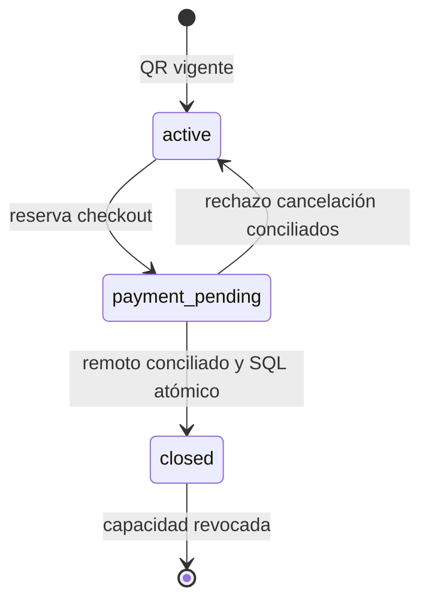

> Referencia de arquitectura heredada y saneada. No constituye evidencia de despliegue ni validación de esta distribución. Las guías públicas del README prevalecen para instalaciones nuevas.

# Modelo de dominio reconstruido

> Actualización 2026-10-07: las secciones anteriores a «Cambio autorizado» conservan la reconstrucción del baseline 2026-10-05. Para contratos modificados prevalecen las specs TASK-002–015 y el [estado actual](IMPLEMENTATION_STATUS.md). La validación local final está en LOCAL_VALIDATION; el despliegue permanece UNKNOWN.

AS-IS. **INFERIDO:** agrupación conceptual basada en consumidores y constraints; no existe implementación explícita de agregados DDD, value objects o event bus. Las entidades y sus datos se apoyan en [DATA_MODEL](DATA_MODEL.md) y [FEATURES](FEATURES.md).

| Contexto y concepto | Ownership, ciclo de vida y responsabilidades | Evidencia |
|---|---|---|
| Registro / solicitud | Prospecto crea pending; aprobación verifica, rechazo rechaza; plan determina activación/invitación | adminService, RegisterPage, auto_approve_registration_v2 |
| Identidad / perfil / membresía | auth.users aporta identidad; profiles rol y restaurante activo; profile_restaurants acceso a varios locales | useAuth, RequireRole, is_my_restaurant |
| Restaurante / sucursal | Root conceptual INFERIDO; configuración comercial/regional, carta y operaciones pertenecen a restaurant_id. Sucursal hereda primario | create_restaurant_branch, migración 20260902000001 |
| Carta / plato / receta | Plato disponible y precio/opciones definen pedido; receta enlaza consumo de insumos y no es requisito universal para vender | Menu, create_order, inventoryService |
| Pedido / items | Items JSONB son snapshot de consumo/precio. Status operativo y payment_status son dimensiones separadas | restaurantService, create_order, payment_integrity |
| Cliente CRM | Nombre/teléfono/email por restaurante; clientes sintéticos derivados de pedidos no son filas persistidas | getCustomers/createOrUpdateCustomerForOrder |
| Mesa / sesión | Mesa física conceptual; QR estable, sesión de consumo con token distinto; payment_pending impide nuevos pedidos de esa sesión | tableService, create_table_order, order-pay |
| Inventario / movimiento | Stock actual y ledger de cambios; receta produce deducción al completar pedido. Hay clamp y límites de consistencia observados | adjust_inventory_stock, _deduct_inventory_for_order_internal |
| Mesero / sesión / propina | Mesero identificado por PIN y atribuido a pedidos; sesión de personal no es JWT de acceso a panel | waiterService, tipsService |
| Pago parcial / turno de caja | División crea registros de pagos; cierre calcula cobros y diferencia por turno, no ingresos fiscales | splitBillService, cashShiftService |
| Suscripción / intención / pago | Trial, recurrente y lifetime; estado de proveedor debe conciliarse con registros locales | Flow/MP/Webpay handlers |
| Consentimiento / DSAR / incidente | Registro de voluntad, solicitud de derechos y gestión de brecha son conceptos distintos; sus actores/evidencia no son intercambiables | privacyService, verify-dsar, securityService |
| Documento tributario | DTE/NC pertenece a restaurante y referencia pedido/documento anterior; aceptación la determina motor externo | accounting, tax-client |

## Estados y transiciones observadas

Pedido: pending, accepted, preparing, ready, completed, cancelled, rejected. **CONFIRMADO:** enum cliente y timestamps de transición; SQL bloquea completed sin paid. **REQUIERE VALIDACIÓN:** matriz completa de transiciones permitidas; el wrapper updateOrderStatus acepta string y no impone toda una máquina de estados. No dibujar como invariante una secuencia que sólo sigue la UI.

Restaurante: active/blocked/trial; plan free_trial/starter/pro/lifetime en catálogo UI, y enterprise/test_plan aparecen en tipos/historia SQL. La normalización de planes pagados y heredabilidad están en migraciones posteriores. No asumir que todo enum de interfaz es un plan vendible vigente.

Mesa: available/occupied/reserved/cleaning. Sesión: active/payment_pending/closed según rutas; start_table_session sólo busca active. Turno: open/closed. Propina: collected/paid_out según tabla/servicio.

Contabilidad: queued → processing/submitted → accepted/observed/rejected/failed/cancelled según respuestas externas y reconciliación; no toda flecha es una transición exhaustivamente restringida por SQL. Constraint limita estados y tipos 33/39/61, pero no prueba todas las transiciones.

## Invariantes y excepciones

- CONFIRMADO: completed requiere paid; total de pedido recalculado en RPC; productos disponibles del mismo restaurante; máximo 50 líneas y cantidades 1–100 mediante trigger. El fallback legacy sigue otra cadena.
- CONFIRMADO: ajustes de stock RPC rechazan negativos; descuento por receta clampa cero. Exactitud del movimiento al clamp REQUIERE VALIDACIÓN (RISK-007).
- CONFIRMADO: máximo 5 membresías en inserciones secuenciales y 30 platos trial. Concurrencia no certificada por count/EXISTS.
- CONFIRMADO: tax_rate configura desglose de precio bruto; no añadir impuesto sobre ese total. No es cálculo legal completo de cada régimen fiscal.
- CONFIRMADO: get_my_order consume token de un uso con TTL 24h; token cocina se rota y vence en 12h. Las sesiones de mesa tienen otra semántica de acceso.
- CONFIRMADO: referencia contable única por restaurante; nonce y Idempotency-Key cumplen funciones distintas. El intento puede alterar la referencia de emisión según builder.

## Tablas técnicas y objetos de valor

orders_events es proyección técnica para Realtime, no un segundo pedido; rate_limits y ai_usage_log son controles de cuota; accounting_cron_secret es configuración sensible; feature_flags modifica rutas de implementación; profile_restaurants es asociación de autorización. No tratarlas como entidades de negocio autónomas por existir una tabla.

Dinero/moneda, tasa, país, PIN, tokens y referencias son **value objects conceptuales INFERIDOS**; se implementan como number/string/JSONB, sin tipos de dominio que garanticen sus invariantes por construcción. El acceso a un UUID no es ownership.

Eventos confirmados: triggers, notifications PostgreSQL y Realtime. No hay evidencia de un catálogo formal de domain events; los side effects se enumeran por feature y contrato.

## Cambio autorizado — estados

POS cobrado accepted/paid; cocina completa aparte. Público pending/pending. DSAR pending_verification → verified → in_progress/fulfilled; rectificación verified → pending revisión admin. Fallo descarga/proveedor conserva recuperación, nunca fulfilled parcial. Stock insuficiente permite venta/faltante; BR-047–056.
