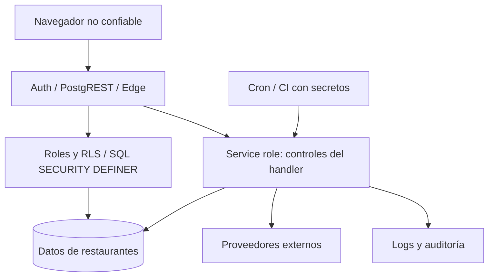

> Referencia de arquitectura heredada y saneada. No constituye evidencia de despliegue ni validación de esta distribución. Las guías públicas del README prevalecen para instalaciones nuevas.

# Modelo de amenazas

> Actualización 2026-10-07: las secciones anteriores a «Cambio autorizado» conservan la reconstrucción del baseline 2026-10-05. Para contratos modificados prevalecen las specs TASK-002–015 y el [estado actual](IMPLEMENTATION_STATUS.md). La validación local final está en LOCAL_VALIDATION; el despliegue permanece UNKNOWN.

AS-IS, análisis estático sin explotación. Activos y amenazas se derivan de [ARCHITECTURE](ARCHITECTURE.md), [DATA_MODEL](DATA_MODEL.md) y handlers citados en [SECURITY](SECURITY.md). Riesgos desplegados requieren validación; STRIDE organiza amenazas plausibles, no demuestra incidentes.

## Activos y actores

Activos: identidad/perfiles y membresías; pedidos/precios/pagos; CRM y PII; sesiones y tokens de mesa/cocina/DSAR; PIN hasheados; inventario y caja; consentimientos/auditoría; planes; credenciales tributarias, documentos y archivos; secretos de Edge/workflows.

Actores: cliente anónimo, prospecto, owner legítimo o de otro restaurante, perfil staff, mesero, admin/DPO, operador de cocina, proveedor de pago/motor/IA y operador con acceso a logs/config. Supabase Auth es proveedor de identidad; mesero/PIN no es una cuenta Auth equivalente.

## Fronteras de confianza

1. Navegador/localStorage/sessionStorage → APIs. Toda entrada, precio, tenant, estado y token enviado necesita validación server-side.
2. PostgREST con roles anon/authenticated → PostgreSQL. Grants, RLS y EXECUTE de helpers interactúan; SECURITY DEFINER cambia contexto efectivo.
3. Edge con service role → DB. Bypass RLS obliga a validar actor/ownership/capability por ruta.
4. Aplicación → Flow/MP/Transbank/Tax/OpenRouter/Resend. Respuestas, callbacks y estados no son confiables sólo por su shape TypeScript.
5. PostgreSQL cron/workflows/logs → Edge/proveedores. Secretos y trazas deben protegerse; scheduling/alertas reales no verificados.

## Amenazas relevantes

| STRIDE | Escenario/entrada | Activo y feature | Control real / laguna | Riesgo |
|---|---|---|---|---|
| Spoofing | Declarar email de otro titular en export/object/revoke | PII/consentimientos FEAT-019 | Identidad implementada en access/erase, ausente en otras rutas | RISK-001 |
| Elevation of Privilege | Helper is_admin evalúa propietario privilegiado | Todas las policies/RPC dependientes | SECURITY DEFINER + current_user; verificar owner | RISK-002 |
| Information Disclosure | Obtener sesión mediante UUID de mesa | Cuenta/token FEAT-014/015 | start_table_session sin qr_token | RISK-003 |
| Tampering | Repetir pago o mutar estados durante fallo parcial | Cobro y sesión FEAT-015 | Lookup/conciliación y claim Flow parcial; writes separados en order-pay | RISK-006 |
| Repudiation | Insertar audit_log con actor/action suministrados | Auditoría FEAT-024/019 | Append-only sin autenticidad universal de inserción | RISK-005 |
| Information Disclosure | Operador/log recibe URL de verificación | DSAR FEAT-019 | Fallback sendEmail imprime capability | RISK-004 |
| Tampering | Cantidad/precio/IDs manipulados | Pedidos FEAT-006/007 | Recalculo SQL existe; fallback/shape POS divergentes | RISK-010 |
| Tampering | Stock clamp registra movimiento incorrecto o doble deducción | Inventario FEAT-010 | Ajuste atómico, deducción EXISTS sin prueba concurrente | RISK-007 |
| Denial of Service | Solicitudes IA concurrentes/fallo de contador | Coste/créditos FEAT-020 | Cuenta 10/24h, fail-open y sin reserva | RISK-011 |
| Information Disclosure | Respuesta error/modelo/tercero con contenido inesperado | Logs/PII FEAT-015/019/020 | Redacción parcial y validación TS insuficiente | RISK-004/012 |
| Repudiation/Tampering | DSAR marcado fulfilled pese a rama incompleta | Derechos FEAT-019 | Ejecución y actualización en pasos; stubs/parámetros divergentes | RISK-009 |

## Casos de validación futura

TO-BE RECOMMENDATION: probar anónimo/owner A/owner B/admin en cada ruta; IDs conocidos y tokens de otro recurso; expiración/replay; pagos con proveedor correcto pero importe/referencia incorrectos; duplicado concurrente; commit externo seguido de fallo local; scopes sin consentimiento; error del contador y secretos no configurados; documento/nota de crédito de otro restaurante.

No se ejecutarán esas pruebas sobre sistemas externos durante esta reconstrucción. Amenazas como Kubernetes/RabbitMQ no se incluyen porque no forman parte de la arquitectura observada. Regiones, controles de plataforma y respuesta operativa efectiva son DESCONOCIDOS.

## Cambio autorizado — mitigaciones/residual

Identidad/MFA/epoch, ACL/tenant, QR/capacidades, DSAR/hash/claim/snapshot, reserva/conciliación, ledger/faltantes y límites fueron comprobados en runtime local. Evidencia por amenaza en [SECURITY](SECURITY.md) y [VALIDATION_REPORT](VALIDATION_REPORT.md). Residual: estado desplegado UNKNOWN, histórico ambiguo, proveedores/catálogo/PEN, retención, operadores recovery/outbox/DTE y validación de imagen sin antivirus. No inferir explotación. Nivel 4 local; nivel 5 pendiente.

## Triaje vigente TASK-016

RISK-006: reserva tardía confirmada y proveedor único probados en I17/SQL34. RISK-013: npm0 y CI aprobados. RISK-014: publicación ajena y escrituras Storage denegadas en I13, ambas instalaciones. Confianza ALTA en reproducción; responsable de operación/aceptación: administrador del cliente. Criterio local satisfecho con comportamiento, prueba confiable, contrato y residual; estado productivo DESCONOCIDO. SEC-003/004/007/008/014/015. Sin indicios de incidente activo. Evidencia (referencia histórica excluida de esta distribución).
