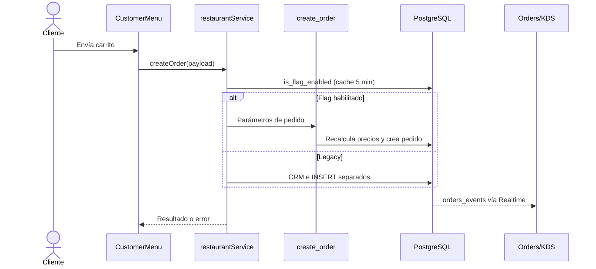
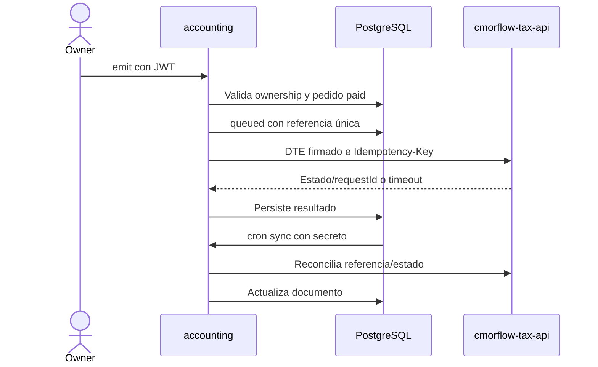

> Referencia de arquitectura heredada y saneada. No constituye evidencia de despliegue ni validación de esta distribución. Las guías públicas del README prevalecen para instalaciones nuevas.

# Flujos reales

> Actualización 2026-10-07: las secciones anteriores a «Cambio autorizado» conservan la reconstrucción del baseline 2026-10-05. Para contratos modificados prevalecen las specs TASK-002–015 y el [estado actual](IMPLEMENTATION_STATUS.md). La validación local final está en LOCAL_VALIDATION; el despliegue permanece UNKNOWN.

AS-IS. Cada flujo contiene ramas/acciones observadas; la enumeración no significa que todas sean pasos obligatorios de una misma transacción. Servicios externos no ejecutados.

## FEAT-001 — Identidad, sesión e invitaciones

Actor: Owner, staff y administrador; Supabase Auth como actor secundario. Entrada: /login, /admin/login, /setup-password; guards /restaurant/* y /admin/*.

Sesión válida de Supabase y perfil asociado para paneles; invitación vigente para vincular propietario.

Punto de entrada y trigger: /login, /admin/login, /setup-password; guards /restaurant/* y /admin/*; acción del actor en pantalla o llamada del consumidor indicado.

1. El guard espera la resolución de sesión, redirige anónimos al login y rechaza un perfil ausente o sin restaurante salvo admin.
2. El panel admin sólo admite profile.role=admin; el guard owner admite cualquier perfil asociado, incluido staff y admin.
3. SetupPassword consume el token de invitación y exige contraseña de al menos 8 caracteres antes de updateUser.

Datos: profiles, profile_restaurants, restaurants, invitations. APIs: API-102, API-106, API-108, API-110, API-113, API-115.

Resultado/side effects: Cambios en sesión Auth, consumo de invitación y vinculación de perfil. Logout limpia sesión vía SDK.

Eventos SQL/Realtime e integraciones: [ARCHITECTURE](ARCHITECTURE.md), [INTEGRATIONS](INTEGRATIONS.md). No se declara un bus de dominio inexistente.

Permisos: Guard frontend confirmado; autorización efectiva depende de RLS y comprobaciones Edge, no del guard.

Reglas de negocio relacionadas: [BR-001](BUSINESS_RULES.md#br-001). La UI no concede permisos al servidor. Grants y policies deben leerse cronológicamente, incluyendo revocaciones posteriores.

Errores: - Given: Sin sesión resuelta.
- When: Se intenta abrir /admin.
- Then: Se redirige al login administrativo.

Ante error de red/base de datos, el retorno y manejo concreto están en los contratos citados en API; no hay un fallback uniforme entre servicios. Prueba de todas las ramas de error: MISSING.

Evidencia: [src/hooks/useAuth.ts](<../../src/hooks/useAuth.ts>); [src/components/RequireRole.tsx](<../../src/components/RequireRole.tsx>); [src/pages/public/LoginPage.tsx](<../../src/pages/public/LoginPage.tsx>); [src/pages/public/SetupPassword.tsx](<../../src/pages/public/SetupPassword.tsx>); [src/pages/admin/LoginPage.tsx](<../../src/pages/admin/LoginPage.tsx>); [src/config/authClient.ts](<../../src/config/authClient.ts>).

## FEAT-002 — Registro, aprobación y activación

Actor: Prospecto, administrador; Supabase Auth y proveedor de pagos. Entrada: /register, /admin/requests.

Solicitud pending con email del dueño; plan elegido y país válido.

Punto de entrada y trigger: /register, /admin/requests; acción del actor en pantalla o llamada del consumidor indicado.

1. RegisterPage crea la solicitud y deriva free_trial a activate-trial-registration; planes pagos pasan a la pasarela correspondiente al país.
2. La activación gratuita sólo envía free_trial a auto_approve_registration_v2; SQL crea restaurante trial de 14 días y una invitación de 7 días.
3. La aprobación administrativa real crea restaurante e invitación; la rama mock conserva credenciales temporales y no envía correo real.

Datos: registration_requests, restaurants, invitations, payment_intents. APIs: API-001, API-022, API-046, API-053, API-073, API-112, API-116, API-136, API-137, API-139.

Resultado/side effects: Inserta restaurante/invitación, cambia solicitud a verified y solicita email de invitación.

Eventos SQL/Realtime e integraciones: [ARCHITECTURE](ARCHITECTURE.md), [INTEGRATIONS](INTEGRATIONS.md). No se declara un bus de dominio inexistente.

Permisos: Activación gratuita pública limitada en handler; activación paga depende de is_admin/service role en SQL: RISK-002 requiere validación.

Reglas de negocio relacionadas: [BR-002](BUSINESS_RULES.md#br-002). La UI no concede permisos al servidor. Grants y policies deben leerse cronológicamente, incluyendo revocaciones posteriores.

Errores: - Given: UUID de registro malformado.
- When: Se solicita activar trial.
- Then: La Edge responde 400 sin llamar a activación.

Ante error de red/base de datos, el retorno y manejo concreto están en los contratos citados en API; no hay un fallback uniforme entre servicios. Prueba de todas las ramas de error: MISSING.

Evidencia: [src/pages/public/RegisterPage.tsx](<../../src/pages/public/RegisterPage.tsx>); [src/services/adminService.ts](<../../src/services/adminService.ts>); [supabase/functions/activate-trial-registration/index.ts](<../../supabase/functions/activate-trial-registration/index.ts>); [supabase/functions/invite-owner/index.ts](<../../supabase/functions/invite-owner/index.ts>).

## FEAT-003 — Administración de restaurantes y plataforma

Actor: Administrador; dueño como destinatario de invitaciones. Entrada: /admin, /admin/requests, /admin/restaurants, /admin/analytics.

Perfil administrativo y permisos RPC efectivos.

Punto de entrada y trigger: /admin, /admin/requests, /admin/restaurants, /admin/analytics; acción del actor en pantalla o llamada del consumidor indicado.

1. El listado administrativo usa admin_list_restaurants para acceder a columnas internas protegidas por grants.
2. El bloqueo/desbloqueo y rechazo de solicitudes usan admin_toggle_restaurant_status y admin_reject_request.
3. deleteRestaurant usa admin_delete_restaurant en modo real; en mock elimina restaurantes/perfiles/usuarios de stores locales.

Datos: restaurants, registration_requests, audit_log, invitations, orders. APIs: API-038, API-039, API-040, API-041, API-042, API-043, API-044, API-045, API-081, API-089, API-090, API-091.

Resultado/side effects: Actualiza/borrra registros y registra acciones mediante funciones SQL de auditoría según operación.

Eventos SQL/Realtime e integraciones: [ARCHITECTURE](ARCHITECTURE.md), [INTEGRATIONS](INTEGRATIONS.md). No se declara un bus de dominio inexistente.

Permisos: Guard admin y comprobaciones SQL presentes; owner de is_admin y alcance de auditoría REQUIEREN VALIDACIÓN.

Reglas de negocio relacionadas: [BR-003](BUSINESS_RULES.md#br-003). La UI no concede permisos al servidor. Grants y policies deben leerse cronológicamente, incluyendo revocaciones posteriores.

Errores: - Given: Usuario sin autorización RPC.
- When: Intenta una mutación administrativa.
- Then: El SQL contiene comprobación is_admin; su eficacia requiere resolver RISK-002.

Ante error de red/base de datos, el retorno y manejo concreto están en los contratos citados en API; no hay un fallback uniforme entre servicios. Prueba de todas las ramas de error: MISSING.

Evidencia: [src/services/adminService.ts](<../../src/services/adminService.ts>); [src/pages/admin/AllRestaurants.tsx](<../../src/pages/admin/AllRestaurants.tsx>); [src/pages/admin/PendingRequests.tsx](<../../src/pages/admin/PendingRequests.tsx>); [src/pages/admin/Analytics.tsx](<../../src/pages/admin/Analytics.tsx>).

## FEAT-004 — Membresías, sucursales y restaurante activo

Actor: Usuario autenticado con restaurantes; admin. Entrada: RestaurantSwitcher en /restaurant/*.

Membresía del usuario; UI exige plan habilitado para crear sucursal.

Punto de entrada y trigger: RestaurantSwitcher en /restaurant/*; acción del actor en pantalla o llamada del consumidor indicado.

1. La RPC create_restaurant_branch hereda país, moneda, idioma, impuestos, plan, estado y trial del restaurante primario; ignora parámetros de plan/estado del cliente.
2. El trigger check_max_restaurants rechaza insertar una membresía cuando ya existen 5 para ese perfil.
3. switchRestaurant intenta actualizar profiles.restaurant_id y luego refrescar; el grant posterior sólo permite display_name, por lo que el flujo real REQUIERE VALIDACIÓN.

Datos: restaurants, profile_restaurants, profiles. APIs: API-048, API-055, API-065, API-076, API-103, API-104, API-105, API-109, API-111, API-114, API-131, API-132, API-138, API-162.

Resultado/side effects: Crea restaurante y asociación dentro de RPC; selección intenta persistir restaurante activo.

Eventos SQL/Realtime e integraciones: [ARCHITECTURE](ARCHITECTURE.md), [INTEGRATIONS](INTEGRATIONS.md). No se declara un bus de dominio inexistente.

Permisos: Membresía verificada en is_my_restaurant; no confundir ocultar formulario por plan con enforcement del plan en RPC.

Reglas de negocio relacionadas: [BR-004](BUSINESS_RULES.md#br-004). La UI no concede permisos al servidor. Grants y policies deben leerse cronológicamente, incluyendo revocaciones posteriores.

Errores: - Given: Sexta asociación secuencial.
- When: Se inserta profile_restaurants.
- Then: El trigger lanza check_violation; concurrencia del límite no está probada.

Ante error de red/base de datos, el retorno y manejo concreto están en los contratos citados en API; no hay un fallback uniforme entre servicios. Prueba de todas las ramas de error: MISSING.

Evidencia: [src/components/RestaurantSwitcher.tsx](<../../src/components/RestaurantSwitcher.tsx>); [src/hooks/useAuth.ts](<../../src/hooks/useAuth.ts>); [src/services/restaurantService.ts](<../../src/services/restaurantService.ts>); [supabase/migrations/20260902000001_audit_fixes.sql](<../../supabase/migrations/20260902000001_audit_fixes.sql>); [supabase/migrations/20260101000007_multi_restaurant.sql](<../../supabase/migrations/20260101000007_multi_restaurant.sql>).

## FEAT-005 — Carta, variantes, disponibilidad e imágenes

Actor: Owner/staff en panel; cliente como lector. Entrada: /restaurant/menu, /menu/:slug.

Restaurante accesible para edición; público según policies de menú.

Punto de entrada y trigger: /restaurant/menu, /menu/:slug; acción del actor en pantalla o llamada del consumidor indicado.

1. El servicio crea, edita, elimina platos y alterna is_available; CustomerMenu recibe cambios de menu_items por Realtime.
2. La inserción de un plato en free_trial se rechaza si ya existen 30; la UI también aplica ese límite.
3. ImageDropZone valida imagen y tamaño por defecto 2 MB, comprime hasta 800x800 JPEG y sube a menu-images o usa base64 legacy.

Datos: menu_items, menu_categories, recipes, recipe_ingredients. APIs: API-174, API-175, API-176, API-177, API-178.

Resultado/side effects: Escritura/borrado de platos y archivos; receta se guarda en llamadas separadas.

Eventos SQL/Realtime e integraciones: [ARCHITECTURE](ARCHITECTURE.md), [INTEGRATIONS](INTEGRATIONS.md). No se declara un bus de dominio inexistente.

Permisos: RLS controla escritura; rutas Storage usan carpeta restaurante. MIME cliente y compresión no demuestran validación server-side de contenido.

Reglas de negocio relacionadas: [BR-005](BUSINESS_RULES.md#br-005). La UI no concede permisos al servidor. Grants y policies deben leerse cronológicamente, incluyendo revocaciones posteriores.

Errores: - Given: Archivo no image/* o mayor que 2 MB.
- When: Se carga con configuración por defecto.
- Then: Se muestra error antes de la compresión/subida.

Ante error de red/base de datos, el retorno y manejo concreto están en los contratos citados en API; no hay un fallback uniforme entre servicios. Prueba de todas las ramas de error: MISSING.

Evidencia: [src/pages/restaurant/Menu.tsx](<../../src/pages/restaurant/Menu.tsx>); [src/services/restaurantService.ts](<../../src/services/restaurantService.ts>); [src/components/ImageDropZone.tsx](<../../src/components/ImageDropZone.tsx>); [supabase/migrations/20260101000004_trial_limits.sql](<../../supabase/migrations/20260101000004_trial_limits.sql>).

## FEAT-006 — Pedidos públicos, estados y seguimiento

Actor: Cliente anónimo, owner; cocina como consumidor. Entrada: /menu/:slug, /restaurant/orders.

Restaurante activo/trial vigente, carrito con productos disponibles.

Punto de entrada y trigger: /menu/:slug, /restaurant/orders; acción del actor en pantalla o llamada del consumidor indicado.

1. create_order recalcula precio de carta, tamaño y addons; total es suma de items y subtotal=total/(1+tax_rate).
2. SQL rechaza carrito vacío o más de 50 líneas; el trigger limita cantidades a enteros de 1 a 100 y total positivo.
3. get_my_order acepta access_token durante 24h y lo anula tras devolver el pedido.
4. createOrder elige RPC mediante flag cacheado 5 minutos; si no lo activa usa INSERT directo y vinculación CRM separada.

Datos: orders, orders_events, menu_items, restaurant_customers, feature_flags, rate_limits. APIs: API-049, API-050, API-054, API-060, API-061, API-064, API-074, API-075, API-083, API-084, API-087, API-092, API-095, API-097, API-099, API-100, API-117, API-119, API-121, API-122, API-124, API-125, API-135, API-140, API-141, API-145, API-172, API-173, API-179, API-183, API-184, API-185, API-186, API-188, API-191, API-201.

Resultado/side effects: Inserta pedido, puede crear/actualizar cliente, genera número atómico y evento espejo; completed exige paid y dispara descuento de inventario.

Eventos SQL/Realtime e integraciones: [ARCHITECTURE](ARCHITECTURE.md), [INTEGRATIONS](INTEGRATIONS.md). No se declara un bus de dominio inexistente.

Permisos: Pedido público permite crear por restaurante activo; grant safe RPC evita necesitar lectura pública de orders. El fallback legacy no garantiza recálculo SQL.

Reglas de negocio relacionadas: [BR-006](BUSINESS_RULES.md#br-006). La UI no concede permisos al servidor. Grants y policies deben leerse cronológicamente, incluyendo revocaciones posteriores.

Errores: - Given: Producto de otro restaurante o no disponible.
- When: Se llama create_order.
- Then: Se retorna success=false con item_not_available; UUID inválido puede producir error SQL de cast.

Ante error de red/base de datos, el retorno y manejo concreto están en los contratos citados en API; no hay un fallback uniforme entre servicios. Prueba de todas las ramas de error: MISSING.

Evidencia: [src/pages/customer/CustomerMenu.tsx](<../../src/pages/customer/CustomerMenu.tsx>); [src/pages/restaurant/Orders.tsx](<../../src/pages/restaurant/Orders.tsx>); [src/services/restaurantService.ts](<../../src/services/restaurantService.ts>); [supabase/migrations/20260831000001_multi_country.sql](<../../supabase/migrations/20260831000001_multi_country.sql>); [supabase/migrations/20260828000002_audit_enforce_service_cutoff.sql](<../../supabase/migrations/20260828000002_audit_enforce_service_cutoff.sql>).

## FEAT-007 — POS, cobro manual y envío a cocina

Actor: Cajero/owner, mesero identificado por PIN; cocina. Entrada: /restaurant/pos y alias /restaurant/cash.

Restaurante activo, carrito no vacío; número de mesa obligatorio para order_type=table.

Punto de entrada y trigger: /restaurant/pos y alias /restaurant/cash; acción del actor en pantalla o llamada del consumidor indicado.

1. El POS bloquea doble envío local mientras orderSubmitting está activo y muestra éxito optimista con snapshots para revertir ante fallo.
2. El carrito se conserva en sessionStorage con expiración de 12 horas; la clave pos_cart_draft no incluye restaurante.
3. El POS crea/actualiza pedidos y registra el cobro; completed con pago no confirmado es rechazado por trigger SQL.

Datos: orders, restaurant_customers, tips, order_payments, cash_shifts. APIs: N/A o compartidas.

Resultado/side effects: Pedidos, CRM, propinas y pagos divididos en varias llamadas; posible fallo parcial después del éxito optimista.

Eventos SQL/Realtime e integraciones: [ARCHITECTURE](ARCHITECTURE.md), [INTEGRATIONS](INTEGRATIONS.md). No se declara un bus de dominio inexistente.

Permisos: Cobros y cambios usan permisos DB del usuario; PIN mesero aporta atribución, no reemplaza Auth del dueño.

Reglas de negocio relacionadas: [BR-007](BUSINESS_RULES.md#br-007). La UI no concede permisos al servidor. Grants y policies deben leerse cronológicamente, incluyendo revocaciones posteriores.

Errores: - Given: Carrito vacío o mesa sin número.
- When: Se envía el pedido.
- Then: La UI muestra error y no envía hasta completar la condición.

Ante error de red/base de datos, el retorno y manejo concreto están en los contratos citados en API; no hay un fallback uniforme entre servicios. Prueba de todas las ramas de error: MISSING.

Evidencia: [src/pages/restaurant/Pos.tsx](<../../src/pages/restaurant/Pos.tsx>); [src/services/restaurantService.ts](<../../src/services/restaurantService.ts>); [src/hooks/useWaiterSession.ts](<../../src/hooks/useWaiterSession.ts>); [src/components/SplitBillModal.tsx](<../../src/components/SplitBillModal.tsx>).

## FEAT-008 — CRM e historial de clientes

Actor: Owner/cajero; cliente como titular de datos. Entrada: /restaurant/crm, selector de cliente en POS.

Usuario con acceso al restaurante; nombre y teléfono para vínculo automático.

Punto de entrada y trigger: /restaurant/crm, selector de cliente en POS; acción del actor en pantalla o llamada del consumidor indicado.

1. getCustomers combina clientes persistidos con pedidos de los últimos 90 días por teléfono, sin duplicar IDs de pedidos.
2. Los teléfonos sin fila CRM producen clientes sintéticos con id order:<restaurantId>:<phone> e isSynthetic=true.
3. getCustomerOrders devuelve por defecto los 3 pedidos más recientes por customer_id; CRUD de clientes usa restaurant_customers.

Datos: restaurant_customers, orders. APIs: API-180, API-181, API-182, API-187, API-189, API-190.

Resultado/side effects: Actualiza nombre/email del cliente en pedidos; lectura y edición CRM.

Eventos SQL/Realtime e integraciones: [ARCHITECTURE](ARCHITECTURE.md), [INTEGRATIONS](INTEGRATIONS.md). No se declara un bus de dominio inexistente.

Permisos: PII de nombre/teléfono/email requiere RLS; el teléfono es clave de agregación por restaurante, no prueba de identidad.

Reglas de negocio relacionadas: [BR-008](BUSINESS_RULES.md#br-008). La UI no concede permisos al servidor. Grants y policies deben leerse cronológicamente, incluyendo revocaciones posteriores.

Errores: - Given: Error al consultar historial individual.
- When: getCustomerOrders recibe error Supabase.
- Then: El servicio registra el error y devuelve [], sin distinguir historial vacío de fallo.

Ante error de red/base de datos, el retorno y manejo concreto están en los contratos citados en API; no hay un fallback uniforme entre servicios. Prueba de todas las ramas de error: MISSING.

Evidencia: [src/pages/restaurant/Crm.tsx](<../../src/pages/restaurant/Crm.tsx>); [src/services/restaurantService.ts](<../../src/services/restaurantService.ts>).

## FEAT-009 — Reportes y analítica de ventas

Actor: Owner y admin en analítica de plataforma. Entrada: /restaurant/reports, /admin/analytics.

Restaurante accesible y rango de fechas seleccionado.

Punto de entrada y trigger: /restaurant/reports, /admin/analytics; acción del actor en pantalla o llamada del consumidor indicado.

1. Las métricas de ventas usan get_daily_sales, get_top_items, get_avg_ticket, get_sales_by_hour, get_sales_by_order_type y get_reports_summary.
2. Reportes complementarios leen propinas, inventario, meseros y turnos de caja desde sus tablas.
3. La capa cliente transforma fechas y genera exportaciones; indicadores de ingresos deben contrastarse con filtro de estado/pago de cada consumidor.

Datos: orders, tips, inventory_items, waiters, cash_shifts. APIs: API-062, API-063, API-066, API-067, API-068, API-072.

Resultado/side effects: Lecturas y descarga de archivos en navegador; no se observa envío automático de reportes.

Eventos SQL/Realtime e integraciones: [ARCHITECTURE](ARCHITECTURE.md), [INTEGRATIONS](INTEGRATIONS.md). No se declara un bus de dominio inexistente.

Permisos: RPCs de reporte incluyen is_my_restaurant; eficacia ligada a RISK-002. Exportaciones deben limitar tenant y campos sensibles.

Reglas de negocio relacionadas: [BR-009](BUSINESS_RULES.md#br-009). La UI no concede permisos al servidor. Grants y policies deben leerse cronológicamente, incluyendo revocaciones posteriores.

Errores: - Given: RPC de reporte devuelve error.
- When: Se consulta un reporte.
- Then: El servicio devuelve los valores por defecto específicos de cada wrapper; revisar contrato API, no asumir respuesta única.

Ante error de red/base de datos, el retorno y manejo concreto están en los contratos citados en API; no hay un fallback uniforme entre servicios. Prueba de todas las ramas de error: MISSING.

Evidencia: [src/pages/restaurant/Reports.tsx](<../../src/pages/restaurant/Reports.tsx>); [src/services/restaurantService.ts](<../../src/services/restaurantService.ts>); [supabase/migrations/20260710000008_notifications_usage.sql](<../../supabase/migrations/20260710000008_notifications_usage.sql>).

## FEAT-010 — Inventario, recetas y movimientos

Actor: Owner; pedidos completados como trigger secundario. Entrada: /restaurant/inventory, editor de recetas en /restaurant/menu.

Insumo/receta del restaurante; delta y tipo de movimiento para ajustes.

Punto de entrada y trigger: /restaurant/inventory, editor de recetas en /restaurant/menu; acción del actor en pantalla o llamada del consumidor indicado.

1. adjust_inventory_stock modifica stock e inserta movimiento en una RPC, valida ownership y rechaza stock negativo.
2. saveRecipe hace upsert de receta, DELETE de ingredientes y luego INSERT; esas llamadas no forman una transacción única.
3. La deducción al completar un pedido omite productos sin receta y utiliza GREATEST(0,current_stock-v_needed); detecta deducción previa por reference_id.

Datos: inventory_items, recipes, recipe_ingredients, inventory_movements, orders. APIs: API-034, API-037, API-058, API-085, API-120, API-127, API-148, API-151, API-152, API-153, API-154, API-155, API-156, API-157, API-158, API-159, API-160, API-161.

Resultado/side effects: Actualiza stock e historial; borrado de ingredientes por cascade; descuento desde trigger de pedidos.

Eventos SQL/Realtime e integraciones: [ARCHITECTURE](ARCHITECTURE.md), [INTEGRATIONS](INTEGRATIONS.md). No se declara un bus de dominio inexistente.

Permisos: RPC y policies comprueban is_my_restaurant; consistencia de restaurant_id en relaciones requiere revisar constraints y RISK-002.

Reglas de negocio relacionadas: [BR-010](BUSINESS_RULES.md#br-010). La UI no concede permisos al servidor. Grants y policies deben leerse cronológicamente, incluyendo revocaciones posteriores.

Errores: - Given: Delta deja stock menor que cero.
- When: Se ajusta inventario vía RPC.
- Then: Se lanza insufficient_stock/22023 y se revierte la transacción RPC.

Ante error de red/base de datos, el retorno y manejo concreto están en los contratos citados en API; no hay un fallback uniforme entre servicios. Prueba de todas las ramas de error: MISSING.

Evidencia: [src/services/inventoryService.ts](<../../src/services/inventoryService.ts>); [src/pages/restaurant/Inventory.tsx](<../../src/pages/restaurant/Inventory.tsx>); [supabase/migrations/20260828000006_audit_atomic_inventory_adjust.sql](<../../supabase/migrations/20260828000006_audit_atomic_inventory_adjust.sql>); [supabase/migrations/20260710000001_inventory.sql](<../../supabase/migrations/20260710000001_inventory.sql>).

## FEAT-011 — Meseros, PIN y sesiones

Actor: Owner, mesero; POS como consumidor de sesión. Entrada: /restaurant/waiters, WaiterPinPad en POS.

Acceso al restaurante; PIN y mesero activo para validar sesión.

Punto de entrada y trigger: /restaurant/waiters, WaiterPinPad en POS; acción del actor en pantalla o llamada del consumidor indicado.

1. Crear y actualizar meseros usa RPCs; los PIN se hashean en SQL y el listado de servicio excluye pin_hash.
2. validatePin devuelve data=null,error=null cuando no hay filas por PIN incorrecto.
3. Historial de sesiones cerradas se limita por defecto a 50; end_waiter_session cierra y calcula atribución según SQL.

Datos: waiters, waiter_sessions, orders. APIs: API-057, API-059, API-098, API-101, API-118, API-123, API-128, API-130, API-146, API-213, API-214, API-215.

Resultado/side effects: Inserta/actualiza mesero y sesiones; pedidos/propinas atribuidos a mesero.

Eventos SQL/Realtime e integraciones: [ARCHITECTURE](ARCHITECTURE.md), [INTEGRATIONS](INTEGRATIONS.md). No se declara un bus de dominio inexistente.

Permisos: Writes sensibles via RPC; leer pin_hash por otras rutas depende de grants efectivos, no sólo proyección de getWaiters.

Reglas de negocio relacionadas: [BR-011](BUSINESS_RULES.md#br-011). La UI no concede permisos al servidor. Grants y policies deben leerse cronológicamente, incluyendo revocaciones posteriores.

Errores: - Given: PIN no coincide.
- When: Se valida mesero.
- Then: No hay ActiveWaiter; el cliente debe tratar data=null como rechazo, no como éxito.

Ante error de red/base de datos, el retorno y manejo concreto están en los contratos citados en API; no hay un fallback uniforme entre servicios. Prueba de todas las ramas de error: MISSING.

Evidencia: [src/services/waiterService.ts](<../../src/services/waiterService.ts>); [src/hooks/useWaiterSession.ts](<../../src/hooks/useWaiterSession.ts>); [src/pages/restaurant/Waiters.tsx](<../../src/pages/restaurant/Waiters.tsx>); [supabase/migrations/20260710000002_waiters.sql](<../../supabase/migrations/20260710000002_waiters.sql>).

## FEAT-012 — Registro y liquidación de propinas

Actor: Owner/cajero; mesero beneficiario. Entrada: POS, /restaurant/reports y pago QR.

Permisos del restaurante y monto/porcentaje de propina.

Punto de entrada y trigger: POS, /restaurant/reports y pago QR; acción del actor en pantalla o llamada del consumidor indicado.

1. calculateTipAmount retorna 0 si total o porcentaje no es positivo; usa Math.round con decimales de moneda.
2. markTipsAsPaid marca IDs como paid_out y registra paid_out_at.
3. Resúmenes por mesero agregan monto/cantidad en el navegador a partir de tips filtradas por restaurante y fechas.

Datos: tips, orders, waiters. APIs: API-126, API-150, API-208, API-209, API-210, API-211, API-212.

Resultado/side effects: Inserta tips y actualiza liquidación; complete_session_payment puede insertar propina QR.

Eventos SQL/Realtime e integraciones: [ARCHITECTURE](ARCHITECTURE.md), [INTEGRATIONS](INTEGRATIONS.md). No se declara un bus de dominio inexistente.

Permisos: Mutaciones de propinas deben pasar RLS; paid_out es liquidación al mesero, diferente de pago del pedido.

Reglas de negocio relacionadas: [BR-012](BUSINESS_RULES.md#br-012). La UI no concede permisos al servidor. Grants y policies deben leerse cronológicamente, incluyendo revocaciones posteriores.

Errores: - Given: Total o porcentaje no positivo.
- When: Se calcula propina con helper POS.
- Then: El helper retorna 0.

Ante error de red/base de datos, el retorno y manejo concreto están en los contratos citados en API; no hay un fallback uniforme entre servicios. Prueba de todas las ramas de error: MISSING.

Evidencia: [src/services/tipsService.ts](<../../src/services/tipsService.ts>); [src/services/tableService.ts](<../../src/services/tableService.ts>); [supabase/migrations/20260710000003_tips.sql](<../../supabase/migrations/20260710000003_tips.sql>).

## FEAT-013 — División de cuentas y pagos parciales

Actor: Cajero/owner; pagadores como etiquetas. Entrada: SplitBillModal en POS.

Pedido accesible y partes/montos elegidos.

Punto de entrada y trigger: SplitBillModal en POS; acción del actor en pantalla o llamada del consumidor indicado.

1. splitEqually divide con Math.floor y devuelve resto separado; people<=0 devuelve partes vacías y remainder=total.
2. validateSplitTotals acepta diferencia absoluta menor o igual a 1 unidad monetaria.
3. El servicio persiste pagos parciales, marca is_split/split_count y consulta can_close_split_order por suma de pagos paid>=total.

Datos: order_payments, orders. APIs: API-047, API-197, API-198, API-199, API-200.

Resultado/side effects: Inserta/actualiza/borrra order_payments y actualiza flags de orders.

Eventos SQL/Realtime e integraciones: [ARCHITECTURE](ARCHITECTURE.md), [INTEGRATIONS](INTEGRATIONS.md). No se declara un bus de dominio inexistente.

Permisos: RLS de order_payments y comprobación SQL de cierre; relaciones entre order_id y restaurant_id requieren revisión.

Reglas de negocio relacionadas: [BR-013](BUSINESS_RULES.md#br-013). La UI no concede permisos al servidor. Grants y policies deben leerse cronológicamente, incluyendo revocaciones posteriores.

Errores: - Given: Partes con diferencia mayor a 1.
- When: Se valida total dividido.
- Then: El helper retorna valid=false; esto por sí solo no valida writes directos DB.

Ante error de red/base de datos, el retorno y manejo concreto están en los contratos citados en API; no hay un fallback uniforme entre servicios. Prueba de todas las ramas de error: MISSING.

Evidencia: [src/services/splitBillService.ts](<../../src/services/splitBillService.ts>); [src/components/SplitBillModal.tsx](<../../src/components/SplitBillModal.tsx>); [supabase/migrations/20260710000004_split_bills.sql](<../../supabase/migrations/20260710000004_split_bills.sql>).

## FEAT-014 — Mesas, QR y sesiones de consumo

Actor: Owner, cliente anónimo; mesero asignado. Entrada: /restaurant/tables, /mesa/:qrToken, /mesa/:qrToken/pagar.

Mesa y restaurante activos; token QR para lookup público y session_token para pedidos.

Punto de entrada y trigger: /restaurant/tables, /mesa/:qrToken, /mesa/:qrToken/pagar; acción del actor en pantalla o llamada del consumidor indicado.

1. El owner gestiona mesas y puede regenerar qr_token usando crypto.randomUUID.
2. start_table_session recibe table_id, devuelve una sesión active existente o crea una y marca mesa occupied.
3. create_table_order sólo acepta sesión active, recalcula precios base y rechaza selected_size_id/addon_ids; devuelve token de pedido y total de sesión.

Datos: restaurant_tables, table_sessions, orders. APIs: API-035, API-052, API-056, API-069, API-070, API-071, API-096, API-147, API-202, API-203, API-204, API-205, API-206, API-207.

Resultado/side effects: Crea sesiones/pedidos, cambia estado de mesa y total_amount; pago finalizado cierra sesión/libera mesa.

Eventos SQL/Realtime e integraciones: [ARCHITECTURE](ARCHITECTURE.md), [INTEGRATIONS](INTEGRATIONS.md). No se declara un bus de dominio inexistente.

Permisos: Capability pública; start_table_session sólo exige table_id, no qr_token: revisar exposición de sesión en RISK-003.

Reglas de negocio relacionadas: [BR-014](BUSINESS_RULES.md#br-014). La UI no concede permisos al servidor. Grants y policies deben leerse cronológicamente, incluyendo revocaciones posteriores.

Errores: - Given: Variantes solicitadas en pedido de mesa.
- When: Se envían selected_size_id o selected_addon_ids no vacíos.
- Then: SQL devuelve menu_options_not_supported_for_table_qr.

Ante error de red/base de datos, el retorno y manejo concreto están en los contratos citados en API; no hay un fallback uniforme entre servicios. Prueba de todas las ramas de error: MISSING.

Evidencia: [src/services/tableService.ts](<../../src/services/tableService.ts>); [src/pages/customer/TableQR.tsx](<../../src/pages/customer/TableQR.tsx>); [src/pages/restaurant/Tables.tsx](<../../src/pages/restaurant/Tables.tsx>); [supabase/migrations/20260831000001_multi_country.sql](<../../supabase/migrations/20260831000001_multi_country.sql>).

## FEAT-015 — Checkout, pago de mesa y conciliación de webhooks

Actor: Cliente/prospecto; Flow, Mercado Pago y Transbank. Entrada: Registro y /mesa/:qrToken/pagar; /payment/error.

Intención/solicitud o sesión válida; proveedor configurado.

Punto de entrada y trigger: Registro y /mesa/:qrToken/pagar; /payment/error; acción del actor en pantalla o llamada del consumidor indicado.

1. order-pay recalcula suma de pedidos no cancelled/rejected y limita propina a 100%; CL usa Flow, BR/PE Mercado Pago, BO rechaza pago online.
2. Flow consulta estado real y reclama webhook atómicamente; processed retorna 200 y busy retorna 503.
3. Mercado Pago valida firma si existe secreto y siempre consulta pago real; concilia importe y referencia contra intención local.
4. La finalización de sesión evita repetir cierre si status=closed; retorno del navegador Flow no activa una cuenta por sí mismo.

Datos: payment_intents, flow_payments, flow_webhook_events, table_sessions, orders, tips, registration_requests. APIs: API-010, API-011, API-012, API-023, API-024, API-032, API-033.

Resultado/side effects: Llamadas de cobro, intenciones, activación de restaurante, marca payment_pending y cierre/pago/propina de sesiones.

Eventos SQL/Realtime e integraciones: [ARCHITECTURE](ARCHITECTURE.md), [INTEGRATIONS](INTEGRATIONS.md). No se declara un bus de dominio inexistente.

Permisos: Confirmación server-side con service role; firma MP opcional y writes no comprobados en order-pay dejan controles parciales.

Reglas de negocio relacionadas: [BR-015](BUSINESS_RULES.md#br-015). La UI no concede permisos al servidor. Grants y policies deben leerse cronológicamente, incluyendo revocaciones posteriores.

Errores: - Given: Session token desconocido.
- When: Se inicia pago de mesa.
- Then: order-pay devuelve 404 invalid_session.

Ante error de red/base de datos, el retorno y manejo concreto están en los contratos citados en API; no hay un fallback uniforme entre servicios. Prueba de todas las ramas de error: MISSING.

Evidencia: [supabase/functions/order-pay/index.ts](<../../supabase/functions/order-pay/index.ts>); [supabase/functions/flow-checkout/index.ts](<../../supabase/functions/flow-checkout/index.ts>); [supabase/functions/mp-checkout/index.ts](<../../supabase/functions/mp-checkout/index.ts>); [supabase/functions/mp-webhook/index.ts](<../../supabase/functions/mp-webhook/index.ts>); [supabase/functions/create-payment-intent/index.ts](<../../supabase/functions/create-payment-intent/index.ts>); [supabase/functions/webhooks/flow/index.ts](<../../supabase/functions/webhooks/flow/index.ts>); [supabase/functions/webhooks/webpay/index.ts](<../../supabase/functions/webhooks/webpay/index.ts>).

## FEAT-016 — Pantalla de cocina interna y pública

Actor: Owner/staff interno, operador cocina con PIN. Entrada: /restaurant/kds, /kds/:restaurantSlug.

Sesión owner para KDS interno o PIN de cocina para token público.

Punto de entrada y trigger: /restaurant/kds, /kds/:restaurantSlug; acción del actor en pantalla o llamada del consumidor indicado.

1. kitchen_login valida PIN de 4 a 32 caracteres, hashea/verifica en SQL y emite token de 12 horas.
2. KDS público guarda token en sessionStorage y hace polling cada 5 segundos; KDS interno usa suscripción de pedidos.
3. partitionOrders separa pending/accepted/preparing/ready y ordena FIFO por created_at; ignora estados terminales.

Datos: restaurants, orders, orders_events, rate_limits. APIs: API-077, API-078, API-079, API-080, API-094.

Resultado/side effects: Rota token y su expiración; lecturas de pedidos activos; cambios de estado en KDS interno.

Eventos SQL/Realtime e integraciones: [ARCHITECTURE](ARCHITECTURE.md), [INTEGRATIONS](INTEGRATIONS.md). No se declara un bus de dominio inexistente.

Permisos: Token expirable opaco y rate limit por IP si existen headers; grants excluyen kitchen_pin_hash/token del cliente normal.

Reglas de negocio relacionadas: [BR-016](BUSINESS_RULES.md#br-016). La UI no concede permisos al servidor. Grants y policies deben leerse cronológicamente, incluyendo revocaciones posteriores.

Errores: - Given: PIN incorrecto, recurso desconocido o rate limit.
- When: Se llama kitchen_login.
- Then: SQL lanza invalid/42501 sin distinguir las causas.

Ante error de red/base de datos, el retorno y manejo concreto están en los contratos citados en API; no hay un fallback uniforme entre servicios. Prueba de todas las ramas de error: MISSING.

Evidencia: [src/services/kdsService.ts](<../../src/services/kdsService.ts>); [src/pages/customer/KDSPublic.tsx](<../../src/pages/customer/KDSPublic.tsx>); [src/pages/restaurant/KDS.tsx](<../../src/pages/restaurant/KDS.tsx>); [supabase/migrations/20260807020000_harden_public_kds_access.sql](<../../supabase/migrations/20260807020000_harden_public_kds_access.sql>).

## FEAT-017 — Apertura y cierre de turnos de caja

Actor: Owner/cajero; mesero responsable opcional. Entrada: Panel de caja integrado en POS; /restaurant/cash resuelve Pos.

Restaurante accesible; fondo inicial o conteo final y turno válido.

Punto de entrada y trigger: Panel de caja integrado en POS; /restaurant/cash resuelve Pos; acción del actor en pantalla o llamada del consumidor indicado.

1. open_cash_shift devuelve turno abierto existente sin duplicar en flujo secuencial; el responsable se pasa como waiter_id opcional.
2. close_cash_shift calcula totales server-side y devuelve sin recalcular un turno ya closed.
3. Preview suma sólo paid y excluye cancelled/rejected; métodos desconocidos caen en cash. expectedCash=fondo+ventas efectivo+propinas efectivo y diferencia=real-esperado.

Datos: cash_shifts, orders, tips, waiters. APIs: API-051, API-086, API-129, API-142, API-143, API-149.

Resultado/side effects: Abre/cierra fila cash_shifts y persiste resumen de métodos/meseros; no envía cobros externos.

Eventos SQL/Realtime e integraciones: [ARCHITECTURE](ARCHITECTURE.md), [INTEGRATIONS](INTEGRATIONS.md). No se declara un bus de dominio inexistente.

Permisos: RPC valida ownership; preview del navegador no es fuente autoritativa para cierre.

Reglas de negocio relacionadas: [BR-017](BUSINESS_RULES.md#br-017). La UI no concede permisos al servidor. Grants y policies deben leerse cronológicamente, incluyendo revocaciones posteriores.

Errores: - Given: Pedido pendiente de pago.
- When: Se agrega al preview por método.
- Then: sumSalesByMethod lo excluye.

Ante error de red/base de datos, el retorno y manejo concreto están en los contratos citados en API; no hay un fallback uniforme entre servicios. Prueba de todas las ramas de error: MISSING.

Evidencia: [src/services/cashShiftService.ts](<../../src/services/cashShiftService.ts>); [src/pages/restaurant/CashShift.tsx](<../../src/pages/restaurant/CashShift.tsx>); [src/pages/restaurant/Pos.tsx](<../../src/pages/restaurant/Pos.tsx>); [supabase/migrations/20260807013000_repair_payment_integrity_and_sql_lint.sql](<../../supabase/migrations/20260807013000_repair_payment_integrity_and_sql_lint.sql>).

## FEAT-018 — Planes, trial, tarjeta y suscripción recurrente

Actor: Owner, admin para sincronizar planes; Flow. Entrada: /restaurant/subscription, /restaurant/settings.

Owner con acceso al restaurante; Flow configurado y plan permitido.

Punto de entrada y trigger: /restaurant/subscription, /restaurant/settings; acción del actor en pantalla o llamada del consumidor indicado.

1. Catálogo comercial expone free_trial, starter, pro y lifetime; lifetime es pago único y no recurrente.
2. flow-customer permite crear cliente, registrar tarjeta, consultar registro por token y desvincular tarjeta con ownership.
3. flow-subscription crea/cancela/consulta recurrentes; sync-plans requiere admin; free_trial declarado es 14 días.

Datos: restaurants, flow_plans, flow_customers, flow_subscriptions, flow_payments, flow_invoices. APIs: API-013, API-014, API-015, API-016, API-017, API-018, API-019, API-020, API-107, API-133, API-134.

Resultado/side effects: Registra cliente/tarjeta/suscripción en Flow y refleja estados en tablas locales; webhooks actualizan pagos.

Eventos SQL/Realtime e integraciones: [ARCHITECTURE](ARCHITECTURE.md), [INTEGRATIONS](INTEGRATIONS.md). No se declara un bus de dominio inexistente.

Permisos: Planes no escribibles directamente por authenticated según hardening; eficacia de RPC privilegiadas requiere validar is_admin.

Reglas de negocio relacionadas: [BR-018](BUSINESS_RULES.md#br-018). La UI no concede permisos al servidor. Grants y policies deben leerse cronológicamente, incluyendo revocaciones posteriores.

Errores: - Given: Plan recurrente inválido.
- When: Se solicita create en flow-subscription.
- Then: Handler devuelve 400 antes de crear suscripción.

Ante error de red/base de datos, el retorno y manejo concreto están en los contratos citados en API; no hay un fallback uniforme entre servicios. Prueba de todas las ramas de error: MISSING.

Evidencia: [src/hooks/useFlowSubscription.ts](<../../src/hooks/useFlowSubscription.ts>); [src/services/flowService.ts](<../../src/services/flowService.ts>); [src/pages/restaurant/Subscription.tsx](<../../src/pages/restaurant/Subscription.tsx>); [src/config/config.ts](<../../src/config/config.ts>); [supabase/functions/flow-customer/index.ts](<../../supabase/functions/flow-customer/index.ts>); [supabase/functions/flow-subscription/index.ts](<../../supabase/functions/flow-subscription/index.ts>).

## FEAT-019 — Consentimientos, derechos y páginas de privacidad

Actor: Titular, owner y admin/DPO; Resend y Supabase Auth. Entrada: /legal/*, /verify-dsar, /restaurant/privacy, /admin/privacy.

Email y payload según derecho; prueba de identidad sólo implementada en determinados handlers.

Punto de entrada y trigger: /legal/*, /verify-dsar, /restaurant/privacy, /admin/privacy; acción del actor en pantalla o llamada del consumidor indicado.

1. Access/erase validan JWT del mismo email o crean pending_verification y envían token; verify-dsar exige token de al menos 32 caracteres y TTL 24h.
2. Export recolecta datos por email y devuelve JSON+CSV sin verificación observable de identidad; object/revoke-consent revocan por email; esto es AS-IS y hallazgo, no requisito deseable.
3. Rectify crea pending con payload.fields y SLA declarado de 15 días; no modifica directamente datos del titular en ese handler.
4. Consentimientos almacenan scope, purpose, legal_basis, versión y prueba; los handlers de verificación usan campos/ejecutores diferentes de las rutas directas.

Datos: consents, data_subject_requests, audit_log, restaurant_customers, orders, restaurants, invitations. APIs: API-025, API-026, API-027, API-028, API-029, API-030, API-031, API-088, API-093, API-163, API-164, API-165, API-166, API-167, API-168, API-169, API-170, API-171.

Resultado/side effects: Solicitud/auditoría, correo, exportación, anonimización/eliminación según executeErase y revocación de consentimiento; no se demuestra propagación a terceros.

Eventos SQL/Realtime e integraciones: [ARCHITECTURE](ARCHITECTURE.md), [INTEGRATIONS](INTEGRATIONS.md). No se declara un bus de dominio inexistente.

Permisos: RISK-001 CRITICAL para export por email y revocación no autenticada. CORS no autentica titulares. Queries auth.users vía from requieren validar esquema expuesto.

Reglas de negocio relacionadas: [BR-019](BUSINESS_RULES.md#br-019). La UI no concede permisos al servidor. Grants y policies deben leerse cronológicamente, incluyendo revocaciones posteriores.

Errores: - Given: Token de más de 24h.
- When: Se verifica DSAR pending_verification.
- Then: Marca expired y devuelve 410; reutilización sin pending devuelve 404.

Ante error de red/base de datos, el retorno y manejo concreto están en los contratos citados en API; no hay un fallback uniforme entre servicios. Prueba de todas las ramas de error: MISSING.

Evidencia: [src/services/privacyService.ts](<../../src/services/privacyService.ts>); [supabase/functions/privacy-access/index.ts](<../../supabase/functions/privacy-access/index.ts>); [supabase/functions/privacy-erase/index.ts](<../../supabase/functions/privacy-erase/index.ts>); [supabase/functions/privacy-export/index.ts](<../../supabase/functions/privacy-export/index.ts>); [supabase/functions/privacy-object/index.ts](<../../supabase/functions/privacy-object/index.ts>); [supabase/functions/privacy-rectify/index.ts](<../../supabase/functions/privacy-rectify/index.ts>); [supabase/functions/privacy-revoke-consent/index.ts](<../../supabase/functions/privacy-revoke-consent/index.ts>); [supabase/functions/verify-dsar/index.ts](<../../supabase/functions/verify-dsar/index.ts>); [src/components/privacy/ConsentManager.tsx](<../../src/components/privacy/ConsentManager.tsx>); [src/components/privacy/CookieBanner.tsx](<../../src/components/privacy/CookieBanner.tsx>).

## FEAT-020 — Recomendaciones de negocio y chatbot local

Actor: Owner; OpenRouter/DeepSeek como tercero; cliente del chatbot local. Entrada: /restaurant/ai; chatbot de carta según montaje.

JWT, membresía y OPENROUTER_API_KEY; datos de restaurante disponibles.

Punto de entrada y trigger: /restaurant/ai; chatbot de carta según montaje; acción del actor en pantalla o llamada del consumidor indicado.

1. La Edge valida JWT y membresía y analiza máximo 500 pedidos completed de últimos 30 días junto con carta/inventario/propinas.
2. Limita a 10 análisis por usuario/24h; si la consulta del contador falla permite continuar y registra error.
3. Sin ventas ni carta retorna recommendations=[] sin llamar al modelo; respuestas se parsean y normalizan a tipos conocidos.
4. AiChatbot en frontend contiene respuestas locales y lógica de selección; no debe confundirse con la llamada OpenRouter del panel.

Datos: ai_usage_log, orders, menu_items, inventory_items, tips, profile_restaurants. APIs: API-002.

Resultado/side effects: Solicitud pagada a OpenRouter y fila ai_usage_log tras llamada exitosa; recomendación no muta precios automáticamente.

Eventos SQL/Realtime e integraciones: [ARCHITECTURE](ARCHITECTURE.md), [INTEGRATIONS](INTEGRATIONS.md). No se declara un bus de dominio inexistente.

Permisos: Credencial sólo Edge; datos agregados salen al modelo; no se observa enforcement de ai_profiling en gatherData.

Reglas de negocio relacionadas: [BR-020](BUSINESS_RULES.md#br-020). La UI no concede permisos al servidor. Grants y policies deben leerse cronológicamente, incluyendo revocaciones posteriores.

Errores: - Given: JWT válido sin membresía del restaurante.
- When: Se solicita análisis.
- Then: La Edge devuelve 403 forbidden.

Ante error de red/base de datos, el retorno y manejo concreto están en los contratos citados en API; no hay un fallback uniforme entre servicios. Prueba de todas las ramas de error: MISSING.

Evidencia: [src/services/aiService.ts](<../../src/services/aiService.ts>); [src/pages/restaurant/AiRecommendations.tsx](<../../src/pages/restaurant/AiRecommendations.tsx>); [supabase/functions/ai-recommendations/index.ts](<../../supabase/functions/ai-recommendations/index.ts>); [src/components/AiChatbot.tsx](<../../src/components/AiChatbot.tsx>).

## FEAT-021 — Configuración del restaurante, países e idiomas

Actor: Owner/admin; cliente como consumidor de formato. Entrada: /restaurant/settings, landing/registro/carta con país/idioma.

Configuración accesible; country/currency/language válidos.

Punto de entrada y trigger: /restaurant/settings, landing/registro/carta con país/idioma; acción del actor en pantalla o llamada del consumidor indicado.

1. Los países disponibles son CL, BR, BO y PE; país desconocido en getRegionalConfig/getPlanPrices usa CL.
2. CL sugiere CLP/es/0.19 y Flow; BR BRL/pt/tasa inicial 0, PE PEN/es/0.18 y MP; BO BOB/es/0.13 y manual.
3. El restaurante guarda configuración efectiva; Settings convierte tasa porcentual a fracción y SQL usa tax_rate para pedidos con precio bruto.
4. El panel conserva idioma elegido en cmor-panel-lang; carta usa default_language y traducciones de platos cuando disponibles.

Datos: restaurants, registration_requests, menu_items. APIs: N/A o compartidas.

Resultado/side effects: Actualiza configuración de restaurante, idioma local y formato monetario; no cambia país de un proveedor externo automáticamente.

Eventos SQL/Realtime e integraciones: [ARCHITECTURE](ARCHITECTURE.md), [INTEGRATIONS](INTEGRATIONS.md). No se declara un bus de dominio inexistente.

Permisos: Settings limita UI pero grants permiten columnas regionales; país/impuestos no son dictamen jurídico ni verificación de régimen fiscal.

Reglas de negocio relacionadas: [BR-021](BUSINESS_RULES.md#br-021). La UI no concede permisos al servidor. Grants y policies deben leerse cronológicamente, incluyendo revocaciones posteriores.

Errores: - Given: country fuera de CL/BR/BO/PE en solicitud.
- When: Se inserta con constraint final.
- Then: La base rechaza por registration_requests_country_check.

Ante error de red/base de datos, el retorno y manejo concreto están en los contratos citados en API; no hay un fallback uniforme entre servicios. Prueba de todas las ramas de error: MISSING.

Evidencia: [src/config/regional.ts](<../../src/config/regional.ts>); [src/config/config.ts](<../../src/config/config.ts>); [src/utils/helpers.ts](<../../src/utils/helpers.ts>); [src/i18n/panelI18n.tsx](<../../src/i18n/panelI18n.tsx>); [src/pages/restaurant/RestaurantSettings.tsx](<../../src/pages/restaurant/RestaurantSettings.tsx>); [supabase/migrations/20260831000001_multi_country.sql](<../../supabase/migrations/20260831000001_multi_country.sql>).

## FEAT-022 — Contabilidad y documentos tributarios Chile

Actor: Owner/admin y cron interno; motor cmorflow-tax-api. Entrada: /restaurant/accounting; accounting/config, emit, sync, documents, credit-note, documents/:id/artifact.

Restaurante CL, orden paid para emitir, credencial configurada y master key para cifrar.

Punto de entrada y trigger: /restaurant/accounting; accounting/config, emit, sync, documents, credit-note, documents/:id/artifact; acción del actor en pantalla o llamada del consumidor indicado.

1. Emite boleta 39/factura 33 de pedido pagado; factura requiere receiver.rut válido y name; nota de crédito 61 requiere documento accepted del mismo restaurante.
2. La credencial se cifra AES-GCM con AAD restaurant_id; el cliente normal sólo lee columnas seguras por grants y RLS.
3. La emisión usa fila queued write-ahead y referencia externa única por restaurante; sync reconcilia timeout, hace catch-up/poll y lease 45s.
4. TaxApiClient firma bytes exactos con HMAC, conserva Idempotency-Key y renueva nonce al reintentar; timeout 30s y máximo 2 intentos.

Datos: accounting_config, accounting_documents, accounting_cron_secret, orders, restaurants. APIs: API-003, API-004, API-005, API-006, API-007, API-008, API-009, API-036.

Resultado/side effects: Documentos e IDs/estado local, emisión externa/NC y URLs temporales de artifacts; no se accede directamente al SII desde este repo.

Eventos SQL/Realtime e integraciones: [ARCHITECTURE](ARCHITECTURE.md), [INTEGRATIONS](INTEGRATIONS.md). No se declara un bus de dominio inexistente.

Permisos: Owner por JWT/membresía y cron por X-Cron-Secret; secreto y ciphertext inaccesibles a app roles según hardening final.

Reglas de negocio relacionadas: [BR-022](BUSINESS_RULES.md#br-022). La UI no concede permisos al servidor. Grants y policies deben leerse cronológicamente, incluyendo revocaciones posteriores.

Errores: - Given: Documento no finalizado.
- When: Se solicitan artifacts.
- Then: Handler devuelve 409 document_not_finalized.

Ante error de red/base de datos, el retorno y manejo concreto están en los contratos citados en API; no hay un fallback uniforme entre servicios. Prueba de todas las ramas de error: MISSING.

Evidencia: [src/services/accountingService.ts](<../../src/services/accountingService.ts>); [src/pages/restaurant/Accounting.tsx](<../../src/pages/restaurant/Accounting.tsx>); [src/utils/accounting.ts](<../../src/utils/accounting.ts>); [supabase/functions/accounting/index.ts](<../../supabase/functions/accounting/index.ts>); [supabase/functions/_shared/accounting-payload.ts](<../../supabase/functions/_shared/accounting-payload.ts>); [supabase/functions/_shared/tax-client.ts](<../../supabase/functions/_shared/tax-client.ts>); [supabase/functions/_shared/tax-signing.ts](<../../supabase/functions/_shared/tax-signing.ts>); [supabase/migrations/20260905000001_accounting_module.sql](<../../supabase/migrations/20260905000001_accounting_module.sql>); [supabase/migrations/20260906000001_accounting_grant_hardening.sql](<../../supabase/migrations/20260906000001_accounting_grant_hardening.sql>).

## FEAT-023 — Dashboard y notificaciones operativas

Actor: Owner; módulos operativos como productores. Entrada: /restaurant.

Restaurante activo en contexto y permisos de lectura.

Punto de entrada y trigger: /restaurant; acción del actor en pantalla o llamada del consumidor indicado.

1. Dashboard agrega pedidos, meseros, mesas, stock, turno y propinas; sólo completed+paid contribuye a ingresos del día.
2. getUnreadNotifications consulta máximo 20 por restaurante, is_read=false; mark_notifications_read marca leídas vía RPC.
3. Errores de pedidos/meseros/mesas/caja producen data=null; errores de tips/stock degradan a cero.

Datos: notifications, orders, waiters, restaurant_tables, inventory_items, cash_shifts, tips. APIs: API-082, API-144.

Resultado/side effects: Lecturas y marca de notificaciones; no se observó una cola externa de notificaciones.

Eventos SQL/Realtime e integraciones: [ARCHITECTURE](ARCHITECTURE.md), [INTEGRATIONS](INTEGRATIONS.md). No se declara un bus de dominio inexistente.

Permisos: RLS filtra restaurante; errores a cero no son evidencia de inexistencia de datos ni salud del backend.

Reglas de negocio relacionadas: [BR-023](BUSINESS_RULES.md#br-023). La UI no concede permisos al servidor. Grants y policies deben leerse cronológicamente, incluyendo revocaciones posteriores.

Errores: - Given: Query principal falla.
- When: Se carga dashboard.
- Then: El servicio devuelve error normalizado en vez de agregados; stock/propinas tienen fallback diferente.

Ante error de red/base de datos, el retorno y manejo concreto están en los contratos citados en API; no hay un fallback uniforme entre servicios. Prueba de todas las ramas de error: MISSING.

Evidencia: [src/services/dashboardService.ts](<../../src/services/dashboardService.ts>); [src/pages/restaurant/RestaurantHome.tsx](<../../src/pages/restaurant/RestaurantHome.tsx>); [supabase/migrations/20260710000008_notifications_usage.sql](<../../supabase/migrations/20260710000008_notifications_usage.sql>).

## FEAT-024 — Incidentes, auditoría y operación

Actor: Admin/DPO y workflows; Sentry y Slack configurables. Entrada: /admin/security; healthcheck; GitHub Actions.

Admin para UI; secretos de workflows/DSN para integraciones operativas.

Punto de entrada y trigger: /admin/security; healthcheck; GitHub Actions; acción del actor en pantalla o llamada del consumidor indicado.

1. Security permite registrar incidentes con estados detected/investigating/contained/notified/closed y consultar auditoría/anomalías.
2. listAnomalies cuenta acciones por ventanas y retorna count=0 si falla una query; el threshold configurado no se aplica en ese servicio.
3. Sentry sólo se inicializa con DSN HTTPS y redacta ciertos headers, cookies y tokens; logger redacta claves PII en contextos.
4. CI declara lint/type-check/build/tests y jobs externos condicionales; backups y healthchecks son configuración, no evidencia de ejecuciones exitosas.

Datos: breach_register, audit_log, restaurants. APIs: API-021, API-192, API-193, API-194, API-195, API-196.

Resultado/side effects: Incidentes y auditoría; telemetría a Sentry; workflows pueden enviar Slack, hacer backup o leer healthcheck, no ejecutados en esta auditoría.

Eventos SQL/Realtime e integraciones: [ARCHITECTURE](ARCHITECTURE.md), [INTEGRATIONS](INTEGRATIONS.md). No se declara un bus de dominio inexistente.

Permisos: RLS admin para incidentes; audit_log tiene inserciones públicas en historia que requieren revisar alcance; logs console no pasan por logger.

Reglas de negocio relacionadas: [BR-024](BUSINESS_RULES.md#br-024). La UI no concede permisos al servidor. Grants y policies deben leerse cronológicamente, incluyendo revocaciones posteriores.

Errores: - Given: Consulta de anomalía falla.
- When: Se ejecuta listAnomalies.
- Then: Retorna count=0 para esa categoría y continúa, sin error global.

Ante error de red/base de datos, el retorno y manejo concreto están en los contratos citados en API; no hay un fallback uniforme entre servicios. Prueba de todas las ramas de error: MISSING.

Evidencia: [src/services/securityService.ts](<../../src/services/securityService.ts>); [src/pages/admin/Security.tsx](<../../src/pages/admin/Security.tsx>); [src/instrumentation.ts](<../../src/instrumentation.ts>); [src/utils/logger.ts](<../../src/utils/logger.ts>); [supabase/functions/healthcheck/index.ts](<../../supabase/functions/healthcheck/index.ts>); [.github/workflows/ci.yml](<../../.github/workflows/ci.yml>); .github/workflows/backup.yml (referencia histórica excluida de esta distribución); [.github/workflows/monitor.yml](<../../.github/workflows/monitor.yml>); .github/workflows/healthcheck.yml (referencia histórica excluida de esta distribución).

## Pedido público: secuencia

Fuente: restaurantService.createOrder/subscribeToOrders, notify_order_event. No se presupone atomicidad de legacy.

## Contabilidad: secuencia

Fuente: accounting/index.ts y tax-client.ts. Emisión solicitada no equivale a aceptación fiscal.

## Cambio autorizado — flujos

Admin AAL1 enrola/desafía TOTP; AAL2 habilita operaciones. Owner voluntario. DSAR retira token, pide confirmación y descarga real; rectificación admin name/phone. POS confirma tras RPC. QR comparte cuenta, payment_pending impide pedir, recibo refleja webhook local. Sucursal desmonta consumidores/borradores separados. Recovery/outbox: manifiesto.
